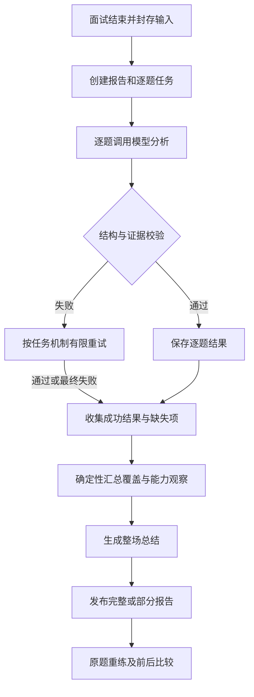

# 文字面试复盘报告实现方案

日期：2026-10-29  
状态：设计基线；本轮已实现范围、启动方式与验证边界见 [模块说明](README.md)。方案中的后续扩展仍未实现。  
开发分支：`feature/kwq-development`；推送后通过 PR 手动合入 `main`。

## 1. 目标与范围

一场文字面试对应一份复盘报告，包含整场总结、能力观察、逐题复盘和练习建议。复用现有报告、鉴权、模型适配与异步任务基础，后续语音转写接入同一套内容分析流程。

当前 reports 已有逐题异步分析、证据引用、报告汇总、失败重试和重练比较。本轮是在这些能力上完善报告，而不是重新开发面试流程。

| 本次完成 | 后续扩展 |
| --- | --- |
| 文字回答逐题分析 | 语音转写接入 |
| 整场总结、优势、优先改进项 | 语速、停顿等独立语音观察 |
| 原文证据引用与定位 | 音频片段定位与回放 |
| 能力维度观察 | 人工校准后的数值评分 |
| 部分结果、失败重试 | PDF 导出 |
| 对接已有单题重练和比较 | 多场面试的长期趋势 |

不另建登录系统、模型服务、任务队列或同步演示 DataClient。

## 2. 报告内容

| 区域 | 内容与行为 |
| --- | --- |
| 面试概况 | 岗位、面试类型、时间、结束原因、文字模式 |
| 分析覆盖 | 有效回答数、已分析数、失败数、是否为部分报告 |
| 整场总结 | 本场概述、主要优势、最多 3 个优先改进项 |
| 能力观察 | 专业知识、项目表达、逻辑表达、代码能力 |
| 逐题复盘 | 原题、原回答、亮点、缺口、参考要点、练习目标 |
| 后续行动 | 定位原题、开始单题重练、查看已有重练比较 |

评价必须能展开对应回答原文。例如：

> 需要改进：说明个人职责。  
> 依据：“我们完成了登录、预约和消息通知。”  
> 分析：这段回答介绍了团队产出，但没有说明你本人承担的工作。  
> 练习目标：重新回答这道题，补充个人负责的部分、采取的行动和验证方法。

评价“本次回答没有说明”，不能据此推断“用户没有参与项目”。

## 3. 输入与分析单位

只读取已经结束并封存的面试，包括正常完成、提前结束和有有效回答的失败面试。

输入使用现有数据：

- 面试配置、岗位和面试类型。
- 实际题干、主问题与追问关联。
- 回答原文、回答状态和 revision。
- 面试开始时冻结的知识、来源、提示及规则版本。
- 结束原因与输入摘要 input_digest。

模型以每个已回答回合为单位分析；页面按“主问题及其追问”分组展示。跳过、未回答的回合保留在记录中，不作为能力差的证据。

分析追问时提供所属主问题及必要上下文，但具体评价必须指向支持它的回答，不能把其他回合内容错误归到当前回答。若现有逐题校验只允许引用当前回合，首版继续保持该限制；跨回合引用需明确扩展合同及校验范围后再启用。

## 4. 生成流程

处理分三层：

1. 逐题分析：模型生成亮点、缺口、参考要点和练习目标。
2. 程序汇总：计算进度、缺失回合、能力覆盖和部分报告标记。
3. 整场总结：仅基于已校验逐题结果归纳，不增加未经支持的评价。

新增独立任务 `reports.summarize.v1`，绑定输入摘要和逐题结果摘要。总结失败不阻止查看逐题结果，可单独重试；没有可用逐题结果时不调用总结模型。

沿用 outbox、worker、租约、取消和有限重试。业务写入与任务登记同事务；模型调用在事务外；提交前重新检查来源、版本与删除状态。先注册处理器再启用生产者。

## 5. 模型输出与可信性

沿用 InterviewEvaluation，完善字段约束：

| 字段 | 要求 |
| --- | --- |
| strengths | 有原文支持的亮点，允许为空 |
| gaps | 有原文依据的具体缺口，允许为空 |
| reference_points | 匹配原题的参考要点，不补造用户经历 |
| retry_goal | 一个具体可执行的练习目标 |
| dimensions | 回答实际提供观察依据的维度 |
| limitations | 知识不足、回答范围有限等限制 |

校验分两层：

- 程序校验：JSON 结构、长度、回合 ID、回答版本、原文引用及知识来源。
- 质量评测：引用是否支持结论、专业判断是否正确、建议是否可执行。

原文引用存在不代表语义一定正确，须用合成回答和人工评审验收。

专业判断遵循：有可靠参考依据才分析正确性；只有观察提纲时只分析覆盖；资料不足时说明无法判断，不编造标准答案。

整场总结的优势、缺口和改进目标同样携带可校验的回答引用，且必须能追溯到已校验逐题结果。用户回答和知识正文均作为不可信数据，不能改变系统规则。

## 6. 数据与版本

保留现有表：

- interview_reports：报告主记录。
- report_evaluations：逐题结果及任务关联。
- interview_comparisons：原答与重练比较。

拟扩展报告 DTO：

| 内容 | 用途 |
| --- | --- |
| analysis_progress | 有效回答、成功、失败、进行中数量 |
| summary_status | 区分逐题分析与整场总结状态 |
| summary | 概述、优势、最多 3 个优先改进项及证据 |
| analysis_metadata | 模型、提示、分析规则、输出结构版本 |
| 总结任务关联 | 独立查询、重试和防止迟到发布 |

以上是设计字段，准确类型在实施第一步确定。任务关联和需查询/约束的字段放数据库列，结构化正文继续使用 JSONB；数据库变化新增迁移，不修改已应用迁移。

版本规则：

1. 一场面试只有一个报告主记录；同一有效输入复用结果。
2. 重复点击不重复生成，写请求沿用幂等键与版本检查。
3. 重试递增报告版本，复用输入未变化的成功逐题结果。
4. 总结绑定准确输入及逐题结果摘要，旧任务不能覆盖新报告。
5. 旧报告缺少新增字段仍可展示；GET 不偷偷调用模型重算。
6. 本轮不提供历史版本浏览。现有 version 不等于保存了全部历史正文；需要永久版本历史时再新增版本表。

不能只凭 report.status 推断全部分析完成。需明确逐题与总结子状态；部分报告仍可 ready，但必须展示 is_partial、缺失项和总结状态。最终状态枚举及兼容规则在合同阶段固定。

## 7. 能力维度与评分

| 维度 | 观察依据 |
| --- | --- |
| technical_knowledge | 概念、原理、方案与验证解释 |
| project_communication | 个人职责、行动、决策、结果和边界 |
| logical_expression | 回应问题、内容结构、论据与结论关系 |
| coding_ability | 实际代码考核证据；普通文字问答不据此观察代码能力 |

逻辑表达仅分析文字内容组织，不分析语速、语气或口头流畅度。

当前保持 scoring_status=uncalibrated，overall_score=null，各维度 score=null。已观察携带依据和解释；未观察不等于零分，已观察不等于优秀。

人工评分标准校准属于后续独立迭代，不能让模型随意生成数值分数。

## 8. 接口与前端

继续使用：

| 接口 | 行为 |
| --- | --- |
| GET /api/v1/interviews/:id/report | 查询报告、进度及部分结果 |
| POST /api/v1/interviews/:id/report | 请求生成/重试，携带版本和 Idempotency-Key |
| 已有 comparisons 接口 | 创建、查询、重试重练比较 |

POST 拟补充明确重试范围，例如缺失逐题分析或整场总结；准确请求枚举在合同阶段确定，并兼容现有调用。重试总结不得重新执行全部逐题任务。耗时生成返回 202，GET 无写入副作用。

前端状态：

- 等待生成：显示任务已登记。
- 分析中：显示已完成数量和已发布的有效逐题结果。
- 完整报告：全部内容可读。
- 部分报告：成功内容、缺失项及重试入口。
- 全部失败：保留记录并展示可重试错误。
- 无有效回答：说明没有可分析内容，不展示空白能力图或虚构总结。

轮询频率有限，终态停止。网络错误与报告生成失败分开呈现。引用通过 turn_id、revision 和 quote 定位；重复原文需要进一步精确定位时，显式扩展字符范围合同。

## 9. 权限与异常

- 本人才能读取、生成报告和查看比较，资源归属由服务校验。
- 面试进行中不得读取面后评价与参考要点。
- 沿用共享 Cookie 身份、同源写入保护和 ServiceError。
- 报告失败不改变面试终态。
- 重复投递不重复发布，部分失败只补缺失项。
- 删除面试后，在途任务不能重建报告。
- 超时、无效模型输出、知识不足分别处理；知识不足不伪装成系统错误。
- 错误、日志不得记录完整私有回答、凭证或原始供应商异常。

## 10. 文件职责

| 位置 | 改动职责 |
| --- | --- |
| service.ts | 生命周期、生成、重试与发布编排 |
| repository.ts | 报告、逐题结果及总结任务存取 |
| 新增 analysis.ts | 报告专用模型调用及输出校验 |
| 新增 aggregate.ts | 确定性进度、覆盖与维度汇总 |
| 新增 schemas.ts | 报告 HTTP schema，与当前数据库 schema.ts 区分 |
| routes.ts | 输入校验、身份上下文和响应映射 |
| core_engine | 共享 DTO 与必要纯规则 |
| entrypoints/worker.ts | 总结任务处理器注册 |
| 前端报告页面及 API 客户端 | 展示、轮询、证据定位、重试 |

当前报告模型能力位于 interviews/agent.ts，实施时逐步抽出报告职责，复用已有底层模型适配器，不保留两套提示和校验规则。跨模块经注入服务调用，不直接读写其他模块表。

共享类型、worker 装配、迁移和前端都属于必要改动，不能仅修改 reports 目录完成闭环。

## 11. 后续语音接入约定

本轮真实输入继续为 text_fallback，不预先宣称语音可用。

和语音模块约定：面试 ID、回合 ID、最终转写文本与 revision、实际输入方式、识别质量、可选片段 ID/时间范围，以及转写更正后的失效通知。

最终转写进入同一内容分析流程；语速和停顿等独立展示，不进入专业能力总分。转写更正生成新分析版本，不覆盖原始回答轨迹。低质量或未定稿转写不得直接用于确定性专业判断。

暂不新增空音频处理器或无实际用途的媒体表。未来扩展 interaction_mode 必须同时更新 DTO、校验、持久化和前端，不能只放宽标签。

## 12. 实施阶段与验收

1. 报告合同与纯汇总：固定字段、子状态、旧数据兼容和版本规则。
2. 逐题分析与总结任务：完成校验、部分结果、独立重试和发布检查。
3. 前端联调：完成状态、原文定位、改进目标与原题重练入口。
4. 工程和质量验收：检查、构建、真实数据库任务测试及人工报告评审。

重点测试：正常结束、提前结束、全跳过、无有效回答、部分失败、总结失败、重复请求、任务重放、删除中生成、跨用户访问、版本冲突、知识不足、虚构引用，以及旧报告兼容。

工程检查遵循后端约定：npm run check、npm run build:backend、前端构建；数据库/进程测试使用独立 interviewlab_test* 数据库，不与其他写测试库的进程并行，不把缺失环境当通过。

人工质量验收检查引用与结论支持、专业正确性、是否补造用户事实、建议可执行性。工程测试通过不等于模型质量已验收。

完成标准：用户结束文字面试后获得可定位原文的复盘，知道具体改进点并能进入原题重练；失败可恢复，资料不足明确说明。

## 13. 项目依据

- [后端开发规则](../../../AGENTS.md)
- [后端说明](../../../README.md)
- [总体架构](../../../../../docs/software/architecture.md)
- [数据与接口合同](../../../../../docs/software/data_and_interfaces.md)
- [评测方案](../../../../../docs/algorithm/evaluation.md)

实施以仓库实际代码和公共合同为准；本文件仅记录本轮计划，不覆盖既有约束或其他模块所有权。
