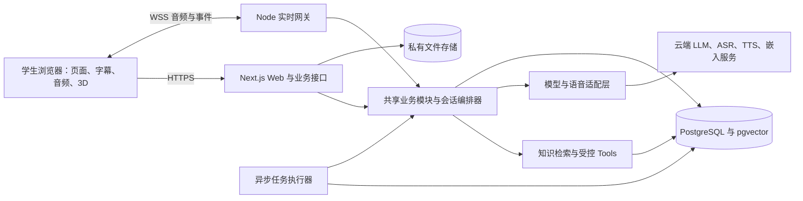

# 总体技术架构

版本：v0.1 · 日期：2026-10-03 · 状态：设计基线，未实现。

## 1. 架构目标

采用模块化单体服务一个小规模学生试用：先验证岗位理解、面试与教学闭环，再增加实时语音和 3D。业务模块、智能体编排和服务商适配层有清晰边界，首版无需微服务、独立向量数据库或自由协商的多智能体系统。

## 2. 系统组成与职责

| 组成 | 责任 | 明确边界 |
| --- | --- | --- |
| 浏览器 | 材料确认、回答、字幕、音频队列、角色动画 | 不持有长期供应商密钥，不自行判定权限与评分 |
| Next.js + TypeScript | 页面与 HTTPS 业务接口、身份验证、材料/历史访问 | 不假设普通请求处理器天然支持长期 WebSocket 会话 |
| Node 实时网关 | 连接鉴权、音频帧、取消与重连，调用共享业务模块 | 同仓库的独立进程，非另一个自主 Agent |
| 会话编排器 | 模式、轮次、时间、题目覆盖、事实上下文、结束条件 | 状态转换由程序负责，LLM 只提出候选内容/动作 |
| 知识检索与 Tools | 按权限读取、检索、验证、保存 | 模型不能直接运行任意 SQL 或发起任意 URL 请求 |
| 提供商适配层 | LLM/ASR/TTS/嵌入统一能力与错误映射 | 供应商特有事件不直接成为产品业务数据 |
| PostgreSQL + pgvector | 用户材料、会话、内容版本、向量与任务状态 | 共享知识与用户资料查询路径区分 |
| 文件存储 | 简历暂存、角色与合成演示素材 | 用户简历私有访问，角色公共素材独立目录 |
| 异步执行器 | 简历解析、入库、报告和比较任务 | 可重试且幂等，依靠持久任务表而非内存队列 |

建议首版以数据库任务表及行锁领取异步任务，避免一开始增加独立队列服务。实时网关和执行器复用同一业务包与数据定义。未来规模扩大再按实际瓶颈拆分。

## 3. 核心数据流

### 材料与岗位准备

JD/模板先形成岗位目标草稿；简历经过格式检查、私有暂存、文本提取、结构化提取、学生确认。已确认经历与岗位解读形成准备计划。模型提取结果是草稿，不自动成为用户事实。

原始材料中的“忽略系统指令”等内容只能被当作待分析数据。输入来源与引用标识贯穿检索、生成和反馈，不因出现在用户上传文件里就获得工具权限。

### 面试与教学

开始时冻结岗位、经历、准备目标、题库/评分与提示版本。编排器选择目标和问题，LLM 生成自然语言，程序校验输出并保存。学生确认回答后，编排器决定追问、换题或结束。

实时模式增加 ASR 和 TTS。字幕区分临时转写与最终转写；用户可以纠正最终文本。模型生成、TTS 和浏览器播放以 `generation_id` 关联，打断取消该代后，迟到的文本/音频不能继续播放。保存的“生成全文”和“实际播放进度”分开，避免把未听到的问题当成已经提问。

### 结束与报告

结束操作幂等，保存已确认回答并将会话置为 `completed`；报告任务独立进入 `pending → generating → ready/failed`。不可恢复而成为failed的会话保留终态，有确认回答时也能独立请求部分报告。报告失败不删除训练，会话完成也不意味着报告已可查看。所有引用核对回答版本与原文后，才可发布反馈。

重练创建关联原题的新教学会话，用相同目标和评分版本比较回答。学生新补充的事实需单独确认，报告注明这些变化，不能一概归因于表达提高。

## 4. AI 技术的分工

| 技术 | 在本系统解决的问题 | 首版决策 |
| --- | --- | --- |
| LLM | 理解 JD、提问、追问、自然语言教学反馈 | 云端 API；按能力/费用验证后选择，不微调 |
| Agent | 将模型、上下文与工具组织成完整教学流程 | 确定性编排器 + 岗位顾问、面试官、教练评估三类提示职责 |
| 知识库 | 保存可维护的岗位与教学依据 | 三类共享知识、来源及版本；学生材料独立 |
| RAG | 为岗位解释和题目/评分选择提供相关依据 | 元数据过滤 + 中文关键词检索 + 向量检索 |
| Tools | 将业务操作变为可验证、可授权的接口 | 默认内部函数调用，读写分级，由服务端上下文授权 |
| MCP | 标准化未来外部工具/资料服务接入 | 首版不部署 MCP server；预留受控适配层 |

知识库既包括可检索文本，也包括结构化题目和评分锚点。RAG 不承担身份授权、业务事务或会话状态管理；检索分数不能直接作为学生能力分数。详细设计见[知识库与智能体](knowledge-and-agent.md)。

pgvector 可在 PostgreSQL 中保存和检索向量，因此适合首版减少组件数量；具体索引与阈值经样本规模和召回率测试决定。[官方项目](https://github.com/pgvector/pgvector)

MCP 的 client/server 结构提供工具与上下文互通。未来如接入另一个受维护的岗位资料服务，可由服务器端 MCP client 连接审核过的服务，再转换为现有工具输出；不能将协议接入视为自动获得来源质量或访问权限。[官方架构](https://modelcontextprotocol.io/docs/learn/architecture)

## 5. 关键设计决策与取舍

| 决策 | 原因 | 代价与处理 |
| --- | --- | --- |
| 文本先行，语音与3D分阶段 | 先判断教学内容是否有效 | 每阶段都沿用同一会话/反馈逻辑，避免两个产品 |
| ASR → LLM → TTS 管线 | 便于保留逐字稿、核对证据、替换服务商 | 多段延迟需分别测量；后续端到端语音需保持证据可追溯 |
| 半身 VRM 浏览器渲染 | 实现倾听/说话等互动状态 | 设备性能不足降为静态头像，不影响练习 |
| 引用校验与结构化反馈 | 降低无依据评价，支持重练定位 | 需要输出校验和人工评测，不将结构化 JSON 等同正确 |
| 会话冻结版本 | 支持复现与合理对比 | 私有快照纳入删除范围，不能以“审计”为由保留个人数据 |
| 用户资料不进共享向量库 | 降低跨用户检索泄露与删除复杂度 | 首版按经历 ID 查询；长材料用当前用户范围内摘要 |

three-vrm 提供在 Three.js 中使用 VRM 的能力；角色行为与音频同步由产品实现，库本身不提供教学策略。[官方项目](https://github.com/pixiv/three-vrm)

## 6. 服务商与部署方案

LLM 适配层最少支持结构化生成、流式生成、取消、超时和 token 用量；不支持结构化输出的提供商由校验器补足，并记录差异。ASR 支持临时/最终转写与端点信息；TTS 支持分段音频与取消；嵌入记录模型、维度和版本。选型方法见[评测与迭代](evaluation-and-roadmap.md)。

初次部署建议一台应用主机运行 Docker Compose：反向代理/HTTPS、Web、实时网关、异步执行器、PostgreSQL，以及持久私有文件卷。公网仅暴露 HTTPS/WSS；数据库与任务进程不直接对公网开放。容器重启不能丢失确认回合和任务记录。

Next.js 可自托管；代理需要正确转发流式响应。实时网关由代理按独立路径转发 WebSocket，不依赖短时 serverless 请求维持整场面试。[自托管文档](https://nextjs.org/docs/app/guides/self-hosting)

上线前验证供应商在目标网络、部署地区的可达性与数据处理条件；开发使用合成材料。版本选择和依赖锁定在开始实现时核验，本文不固定未来安装版本。

## 7. 风险与控制

| 风险 | 可观察信号 | 设计应对 |
| --- | --- | --- |
| 追问跑题或循环 | 连续问题重复、目标覆盖不变 | 每题追问上限、已问列表、无进展换题 |
| 反馈编造或夸大 | 引用不匹配，新增履历或录用断言 | 引用/事实校验、失败重试一次后保守反馈 |
| 语音打断后继续播 | 取消代音频仍进入队列 | 网关取消与客户端generation过滤双重控制 |
| 中文检索不准 | 小词匹配误召回、专业同义词漏召回 | 应用层中文分词/同义词、检索基准与空检索策略 |
| 异步任务重复 | 重复报告、供应商调用激增 | 唯一任务键、状态检查、事务提交、重试预算 |
| 成本失控 | 长会话、无限重试、长上下文 | 固定时长/调用限额、上下文压缩、费用熔断 |
| 内容过时 | 岗位说明与 JD 冲突 | 显示日期与来源，优先说明当前JD，不盲目套模板 |

本轮只设计模块边界和数据流，没有可运行服务。后续实现按照[评测与迭代](evaluation-and-roadmap.md)的阶段门槛验证，不从文档直接推定性能或教学效果。
