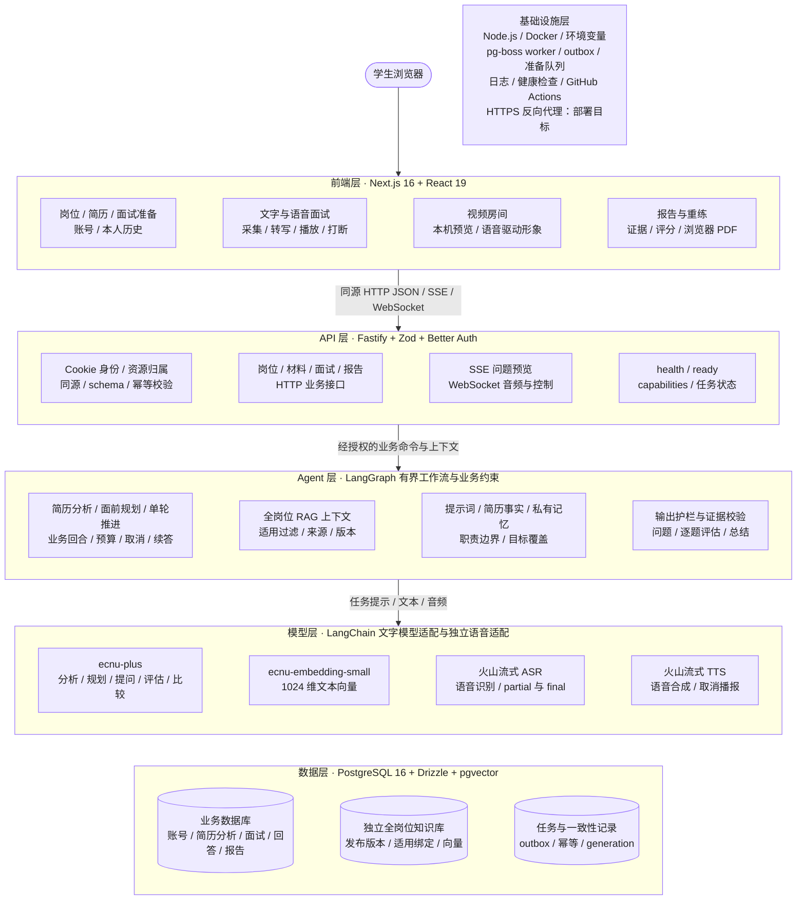
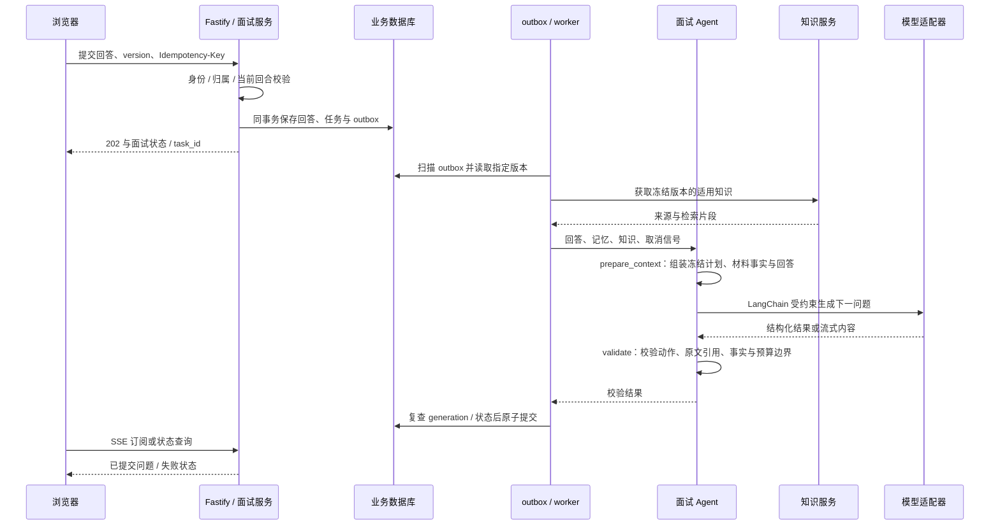
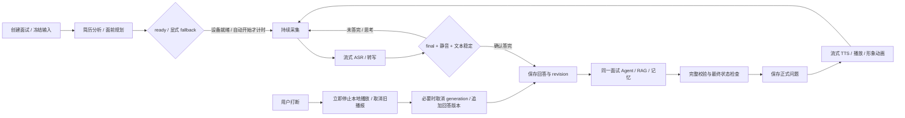

# InterviewLab · AI Agent 技术架构

## 0. 文档信息

| 项目 | 内容 |
| --- | --- |
| 项目名称 | InterviewLab · 面试练习室 |
| 文档版本 | v0.8 |
| 作者 / 小组 | InterviewLab 项目组；具体模块负责人由团队确认 |
| 指导教师 | 按课程提交信息填写，仓库暂未登记姓名 |
| 最后更新 | 2026-11-05 |
| 状态 | 评审稿；按当前代码说明实现边界，不等同于全部能力验收完成 |

| 版本 | 日期 | 修改内容 |
| --- | --- | --- |
| v0.6 | 2026-10-25 | 明确模块化单体、六个业务模块、独立 API/worker 与事务发件箱 |
| v0.7 | 2026-11-04 | 按六层技术架构组织；补充 Agent 编排、RAG、实时语音、视频房间、评分及浏览器 PDF 导出；区分已实现与待验收 |
| v0.8 | 2026-11-05 | 接入全岗位知识、LangChain/LangGraph、简历分析与面前规划；清退旧 Agent 和演示执行链，保持原六层架构及文档格式 |

六层技术架构描述职责和依赖；六个业务模块描述业务归属，两者不是同一分类。本文对应当前仓库实现；详细合同、启动步骤及验收证据分别链接到模块文档。规划能力单独标注，不将设计图中的组件当成已部署服务。

## 1. 项目概述

### 1.1 背景与目标

InterviewLab 面向高校学生，围绕课程项目、竞赛、科研、毕设及实习经历开展岗位面试练习。学生选择岗位并回答问题，面试 Agent 根据当前回答、已问目标和适用知识生成追问，面后提供带回答证据的复盘与重练。系统帮助学生讲清个人贡献、方案取舍和验证过程；评价结果是练习参考，不用于自动招聘决策。

### 1.2 核心功能与实现状态

| 功能 | 当前实现 | 验收边界 |
| --- | --- | --- |
| 账号与岗位 | 邮箱密码注册、登录、Cookie 会话、公开岗位查询 | 邮箱未验证，找回密码未开放 |
| 文字面试 | 配置、动态提问、保存回答、暂停/恢复/结束、本人历史 | 模型输出结构通过校验仍需人工评审语义质量 |
| 知识增强 | 1000 岗位、8000 原创问题统一接入，独立知识库、混合检索、版本冻结及引用 | 全量真实向量正式发布及专业覆盖待验收；九类基础摘要不代表全部细分岗位专家知识 |
| 简历与准备 | 确认后的结构化简历版本、事实分析、面前观察目标及显式简化 | 事实关联材料原文；不生成固定题单，不凭简历加分；准备不计时 |
| 报告与重练 | 逐题证据、总结、参考评分、单题重练、比较、历史报告显式升级 | 每题按实际考察与回答证据评分，非 HR 整场要求六维覆盖；评分草案尚未经专家校准 |
| 实时语音 | 流式 ASR、自动提交、打断、续答、流式 TTS 与文字兜底 | 真实供应商、设备及端到端延迟仍需实测验收 |
| 视频房间 | 本机摄像头/屏幕共享预览、语音驱动参考形象 | 当前不上传视频，不录像，不进行视觉理解 |
| PDF 导出 | 报告页调用浏览器打印并另存为 PDF | 不是后台 PDF 生成或文件存储服务 |
| 材料导入 | 文字版 PDF 提取、结构化文本核对与版本保存 | PDF 提取不等于 OCR、原文件存储或简历事实核验 |
| 后续扩展 | 个人 JD、收藏、隔离代码执行、视觉观察、授权媒体复盘 | 尚未形成完整真实链路，不作为当前已实现能力 |

### 1.3 能力与隐私边界

私有材料及回答只按当前用户和资源授权读取，不写入公共知识库。模型不能补造经历、指标或回答原文，不能根据声音或摄像头推断人格、诚实、情绪或技术能力。摄像头与屏幕共享默认关闭，用户显式授权后才采集本机预览；当前服务不保存原始音视频。已确认简历分析与媒体保存的边界见[数据与接口](data_and_interfaces.md)，不代表已实现上传与存储。

### 1.4 质量属性

| 属性 | 设计要求 | 验证方式 |
| --- | --- | --- |
| 一致性 | 已保存回答不因模型失败回滚；过期 generation 不发布 | 数据库事务、取消竞态与迟到结果测试 |
| 隔离 | HTTP、SSE、WebSocket 均核对身份及资源归属 | 两用户越权、Origin 和会话测试 |
| 可追溯 | 问题、知识版本、回答 revision、报告依据可关联 | 引用校验、冻结快照及历史兼容测试 |
| 实时性 | 分别测量保存、模型提交、首音频和打断停止耗时 | P50/P95 含失败样本统计；语音尚无已验收数值 |
| 可恢复 | 断线后读取权威状态，失败任务有界重试 | 进程重启、重连、取消及文字降级测试 |
| 成本 | 限制上下文、追问次数、超时和重试，记录可得用量 | 模型耗时/token 日志与真实调用统计；不虚构费用预算 |

## 2. 开发与运行环境

### 2.1 语言、工具与运行方式

前后端及 Agent 使用 TypeScript 5.9.3，运行环境以 Node.js 24、npm 11 为基线。统一语言便于共享 DTO、schema 和纯领域规则；SQL 用于迁移与检索，Python 3 用于仓库文档检查。使用 Git/GitHub 协作、npm workspaces 管理依赖，编辑器不作为运行依赖。

开发环境为本机 Node 进程和 Docker 数据库；CI 使用 Linux、Node 24 与独立测试 PostgreSQL。浏览器需要媒体权限、Web Audio、AudioWorklet 和 WebSocket；远程媒体访问使用 HTTPS。生成、嵌入和语音调用外部 API，本地不要求 GPU；硬件容量和云端部署规格尚未完成压测定型。

### 2.2 关键依赖与理由

下表为当前 `package-lock.json` 的安装版本；依赖声明允许范围时，由锁文件确定实际版本，协作使用 `npm ci`。

| 层 | 技术及版本 | 选择理由 |
| --- | --- | --- |
| 前端 | Next.js 16.4.2、React 19.3.1、Tailwind CSS 4.3.3 | 页面路由、组件复用、同源代理及媒体交互 |
| API | Fastify 5.12.7、Zod 4.6.7、@fastify/swagger 9.9.2 | 模块化路由、运行时校验及 OpenAPI |
| 身份 | Better Auth 1.7.12、Drizzle 认证适配器 1.7.12 | 复用邮箱密码与服务端会话，避免自建认证协议 |
| Agent | @langchain/core 1.3.4、@langchain/openai 1.8.0、@langchain/langgraph 1.6.1、pg-boss 12.38.0 | 模型调用统一、工作流节点显式；业务状态、任务恢复和发布仍由原服务控制 |
| 数据 | Drizzle ORM 0.45.4、pg 8.23.1、PostgreSQL 16 | 关系约束、事务、类型化仓储及迁移 |
| 知识检索 | pgvector 镜像 0.8.7-pg16 | 向量、关键词、发布元数据和缓存在同一知识库管理 |
| 实时通信 | @fastify/websocket 11.3.5、ws 8.22.1、SSE | 双向音频/控制消息与单向生成预览分工 |

### 2.3 外部平台与模型

代码托管在 GitHub；文字与嵌入调用 ChatECNU 兼容 API，语音通过火山引擎 ASR/TTS 适配器接入。账户授权、实际可用范围、供应商留存和计费以开通环境为准，本仓库不登记个人凭证。尚未宣称已部署团队共享云环境。

### 2.4 配置与密钥

| 配置 | 用途 | 管理方式 |
| --- | --- | --- |
| `PUBLIC_ORIGIN`、`BACKEND_ORIGIN` | 浏览器来源、服务端同源代理目标 | 按环境设置，来源必须精确匹配 |
| `DATABASE_URL`、`KNOWLEDGE_DATABASE_URL` | 业务库、独立公共知识库 | 含凭证，保存在本机 `.env` 或部署密钥中 |
| `AUTH_ENABLED`、`BETTER_AUTH_SECRET` | 认证开关与会话安全 | secret 至少 32 字符，生产使用独立随机值 |
| `LLM_BASE_URL`、`LLM_MODEL`、`LLM_API_KEY` | 文字模型访问 | Key 只在后端使用 |
| `EMBEDDING_MODEL`、`KNOWLEDGE_PREVIEW` | 向量模型及开发草案读取 | 生产拒绝草案预览模式 |
| `VOICE_ENABLED`、`VOLC_ASR_API_KEY`、`VOLC_TTS_API_KEY` | 实时语音与供应商认证 | 语音 Key 与文字模型 Key 分开配置 |
| `VOLC_ASR_RESOURCE_ID`、`VOLC_TTS_RESOURCE_ID`、`VOLC_TTS_SPEAKER` | 语音资源及音色 | 必须与已开通产品匹配 |
| `WORKER_PREPARATION_CONCURRENCY` | 简历分析与准备队列并发，默认 1 | 与实时出题及报告队列分开控制 |
| `VOICE_SILENCE_MS`、`LLM_TIMEOUT_MS` | 回合停顿与模型超时 | 配置校验约束取值，不能代替真实延迟测试 |

根 `.env` 不入库；示例见仓库根 `.env.example`。服务端配置由 `foundation/config.ts` 校验，显式环境变量优先；不得使用 `NEXT_PUBLIC_*` 暴露供应商或数据库凭证。

## 3. 总体架构

### 3.1 六层技术架构图



图中各技术层自上而下排列，层内横向展开主要组件，基础设施作为跨层支撑单独列出。模型层与数据层之间仅作布局对齐，不表示模型直接读写数据库；业务与知识数据由业务服务、Agent 编排和仓储受控访问。ASR/TTS 由语音会话适配器调用，视频预览与形象动画在浏览器完成。

API 和 worker 是同一后端包的两个进程入口。六层是逻辑边界，不要求六个服务，也不要求所有请求经过模型：岗位查询直接读取公开内容；认证由认证组件处理；媒体预览在浏览器本地完成。模型通过适配器获得必要输入，不直接连接数据库或拥有写权限。

### 3.2 分层职责总览

| 层 | 输入 | 职责与输出 | 主要依赖 |
| --- | --- | --- | --- |
| 前端 | 用户配置、文字、授权后的媒体 | 展示页面、采集与播放、状态/错误、报告与本机 PDF | API、浏览器媒体接口 |
| API | HTTP 请求、SSE 订阅、WS 音频与控制 | 身份/归属、schema、幂等、调用业务服务、DTO/事件 | 业务服务、认证、数据仓储 |
| Agent | 指定回答版本、目标、允许知识、取消信号 | 构造上下文、受约束生成、引用/动作校验 | 模型适配、知识服务、纯领域规则 |
| 模型 | 任务提示、文本、PCM 音频 | 结构化内容、向量、转写或合成 PCM | 外部供应商 API |
| 数据 | 已校验读写和检索条件 | 持久化、约束、版本与可追溯依据 | PostgreSQL、pgvector、Drizzle |
| 基础设施 | 环境配置、构建产物、任务与日志 | 启动、迁移、健康检查、CI 和故障定位 | Node、Docker、GitHub Actions |

### 3.3 核心请求时序



模型在事务外运行。当前图运行时可发送可撤回的题目预览，完整校验并保存后才成为正式问题；语音只播报正式问题。outbox 与业务写入同事务，队列投递采用至少一次语义，靠幂等与最终写入校验抵御重复，不宣称外部模型严格只调用一次。

### 3.4 架构决策记录

| 决策 | 选择与理由 | 备选及代价 |
| --- | --- | --- |
| ADR-01 | TypeScript 模块化单体，API/worker 共享业务服务 | 微服务增加部署与跨服务一致性成本；单体须维护模块依赖边界 |
| ADR-02 | 确定性状态机 + 受约束面试 Agent，权限/计时/取消由程序决定 | 自主 ReAct、多 Agent 讨论并非当前任务所需；自由规划可能破坏会话规则 |
| ADR-03 | LangChain 统一模型协议，LangGraph 显式编排简历、准备与单轮短图 | 单独使用 LangChain 仍需手工表达跨阶段工作流；图不另建 checkpoint 数据库，恢复继续依赖业务库与 pg-boss |
| ADR-04 | Next.js 同源代理 + Cookie 会话 | 浏览器跨域携带凭证增加配置成本；部署必须正确转发 WS Upgrade |
| ADR-05 | 独立知识数据库与版本化 RAG | 各机独立导入易产生内容差异；共享部署需网络、权限与备份管理 |
| ADR-06 | ASR → 同一面试 Agent → TTS | 复用文字闭环和记录；分段生成/校验带来接话延迟，需要测量优化 |
| ADR-07 | 当前视频使用本机预览和播放音量驱动形象 | 云端视觉/数字人服务需另行授权、资产与成本；当前不提供视觉分析 |

### 3.5 六个业务模块与数据归属

| 模块 | 职责 | 当前边界 |
| --- | --- | --- |
| 账号与个人设置 | 身份、会话、个人中心 | 注册登录已实现；偏好维护等按后续模块接入 |
| 简历与经历 | 结构字段、确认、版本、事实分析与删除 | 已有文字版 PDF 提取和结构化保存；OCR、原文件持久化及完整私有文件链路待接入 |
| 岗位与收藏 | 岗位模板、个人 JD、收藏 | 公开岗位已实现；个人 JD/收藏尚未完整接入 |
| 面试会话 | 配置、状态、快照、回答、generation、实时回合 | 会话状态唯一业务写入口；语音视频复用该服务 |
| 报告与重练 | 证据报告、评分草案、重试、比较、导出展示 | 通过面试服务创建重练，不直接修改面试表 |
| 知识内容 | 来源、目标、题目、版本、索引和发布 | 独立库及命令已实现；正式发布须人工审核 |

跨模块调用显式服务，不跨模块直接更新表。共享核心只保留 DTO、纯规则和适配端口，数据库、框架、媒体及供应商 I/O 留在各自实现层。具体职责见[工程目录](repository_structure.md)。

## 4. 前端层（Presentation Layer）

### 4.1 页面、输入与状态

Next.js 提供首页、岗位、账号、面试配置、面试房间、历史和报告页面。首页公开，业务页面登录后按账号读取真实记录；旧演示路径和浏览器假会话已删除。组件使用共享 DTO，通过 `/api/v1` 同源访问后端，不导入认证或数据库实现。

| 界面 / 目录 | 职责 | 关键状态 |
| --- | --- | --- |
| `code/frontend/features/live-interview` | 面试配置与准备、文字/语音、报告与重练 | preparation、interview version、generation、回答草稿、报告进度 |
| `code/frontend/features/personal-center` | 本人结构化简历、分析状态与版本 | confirmed、material version、analysis 状态及失败重试 |
| `code/frontend/features/live-interview/voice` | 采集、转写、音频播放与打断 | WS 连接、ASR partial/final、speech_id、播放队列 |
| `code/frontend/features/video-interview` | 视频房间、设备预览、语音驱动形象 | 设备授权、媒体轨道、播放音量 |

### 4.2 交互与错误处理

三种面试界面均等待 preparation 为 ready/fallback 后才允许开始；准备期间不计时，也不自动启动媒体。普通操作使用 HTTP；生成预览使用 SSE，失败后恢复权威状态轮询；双向语音使用 WebSocket。前端区分“回答已保存”“问题生成中”“正式问题可作答”，预览生成中不可提交回答。网络或 TTS 失败时保留已保存内容，明确提示重试或切回文字。

报告展示引用、分析覆盖、失败项和评分标准版本；历史缺失的新字段不伪造，升级由用户显式触发。PDF 调用本机浏览器打印，个人报告不为导出上传第三方。

### 4.3 语音与视频的实现边界

AudioWorklet 将音频转换为 16 kHz、16-bit、小端单声道 PCM，每 200 ms 发包；请求浏览器回声消除、降噪和自动增益。持续人声触发本地停止播报，并通知服务端取消旧 TTS。摄像头使用 `getUserMedia`，屏幕共享使用 `getDisplayMedia`；当前只作本机预览。

参考形象使用开口/闭口两帧，根据实际播放 PCM 的音量驱动嘴部；排队音频不驱动动画，打断后闭口。它不是音素级口型、生成视频或远端真人画面。关闭设备、结束和离页释放媒体轨道与播放资源。详见[实时语音面试接入](voice-interview.md)。

## 5. API 层（Interface Layer）

### 5.1 职责、认证与合同

Fastify 负责路由、Zod 输入/输出校验、身份、归属、同源校验、错误与 OpenAPI，业务规则由模块服务负责。Better Auth 管理邮箱密码与 Cookie 会话；生产认证要求 HTTPS。私有资源按用户与资源 ID 联合校验，不能依赖客户端传来的 owner_id。

以下列出代表性接口，完整字段以注册的 Zod schema 和生成的 OpenAPI 为准。API 前缀统一为 `/api/v1`；写操作按合同携带 `Origin`、`Idempotency-Key` 和版本号。认证接口由 Better Auth 组件处理，不重新实现会话协议。

### 5.2 代表性接口

| 方法 | 路径 | 输入 / 输出与授权 |
| --- | --- | --- |
| GET | `/health`、`/health/ready` | 存活 / 数据库与 worker 就绪状态 |
| GET | `/job-categories`、`/job-templates` | 公开分类、过滤与分页岗位 |
| POST | `/materials/import-pdf` | 已登录用户提交文字版 PDF → 可核对的提取文本，不自动确认或保存 |
| GET / POST | `/materials`、`/materials/:id/versions` | 本人材料及版本查询 / 创建；写操作仍按对应 schema 执行 |
| POST | `/materials/:id/analysis` | version → 本人指定确认版本的分析状态，可补分析/重试 |
| POST | `/interviews` | 面试配置 → 本人面试 DTO 和独立准备状态 |
| POST | `/interviews/:id/prepare` | version、personalized/fallback → 准备、失败重试或显式简化 |
| POST | `/interviews/:id/start` | version → 核对准备后开始计时并展示自我介绍 |
| POST | `/interviews/:id/pause`、`/resume`、`/finish` | 版本化生命周期命令，仅本人 |
| GET | `/interviews/:id` | 本人权威面试状态 |
| GET | `/interviews/:id/events` | 带 generation_id 的本人 SSE 订阅 |
| GET | `/interviews/:id/voice/capabilities` | 本人语音可用性，不返回凭证 |
| WS | `/interviews/:id/voice` | 同源 Cookie/归属校验，PCM 与控制事件 |
| POST | `/interviews/:id/voice/continue` | 补充回答或按已保存回答继续生成 |
| GET / POST | `/interviews/:id/report` | 本人报告读取 / 按 version、scope 生成或升级 |
| POST / GET | `/comparisons`、`/comparisons/:id` | 创建 / 读取本人重练比较 |
| GET | `/tasks/:id` | 本人任务状态，不泄露其他用户任务 |

### 5.3 数据与错误模型

核心 DTO 包括 `InterviewConfig`、`Interview`、`InterviewQuestion`、`InterviewReport`、`PreparationStatus`、`MaterialAnalysisStatus` 和语音事件；定义见 `code/core_engine/src`，HTTP schema 见对应后端模块。回答用 revision 标识，面试/报告用 version 控制并发，generation_id 标识一次生成，speech_id 标识一次播报，四者不能互相替代。

错误返回 `{code, message, retryable, request_id}`。400 表示输入不符合合同，401 表示未登录，403 表示来源或权限不允许，404 用于不存在或不可见资源，409 用于版本/状态/幂等冲突，501 表示能力未接入，503 表示依赖暂不可用。未知异常返回脱敏的 500，不输出 SQL、凭证或供应商原始响应。

## 6. Agent 层（Orchestration Layer）

### 6.1 类型、职责与选型

采用“固定业务流程 + LangGraph 有界工作流 + RAG + 有限动作选择”。LangChain 统一模型消息、JSON/流式输出、取消和用量；LangGraph 在每项任务中执行 prepare_context → model → validate 三个节点。不同内容职责复用同一模型，不要求多个独立 Agent 互相讨论，也不将无限 ReAct 工具循环引入实时面试。

Agent 负责理解简历和回答、提出观察目标及生成内容；业务服务负责身份、保存、计时、幂等、任务、取消及最终发布。选择图工作流是为了明确输入、节点、结果和失败边界，不能由“接入框架成功”推断问题质量已通过。模型不直接读写业务库，LangGraph 也不替代数据库任务恢复。

语音和视频接入同一面试 Agent：ASR 的已保存回答进入单轮图，校验并保存的正式问题再进入 TTS。本机视频预览不进入模型。当前只保留 graph-v1 执行链；旧快照保留读取，执行请求明确提示新建面试，不静默重写历史记录。

### 6.2 模块划分与输入输出

| 模块 | 输入 → 输出 | 实现位置（后端 `src/modules`） |
| --- | --- | --- |
| 面试业务编排 | 用户命令、版本 → 保存结果与任务 | `interviews/service.ts` |
| 唯一面试 Agent 入口 | 冻结输入、上下文、取消信号 → 有界图结果 | `interviews/agent.ts`、`graph.ts` |
| LangChain 模型适配 | 模型消息、输出合同 → JSON 或既有 SSE 合同 | `interviews/model.ts` |
| 简历事实分析 | 已确认字段版本 → 分类事实、原文定位与待澄清点 | `resumes/analysis.ts`、`interviews/workflow-models.ts` |
| 面前规划 | 岗位、类型、难度、时长、可选分析 → 观察目标及限制 | `interviews/preparation.ts`、`workflow-models.ts` |
| 动态流式提问 | 当前回答、记忆、计划、检索片段 → 动作、预览与记忆 | `interviews/streaming-agent.ts` |
| 经历边界与记忆 | 指定回答证据、材料事实 → 背景充分性与覆盖状态 | `interviews/experience.ts`、`memory.ts` |
| 全岗位知识服务 | 岗位、阶段、类型、目标、冻结版本 → 适用片段与来源 | `knowledge/catalog.ts`、`all-roles.ts`、`embedding.ts` |
| 报告编排与评估 | 已提交回答、逐题证据 → 后台分析、累计评分；封存后整场总结 | `interviews/model-analysis.ts`；`reports/service.ts`、`analysis.ts`、`aggregate.ts` |
| 语音回合 | PCM、转写、打断/续答命令 → 已保存回答、控制与播报事件 | `interviews/voice/session.ts`、`volcengine.ts` |

简历分析提炼经历、技能、职责、行动和结果，但每条事实必须定位到 material_id/version/field/quote；模型只能选择程序建立的原文锚点，待澄清点不能当作事实。结构化字段优先，姓名、联系方式等无关信息在发送模型前移除。

本场计划是允许动态调整的观察目标，不是预先生成的题单。开场仍为自我介绍，后续优先承接实际回答；明确职责不反复索取，职责修正、拒绝话题和无项目经历按当前回答处理。材料事实和实际回答证据分开，简历不直接进入评分。

### 6.3 状态机与实时流程

面试状态为 `draft / ready / in_progress / paused / ending / completed / failed`，生成状态单独维护。创建后冻结运行时、模型、岗位知识和选定材料版本，并进入独立准备状态；后台分析/规划完成或用户显式选择简化后，前端自动 start 才记录开始时间并展示自我介绍。准备状态不替代主状态或 generation_status。时长为10/20/30分钟，主问题上限分别6/10/14道，每题最多2次追问；达到目标后收尾，最多保留2分钟完成当前回答，截止时间包含暂停与断线。



ASR final 只表示识别分句结束，不直接等于回答完毕；结合静音、文本稳定和未完成句尾规则判断。用户可暂停自动接话或主动提交。VAD 活动暂缓下一题发布并复用已生成结果，只有确认新增转写才取消旧 generation；补充转写追加到原回答并提升 revision，旧任务不能覆盖新版本。已显示问题、已保存文本和实际播放范围分别处理，重连不重放全部历史音频。

回答保存与面试推进、逐题评估的 outbox 同事务登记，面试与报告使用独立队列并行执行。分析不阻塞提问，面试 Agent 不读取评分或等待分析 Agent；双方共享有版本的问答与冻结上下文，不直接互相对话。评分按 turn/revision 和本题输入摘要复用或失效，不因下一题、暂停或正常结束重算。逐题分析提交时累计证据和维度分；结束后只等待尚未完成的有效分析，总结与建议基于同一稳定评价集合并行生成。一次完成一题的语音提交可触发分析，ASR 临时片段不可触发。

### 6.4 工具、上下文与提示词

知识读取、检索、保存和任务投递由程序按合同调用，当前不向模型开放任意 SQL、数据库客户端、文件访问或通用工具执行权限。检索是受控步骤，不宣称已使用 LLM Function Calling。语音控制消息也经状态机校验，不由转写中的任意文字直接触发高权限操作。

| 上下文 | 管理方式 |
| --- | --- |
| 冻结快照 | 准备时冻结运行时、模型、材料分析、本场计划和知识版本；开始后不随最新内容改写 |
| 材料与回答 | 材料事实使用 material/version/field/quote，回答使用 turn/revision/quote；不得互换或将材料自动计为已回答 |
| 私有短期记忆 | 保存关注目标、覆盖状态、已问意图及带回答 revision 的原文证据 |
| 输入裁剪 | 当前回答、自我介绍必要摘要、证据记忆和少量检索片段；不默认发送全部历史 |
| 长期画像 | 尚未形成完整长期用户画像服务，不将公共缓存当作私有记忆 |
| 提示词 | 在 `interviews/workflow-models.ts`、`streaming-agent.ts`、`model-analysis.ts`、`reports/analysis.ts` 按任务维护并记录版本 |

### 6.5 输出护栏与报告规则

背景不足时先澄清本人项目与职责，建立真实背景后再追问，不因一句简短描述就虚构复杂系统。生成结果校验 schema、动作、长度、允许来源、原文引用、预算、版本与取消状态；结构合法不代表专业判断已正确。模型超时和非法结果有界重试或失败提示，不无限循环。

报告绑定封存输入及回答 revision；逐题失败不抹除成功分析，总结可独立重试。前端实习 BARS 草案依据适用问题与原文证据聚合；六维反馈模板是另一份明确版本的展示与汇总规则，不与旧四维分数混算。逐题及HR未观察内容保持缺失；专业、业务、综合面整场汇总固定六维，未体现计0分，使用`whole-interview-six-v1`固定权重标准，单题重练仍按本题实际维度。没有提交回答及任务失败不生成能力总分，AI参考分尚未专家校准。旧报告 GET 不调用模型，升级通过显式 scope 请求。详见[报告模块](../../code/backend/src/modules/reports/README.md)。

## 7. 模型层（Model Layer）

### 7.1 模型与适配能力

| 用途 | 当前方案 | 输入 → 输出 | 选择与限制 |
| --- | --- | --- | --- |
| 文字生成/评估 | 默认 `ecnu-plus`，兼容 API | 任务提示与必要上下文 → 结构化内容 | 复用现有模型，model/base URL 可配置；替换后须回归 |
| 语义嵌入 | `ecnu-embedding-small` | 文本 → 1024 维向量 | 与当前 pgvector 列维度匹配，不能随意换维度 |
| ASR | 火山流式识别，资源由配置指定 | 16 kHz PCM → partial/final 转写 | 独立语音授权与 Key；真实设备效果待测 |
| TTS | 火山流式合成，资源/音色由配置指定 | 已提交题目 → 可播放 PCM 块 | 取消后旧 speech_id 音频丢弃 |
| 视频理解 / 重排 | 当前未接入 | 无当前线上输出 | 本机预览不属于多模态推理，当前无额外重排模型 |

### 7.2 访问封装、超时与成本

文字模型经 LangChain ChatOpenAI 和既有结构/流式校验合同访问，不使用 Responses API。SDK maxRetries=0，重试由任务层最多两次执行；LangGraph 失败后按任务重跑短图，不另启一套节点持久化。模型访问传递取消信号，默认 `LLM_TIMEOUT_MS=25000`，配置上限 45000 ms；输出模式支持 `json_object / json_schema`。具体提示和请求参数以当前适配器为准，不虚构温度或 token 上限。语音通过服务端 WebSocket 适配器访问供应商，新问题完整提交后再合成。

记录可得的模型、提示版本、用量和耗时，按真实测试估算单场成本。语音和文字分别计费；尚未建立可承诺的单场费用或端到端 P95。超时、失败与修复调用均计入统计，不只统计成功请求。当前未实现自动切换备用供应商。

## 8. 数据层（Data Layer）

### 8.1 存储与表职责

| 数据 | 存储 | 当前实体与生命周期 |
| --- | --- | --- |
| 账号与会话 | 业务 PostgreSQL | `auth_users / auth_accounts / auth_sessions` 等，由认证模块管理 |
| 简历与分析 | 业务 PostgreSQL | `resume_materials / resume_material_versions / resume_analyses`，确认版本与派生结果按用户隔离 |
| 面试与回答 | 业务 PostgreSQL | `interviews / interview_turns / interview_events`，保存配置、独立 preparation、冻结分析/计划、私有记忆、回答及版本 |
| 报告与比较 | 业务 PostgreSQL | `interview_reports / report_evaluations / interview_comparisons`，绑定回答与标准版本 |
| 任务一致性 | 业务 PostgreSQL | `tasks / outbox_events / idempotency_records / worker_heartbeats`，pg-boss 自有 schema 管理队列 |
| 知识与检索缓存 | 独立 PostgreSQL + pgvector | `knowledge_v2_releases / knowledge_v2_chunks / knowledge_v2_bindings / knowledge_v2_vectors`，按冻结版本和适用关系检索，预取缓存保存在服务进程内 |
| 实时生成预览 | 业务 PostgreSQL | `interview_generation_streams`，仅私有短期状态；终态清理，异常最多保留 15 分钟 |
| 原始音视频 | 当前不持久化 | 浏览器采集/播放缓冲随停止释放；服务商留存需另行核验 |
| 私有文件与媒体复盘 | 目标方案：私有卷 + 存储适配器 | 待接入；不能把本机预览或浏览器 PDF 当作文件存储服务 |

简化关系为：用户拥有面试，面试关联多个回合及一份报告，报告关联逐题评价，重练/比较引用指定原面试与回合。详细字段、ER、索引与删除规则见[数据库设计](data_and_interfaces.md)及模块 schema；HTTP 字段见[数据与接口](data_and_interfaces.md)。

### 8.2 RAG 构建、发布与检索

```text
同源岗位/原创题/专业资料/面试方法/评价参考 → 类型与适用关系编译
→ schema 与来源检查 → building 断点构建 → 文本切分 → Embedding
→ pgvector + 关键词完整性验证 → draft → 人工审核后发布版本
→ 按冻结版本/岗位/阶段/类型/目标过滤 → 混合检索 → 引用与来源校验
```

| 参数 | 当前实现 |
| --- | --- |
| 切分 | 按字符偏移每 550 字推进、最多取 650 字，形成约 100 字重叠；不是 token 切分 |
| 向量维度 | 1024 |
| 检索 | 向量余弦距离与关键词候选各最多 20 条 |
| 融合 | RRF，常数 60，最终最多 5 个片段 |
| 距离阈值 | 当前全岗位检索实现采用初始值 0.48；效果需评测，不能等同于正确率 |
| 上下文预取 | 预取当前/下一目标，公共缓存包含版本；必要时补充检索 |

全岗位知识以同一源编译 1000 个岗位和 8000 道原创问题，按用途区分岗位要求、专业资料、面试方法/问题和评价参考；评价参考不进入实时提问召回。共享正文通过 binding 复用，不为每个岗位复制维护。正式内容通过 `npm run knowledge:all -- coverage / migrate / build / preview / publish / rollback` 等子命令管理；同版本 building 可按摘要续跑，向量按 hash+model 复用，完整发布版本不覆盖。publish 的署名只记录实际审核声明，不代替专家审核；preview 会切换活动版本，只能在非生产隔离知识库使用。

准备不足或检索不足返回明确原因，使用冻结的岗位与原创问题继续相关经历/分析提问，不伪造专业引用。现有专业摘要覆盖九类基础领域，全量真实索引尚未在日常库正式发布，不能据此宣称全部岗位已达到专家水平。细节见[知识检索](../algorithm/knowledge_and_agent.md)、[运行指南](development.md)。

### 8.3 共享、备份与隐私

当前默认配置是本机数据库；Git 只同步代码、迁移和审核后的公共内容，不同步用户记录。共享知识库需部署支持 pgvector 的数据库，各后端设置同一 `KNOWLEDGE_DATABASE_URL`；业务库可继续各自独立。共享发布由指定维护者执行，权限与备份恢复应在部署时验收，当前不宣称已有自动备份。

原始个人记录、密码哈希、会话和音视频不进入 Git。测试使用合成材料或保守脱敏样本；仅保留结构的脱敏样本不能直接作为业务回放或模型语义评测集。私有简历/回答/记忆不进入公共向量索引。

## 9. 基础设施层（Infrastructure Layer）

### 9.1 进程、端口与部署边界

| 组件 | 开发方式 | 当前配置边界 |
| --- | --- | --- |
| Next.js | `npm run dev` | 默认 `127.0.0.1:3000`，对浏览器提供同源入口 |
| Fastify API | `npm run dev:api` | 默认 `127.0.0.1:3001`；生产由统一入口代理 |
| worker | `npm run dev:worker` | 无公共 HTTP 端口，与 API 共用后端代码和业务库 |
| 业务 PostgreSQL | Docker Compose `postgres` | 当前 YAML 映射本机 `5433 → 5432` |
| 知识 PostgreSQL | Docker Compose `knowledge-postgres` | 当前 YAML 映射本机 `5434 → 5432`，带 pgvector |
| 后台准备任务 | 同一 worker 的独立 preparation 队列 | `WORKER_PREPARATION_CONCURRENCY` 默认 1，与实时出题和报告并发分开 |

**配置核对：** Compose 与 `.env.example` 已统一为业务库 5433、知识库 5434。API_HOST/API_PORT 和 BACKEND_ORIGIN 按环境配置，默认 API 端口不代表本机显式配置值。保留命名数据卷，不为切换 Agent 清库或重建已有容器；新流程不再提供旧 Agent 开关或免登录专用联调启动器。

部署目标是统一 HTTPS 入口转发页面与 `/api/v1`，支持 SSE 和 WebSocket Upgrade；数据库和 worker 不向公网开放。API、worker、知识池及 LISTEN 连接合计计算连接预算。生产启动先审核并运行应用迁移，再更新 API/worker；API 启动不自动迁移应用表，worker 首次启动会初始化 pg-boss 自有 schema。

### 9.2 日志、就绪与可观测性

`/health` 判断存活，`/health/ready` 判断数据库与 worker 就绪；`/capabilities` 描述依赖配置，不等于真实模型或设备效果验收。日志关联 request_id、task_id、generation_id 与阶段耗时，不打印凭证、原始音频、私有转写和供应商原始异常。简历、准备和单轮图额外记录工作流名、节点及耗时，日志不保存模型推理正文。模型成功、队列心跳、媒体连接和实际播放分别统计，不能用 worker 在线代替面试成功。

### 9.3 CI/CD 与工程规则

GitHub Actions 覆盖文档链接、依赖边界、类型、内容、普通测试、构建及独立 PostgreSQL 的数据库/进程/代理测试。执行 `npm ci` 复现锁文件；业务修改遵循模块服务和仓储边界。代码保留 `code/frontend / code/backend / code/core_engine` 三工作区，不另建一套后端工程。自动检查通过不代表自动发布或真实语音验收，部署流程尚需按环境配置。

## 10. 测试方案

| 类型 | 对象与命令 | 通过标准与限制 |
| --- | --- | --- |
| 工程检查 | `npm run check`、`npm run build:backend`、`npm run build` | 类型、边界、内容、普通测试、文档与构建通过 |
| 数据库一致性 | `npm run test:db` | 仅独立 `interviewlab_test*`；验证事务、幂等、取消、删除、版本及归属 |
| 进程与代理 | `npm run test:process`、`npm run test:web` | 重启、就绪、真实 Cookie/同源代理和依赖异常符合合同 |
| RAG 与 Agent | `npm run knowledge:all -- coverage`、`npm run test:llm`、全岗位数据库回归 | 检索适用性、引用正确性、经历事实和多轮记忆，结合人工语义复核 |
| 简历与准备 | agent-workflow 单元/独立数据库测试 | 原文定位、版本复用、归属、等待恢复、失败简化、删除竞态及三模式开始前不计时 |
| 供应商连通 | `npm run voice:check` | 使用固定合成测试句验证 TTS → ASR；会调用供应商，不代替麦克风验收 |
| 实时语音 | 受控测试 + 实际浏览器多轮对话 | ASR final 不误提交、长停顿可思考、打断无旧声音、补充不丢、断线可降级 |
| 视频与形象 | 浏览器人工验收 | 拒绝/撤销权限、关闭/离页释放轨道；形象仅随实际播放活动，打断后闭口 |
| 报告与评分 | 引用/缺失维度/版本回归 + 人工标注对照 | 不虚构引用、未观察不补零、标准版本可见；记录人工分歧，校准未完成 |
| 隐私与越权 | Cookie、Origin、跨用户、供应商错误测试 | 不泄露私有记录、凭证或原始错误，不将外部材料指令当权限来源 |

语音真实验收分别记录“讲话结束→回答保存”“保存→正式问题提交”“提交→首音频”“打断→停止播放”的 P50/P95，并统计误截、误打断和失败比例。外放、耳机、专业词、中英混说、弱网、麦克风拔出均需覆盖；当前不填写未测得的延迟值。测试范围见[测试导航](../../tests/README.md)、[效果评测](../algorithm/evaluation.md)及[语音验收](voice-interview.md)。

## 11. 风险与应对

| 风险 | 影响 | 应对 |
| --- | --- | --- |
| 模型幻觉或提示注入 | 问题偏离经历、引用或评价不可信 | 冻结知识、原文引用校验、输入视为数据、人工质量评审 |
| 端点误判与回声 | 回答被截断、播报被误打断 | final/静音/稳定联合判断、思考按钮、续答 revision、设备实测 |
| 取消后的迟到结果 | 旧题目或旧音频覆盖新回合 | generation/speech_id 校验、本地即时停止、提交前复核 |
| 外部服务失败与费用变化 | 无法生成/转写/播放，成本不可控 | 超时、有界重试、文字兜底、依赖提示和实际用量统计 |
| 评分未经校准 | 参考分被误解为招聘能力量表 | 显示草案/版本/覆盖、未观察为空、专家标注与分歧分析 |
| 配置和内容版本不一致 | 接错库、成员读到不同知识 | 启动核对连接、隔离 preview、受控共享发布、迁移及备份验收 |
| 视频能力表述超出实现 | 将预览误认为视觉理解 | 页面和文档明确本机预览与两帧动画，视觉扩展单独设计与授权 |

## 12. 项目结构与迭代计划

### 12.1 工程目录

```text
code/frontend/                  Next.js 页面、面试/报告、语音与视频组件
code/backend/src/server/        Fastify 组合与同源/身份基础
code/backend/src/entrypoints/   API、worker、迁移、账号命令入口
code/backend/src/modules/      账号、岗位、面试、报告、知识等模块
code/backend/src/database/     连接、迁移与基础表
code/backend/drizzle/          已提交的业务数据库迁移
code/core_engine/src/          DTO、领域规则、评分标准与适配端口
tests/                         单元、接口、独立数据库/进程/浏览器测试
docs/                          需求、算法、软件设计、管理与复盘
.github/workflows/             CI 检查
```

### 12.2 分阶段交付与验收

| 阶段 | 当前进展与后续目标 | 验收门槛 |
| --- | --- | --- |
| 1 真实业务闭环 | 账号、文字面试、报告/重练/历史已实现，继续人工质量评审 | 权限、保存、引用、失败恢复及真实模型主路径 |
| 2 内容与材料 | 全岗位索引流水线、确认简历分析及面前规划已实现；正式全量向量、完整文件链路、共享部署与评分校准待完善 | 来源审核、版本切换、检索与评分评测、私有文件确认/删除 |
| 3 实时面试 | 语音适配、打断续答和视频房间已实现，完成真实设备验收 | 多轮麦克风、端点与延迟测量、取消、重连和媒体资源释放 |
| 4 可选扩展 | 视觉分析、隔离代码执行、授权复盘媒体与管理页面按需实施 | 隔离、授权、限额、清理及低质量不可用等单独验收 |

本次清退后工程检查、独立数据库、进程与代理回归结果见[清退记录](../retrospection/2026-11-05-runtime-cleanup.md)。报告汇总曾出现供应商超时及输出校验失败，保留既有超时与评分规则，没有将其宣称为已修复；真实模型质量、麦克风及媒体延迟仍需独立验收。各阶段做回归，稳定后开展同材料对照和授权试用。阶段不是严格串行的完成声明；已有阶段 3 代码不代表阶段 2 或真实语音体验全部验收。人员、期限和预算由[团队计划](../mgmt/team_plan.md)确认，不在技术文档虚构排期。

## 参考资料

- [健康智能助手技术方案](https://github.com/bettermorn/AIAgent/blob/main/code/IndustryAgent/HealthAssistant/HealthAssistant-%E6%8A%80%E6%9C%AF%E6%96%B9%E6%A1%88.md)：参考固定 Pipeline、RAG 和强制护栏的职责划分。
- [海上风电场运维智能体技术方案](https://github.com/bettermorn/AIAgent/blob/main/code/IndustryAgent/WindOnMAgent/%E6%B5%B7%E4%B8%8A%E9%A3%8E%E7%94%B5%E5%9C%BA%E8%BF%90%E7%BB%B4%E6%99%BA%E8%83%BD%E4%BD%93-%E6%8A%80%E6%9C%AF%E8%AE%BE%E8%AE%A1%E6%96%B9%E6%A1%88.md)：参考任务、模型、数据与基础设施的分层方法，未照搬其多 Agent 技术栈。
- 项目合同：[功能需求](../requirements/functional_spec.md)、[数据与接口](data_and_interfaces.md)、[知识与 Agent](../algorithm/knowledge_and_agent.md)。
- 实现与验证：[后端说明](../../code/backend/README.md)、[文字面试](interview-agent-implementation.md)、[面试官 v3](interview-agent-v3.md)、[语音与视频](voice-interview.md)、[账号管理](account-management.md)、[前端评分标准](../algorithm/frontend-scoring-standard.md)。
