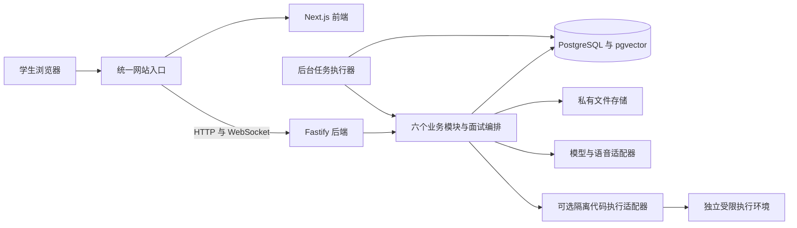

# 总体技术架构

版本：v0.5 · 更新：2026-10-25 · 状态：独立后端公共骨架已实现；各模块完整业务及外部能力按阶段接入。

## 0. 当前实现与本次设计的关系

前端仍运行原 Next.js 演示接口和标签页客户端。新增独立 Fastify API 与 worker 已可运行，具备公开岗位读取、PostgreSQL 公共迁移、事务/幂等/outbox/任务基础和 OpenAPI。认证、私有业务、模型和实时语音尚未接通。

下文保留全产品目标。已实现范围和启动方式以[后端 README](../../code/backend/README.md)为准，不能将完整目标当成已验收能力。原型与真实服务入口分开，不自动上传浏览器个人材料。

## 1. 架构选择与运行边界

采用 TypeScript / Node.js 模块化单体。Next.js 负责界面，Fastify 是独立后端；六个业务模块共享 PostgreSQL，通过服务接口协作。API 和 worker 使用同一后端包的不同进程入口，不按模块拆微服务。

| 部分 | 确定方案 | 职责与边界 |
| --- | --- | --- |
| HTTP 服务 | Fastify | 路由、认证上下文、输入/输出校验、错误映射；业务规则放在模块服务 |
| 数据合同 | Zod + OpenAPI | 可执行 schema 生成 HTTP 合同；HTTP DTO 与实时事件由共享核心声明；公共路由 OpenAPI 已生成，业务合同按模块接入 |
| 身份 | Better Auth + Drizzle 适配 | 受邀账号、服务端登录会话、生产 HttpOnly/Secure Cookie；首轮不开放注册及邮件找回 |
| 数据库 | Drizzle + PostgreSQL | 迁移、约束、索引、事务和仓储；知识向量使用 pgvector |
| 异步任务 | pg-boss + 独立 worker | 解析、JD 分析、问题生成、报告、比较、导出、索引和清理；业务写入使用事务发件箱衔接投递 |
| 实时接入 | Fastify WebSocket 入口 | 连接鉴权、音频、端点、取消和恢复；调用同一面试服务，不维护第二套状态机 |
| 文件 | 私有磁盘卷 + StorageAdapter | 简历、预览、导出与显式授权媒体；接口鉴权后访问，预留对象存储实现 |
| 外部能力 | 受控适配器 | LLM、嵌入、ASR、TTS、视觉及代码执行分别可替换；凭证只在服务端 |

统一入口将页面转给 Next.js，将 `/api/v1` 和 WebSocket 升级请求转给 Fastify。开发同样通过代理访问后端，浏览器保持同源 Cookie；仅部署独立后端不意味着让浏览器直接携带凭证访问任意域名。

官方依据：[Fastify 模块机制](https://fastify.dev/docs/latest/Reference/)、[WebSocket 接入](https://github.com/fastify/fastify-websocket)、[Drizzle 向量检索](https://orm.drizzle.team/docs/guides/vector-similarity-search)、[Better Auth 的 Fastify 集成](https://better-auth.com/docs/integrations/fastify)、[Drizzle 认证适配](https://better-auth.com/docs/adapters/drizzle)、[pg-boss](https://github.com/timgit/pg-boss)。公共基础依赖已锁定并验证；Better Auth、pgvector 和供应商待各阶段接入。

## 2. 六个业务模块

2026-10-25 实现说明：独立 API 默认监听 127.0.0.1:3001；现有 Next.js 演示继续使用。六模块职责保持不变，当前只有公开岗位业务读取和公共基础已实现。API/worker 独立构建，未将所有规划模块生成为空 CRUD。PostgreSQL 暂不安装 pgvector，知识检索方案由模块通过接口接入；认证保留 Better Auth 方向，当前不开放真实账号。

| 模块 | 拥有的数据与服务 | 对其他模块提供的能力 |
| --- | --- | --- |
| 账号与个人设置 | 个人信息、偏好、默认简历指针；认证组件管理登录数据 | 已验证身份、资源归属、个人中心概览；概览组合只读数据，不复制业务记录 |
| 简历与经历 | 多简历、内容版本、经历版本、文件、提取候选与确认 | 读取指定归属及版本的已确认材料；解析结果不能自动成为个人事实 |
| 岗位与收藏 | 平台模板查询、个人 JD、分析、收藏、备注及常用简历 | 解析目标岗位、确认 JD 来源与版本；模板内容的发布由知识模块负责 |
| 面试会话 | 配置、状态、时间、快照、回合、回答片段、纠错及操作事件 | 开始/暂停/恢复/结束、提交与恢复、封存输入；是会话状态的唯一写入口 |
| 报告与重练 | 报告版本、引用、比较、导出及重练关联 | 面后分析、创建关联练习、前后对比；通过面试服务创建重练，不直接修改面试表 |
| 知识内容 | 分类、模板版本、知识、题目、标准、来源和索引版本 | 只检索已发布且岗位/阶段/主题适用内容；授权命令审核、发布、撤回和复核 |

每个模块分为路由、业务服务和数据访问。跨模块调用显式服务，不从别人的路由调用路由，不直接更新其他模块拥有的表。必要的跨模块事务由应用服务组织，仓储接收同一事务上下文。模块不是人员编制，一人可以承担多模块。

Agent、数据库、WebSocket 和 worker 是上述业务的实现能力，不是四套可以各自决定业务状态的系统。共享核心仅保留纯规则、DTO 和适配端口；框架、数据库、文件及供应商 I/O 留在后端。

## 3. 关键业务数据流

### 材料与岗位准备

文本简历和个人 JD 同步保存。JD 分析是显式异步操作；失败不影响原文编辑或直接配置。PDF/DOCX 私有保存后异步提取，用户逐项确认候选才形成可用经历；解析、确认与存入简历库分别记录。

`library` 保存至主动删除；`temporary` 自上传起最长 24 小时，转入库须在过期前显式操作。切换简历清除不属于新版本且未明确补充选择的经历。手填或无简历路径保持可用，不把材料整理设置为面试前置课程。

### 开始面试

创建只保存可修改配置，尚不计时、不冻结材料。`start` 在事务中校验身份、材料确认和版本，冻结必要 JD、简历、经历、知识/题库/标准与提示版本，记录服务端开始时间并进入 `in_progress`，同时登记首题任务。

动态问题依据冻结的内容版本生成，生成后保存实际题干、引用与生成代；不提前编造整场未来问题。最多 6 主问题、每题 2 追问；默认 10 分钟，可选 5 分钟，目标时间提示收尾，含暂停和断线的总经过时间到 12 分钟强制结束。

### 保存回答与生成下一题

1. 校验当前用户、面试/回合状态、版本、提交幂等键及预算。
2. 在同一事务中保存原回答与片段、更新回合和面试版本、登记下一题任务的 outbox 事件。
3. 返回回答保存结果与生成状态。模型失败不回滚已经成功保存的回答。
4. worker 按唯一任务键调用 Agent，读取明确版本的材料、当前回答及适用知识。
5. 提交结果前再次检查状态、输入版本、删除标记、生成代和次数/时间预算。
6. 保存经过校验的问题并通知前端；失败可重试或使用审核过的适用通用题，不换成无关岗位题目。

模型不在数据库事务内运行。业务事务与队列投递不假定天然原子：outbox 随业务提交，投递失败后重扫；重复投递通过任务唯一键和最终写入校验去重，不宣称外部调用严格只执行一次。

### 结束、报告与重练

结束先进入 `ending`，取消活动生成，封存有效回答与采集缺口，再置 `completed`。不可恢复失败保持 `failed`，有有效回答可生成带中断范围的部分报告。报告独立异步生成，失败可重试，不重跑面试。

报告引用指定回答 revision 和材料来源。零有效回答不评分，未观察维度为 `null`，语音/视觉观察独立于专业四维总分；评分标准未经人工校准不得用模型凑出真实专业分数。重练通过面试服务创建关联新面试，固定原题、原回答版本和目标片段，不改写原记录。

### 实时语音与可选能力

第三阶段接入 ASR → 端点确认 → 保存原回答 → 面试编排 → LLM → TTS。端点不能仅凭一个 ASR final 或短停顿判断答完；支持口头自纠、澄清、打断和误截续答。文本降级独立完成，记录每回合实际输入方式。

完整生成文本、实际展示和播放范围分别保存。取消后旧 generation 迟到结果不可展示/播放，重连读取权威状态而非重放所有音频。HTTP、WebSocket 与任务共享同一服务和授权检查。

第四阶段再实现可选代码隔离执行、镜头观察与授权媒体保存。摄像头和复盘保存分别默认关闭，只有授权后的片段可保存，自采集起最长 24 小时；过期不伪造回放或重算。所有反馈在面后开放；视觉/语音不推断情绪、诚实、人格或技术能力。

## 4. 四个实现阶段与验收

| 阶段 | 交付 | 进入下一阶段的条件 |
| --- | --- | --- |
| 1 真实业务闭环 | 独立后端、受邀登录、数据库、文本简历、岗位/收藏、文字面试、真实 Agent 提问与证据报告、重练/比较/记录 | 主路径、权限、事实引用、幂等、任务恢复与删除通过；没有模型凭证时明确不可用 |
| 2 材料与内容完善 | 文件上传/解析/确认、私有文件、PDF、内容维护命令、混合检索、评分人工校准 | 文件有效期/确认/删除、导出版本、发布及索引切换、检索与评分回归通过 |
| 3 实时面试 | ASR/TTS、自动回合、打断/追加/重连/降级、独立语音观测 | 实时接话及端点质量有测量，故障不丢回答、迟到事件无效、面后反馈时机一致 |
| 4 可选能力 | 隔离代码执行/评审、镜头观察、授权复盘媒体、管理页面 | 单独通过隔离限额、授权/清理及低质量不可用等验收；不阻断未开启这些能力的主流程 |

阶段 1–2 对应原需求 P0-A 的基础能力，阶段 3 对应 P0-B 的实时核心，阶段 4 承接可选扩展。原阶段 C 的效果评测不消失，各阶段做回归，稳定后开展同材料对照及授权试用；不能用文字链路完成宣称实时体验已经交付。

## 5. 工程交付与部署约束

后续代码仍落在 `code/backend`、`code/frontend`、`code/core_engine` 三个工作区，不新增顶层服务目录。API 与 worker 共享模块和仓储；前端只依赖公共 DTO 与 HTTP/实时客户端，不导入认证、数据库或模型实现。当前公开内容子入口的过渡见[工程目录](repository_structure.md)。

部署包含统一入口、Next.js、Fastify API、独立 worker、PostgreSQL 与私有文件卷。数据库和 worker 不公开；受限代码服务独立隔离。API 不可用、worker 不可用、数据库迁移失败分别可观测，供应商与费用上线前核验。密钥、真实简历和音视频不进入 Git。

验证包含两用户隔离、材料版本、重复提交、暂停/结束竞态、进程重启、断线、模型失败、旧任务与删除、内容发布/撤回、零回答与未观察。分别验收 OpenAPI 合同、数据库一致性、浏览器主路径和 Agent 质量，不以服务启动成功代替业务可用。

2026-10-25 本轮已实现公共后端骨架、岗位只读模块、迁移和测试，未实现面试/报告等业务闭环；通过本地 Git 提交交付，未推送或部署。原型启动方式保持兼容。

关联：[功能需求](../requirements/functional_spec.md) · [数据与接口](data_and_interfaces.md) · [知识与 Agent](../algorithm/knowledge_and_agent.md) · [评测](../algorithm/evaluation.md)。
