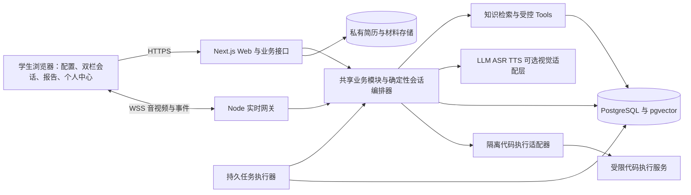

# 总体技术架构

版本：v0.2 · 日期：2026-10-15 · 状态：设计基线，待实现、待验证。本轮仅修订文档。

## 1. 架构目标与阶段

InterviewLab 面向实习经历有限、主要依靠课程项目、竞赛、科研或毕设经历准备技术岗位面试的学生，验证“实时口头模拟面试 → 内容与表达复盘 → 针对性重练与对比”。围绕个人贡献、技术选择、结果依据和岗位关联，练习临场组织与连续追问。

采用模块化单体。阶段 A 建立材料、会话、报告及重练闭环，文本联调作为过渡；阶段 B 交付首版核心实时语音、自然接话、基础语音与可选镜头表现观测；阶段 C 完成对照评测与小规模试用。3D、情绪推断和同类新题自动推荐不作为首版必需交付。未来前端可先用明确标注的模拟数据制作原型，不能将原型结果写成已接入真实服务。

## 2. 组件与边界

| 组件 | 职责 | 边界 |
| --- | --- | --- |
| 浏览器 | 简历/重点经历、实时口头作答、音频队列、可选摄像头、报告与重练比较 | 主动授权后采集，不持有长期供应商密钥；评分和权限不由前端判定 |
| Web 与 API | 身份、资源访问、配置、历史与偏好，提供 `/api/v1` | 普通短请求不承担整场实时连接 |
| 实时网关 | 音视频帧、连接鉴权、端点确认、自动提交、取消、误截恢复与重连 | 复用业务服务，不独立维护另一套会话状态 |
| 编排器 | 状态机、主问题与追问预算、时间、安全上限、结束条件 | LLM 提议内容和动作，程序校验后执行 |
| 受控 Tools | 读取当前用户确认材料、检索发布知识、校验引用和保存 | 模型不能任意执行 SQL、访问 URL 或提升权限 |
| 适配层 | 模型、ASR、TTS、可选视觉的结构化输出、流式、取消、用量、质量及错误映射 | 供应商事件不能直接决定业务事实 |
| 数据库与私有文件 | 用户材料、原作答轨迹、观测、会话快照、临时复盘媒体、版本与任务 | 用户材料不进入共享向量库；文件与媒体私有鉴权 |
| 异步执行器 | 解析、报告、比较、PDF 导出、清理 | 数据库任务表、唯一任务键与领取锁，可恢复且幂等 |
| 代码执行适配器 | C++/Python/Java 的编译、运行与用例结果 | 学生代码不在 Web、网关或数据库主机进程中直接执行 |

代码考核为可选能力；真实执行服务须通过资源、网络和文件系统隔离验证。尚未接入时返回能力不可用，原型演示显式标注“模拟运行结果”。任务资源配置包含编译/运行超时、CPU、内存、进程、输出与文件大小，不依赖模型控制资源。

## 3. 核心数据流

### 岗位、简历与重点经历

首页选择岗位、难度和面试类型，配置页确认 JD、时长、面试官风格、可选代码考核及所选简历。岗位说明区分 JD 明文、发布知识和系统推断。用户可直接使用模板或通用问答，不必先学习课程或完成长期准备计划。

个人中心的简历库允许多份命名、默认、预览和下载；`library` 文件私有保存至主动删除。配置页临时上传使用 `temporary`，默认不入库，自上传起最长 24 小时；转入库必须显式操作。解析只生成待确认候选，学生确认后才形成可供个性化提问的 `Experience`。

选择某份简历时，只自动提供该版本下已确认经历；独立手填经历需要学生另行选择，不将其他简历的经历混入上下文。轻量经历记录包含来源类型、个人职责、行动、技术选择、结果与材料定位。允许无量化成果和未知项；确认代表认可表述，不代表真实性认证。

### 双栏模拟会话

开始成功时冻结 JD、简历、重点经历、问题/评分标准和提示版本。`Session.mode` 仅为 `mock`；面试类型单独记录。左侧展示面试官状态、问题和题目轨迹，右侧为实时作答记录与可展开代码面板；计时和暂停、跳过、结束保持可见。`interaction_mode` 默认 realtime_voice，text_fallback 可独立完成并如实标注；可选镜头默认关闭。会话中不展示答案框架、表达点评、逐题评分或参考答案，澄清题意不转成即时教学。

首版时长选 5 或 10 分钟，默认 10 分钟；最多 6 个主问题，每题最多 2 次追问。主问题与追问分开计数，不承诺所有场次固定总题数。目标时间提示收尾，12 分钟含暂停及断线的总经过时间为安全上限。端点确认后先自动保存原口头回答，再请求下一问题，模型故障不丢失正式回答。代码编辑/运行仍按独立提交规则，不能把编辑代码误记为口头润色。

重点经历追问讨论本人实际实现、技术取舍、困难与验证，不把团队成果全部归于个人，不要求校园项目具备商业收益、上线规模或增长指标。材料中的指令文本只能作为资料，不具有工具权限。

### 实时语音、镜头与派生观测

采用 ASR → 端点确认 → 自动封存原作答 → 会话编排 → LLM → TTS。`partial` 为临时字幕，`final` 原识别与回答轨迹保留，不提供转写润色后发送。允许思考、口头自纠和澄清，短暂停顿不立即结束回合；误截可口头追加到原回合并取消过早后续代。面后仅作 ASR 识别纠错并保存原因/revision，不补写原话。问题完整生成文本、实际已展示文本及已播放位置分别记录，不把未展示且未播放的问题计为已覆盖。

打断先停止浏览器播放，再取消相应 `generation_id` 的模型和TTS；网关与客户端均丢弃迟到事件。音频缓冲有界，断线不自动重传全部帧。运行中通过interaction-settings事务切换text_fallback、关闭/重新授权镜头或媒体保存，记录实际模式与授权事件；关闭即停对应采集/写入并丢弃旧采集代帧，重新授权只处理后续片段，不延长已有媒体期限。关闭、结束和离开页面释放相应设备与播放器。

`SpeechObservation` 保存语速、停顿、疑似口头语和音量/音高变化；可选 `VisionObservation` 保存画面质量、头部朝向及面部动作描述。两者各自版本化并引用回答轨迹、时间与质量，不推断情绪、诚实、人格或技术能力，不纳入四维专业总分。低质量或低置信显示 unavailable。进行中 HTTP/WS 仅返回采集质量/处理状态，完整表达反馈在面后开放。

原始音视频默认临时处理后清除。显式开启的复盘媒体分别授权、私有保留自采集起最长 24 小时，支持到期与主动删除；报告片段定位不保证媒体仍可回放。原媒体已清除不伪造回放或重算，摄像头关闭不影响专业分。

### 结束、报告与重练

幂等结束进入 `ending`，取消活动代并封存已保存回答，再将会话置为 `completed`；未完成片段标缺口，不静默当完整有效回答评分。报告独立异步 `pending → generating → ready/failed`。不可恢复的 `failed` 会话保持终态，有有效回答时可请求部分报告，明确中断和观察范围；零有效回答不评分。

报告采用专业知识、项目表达、代码能力、逻辑表达四维百分制；未考查项 `not_observed`、分数为空，总分仅对已观察维度等权平均后四舍五入。分析引用回答版本与精确片段，围绕个人贡献、技术决策、结果依据、岗位关联解释优势与缺口，不编写学生未确认的履历或结果。语音观测独立展示。

单题重练新建关联原问题、回答版本与片段的 `mock` 会话，共用会话界面、限额与提交逻辑。新回答和原文并列，区分事实补充、组织变化与仍未解决的问题；输入模式不同标明语音变化不可直接比较，变长或模型涨分不等于能力提高。同类新题检验在阶段 C 评测中使用，自动推荐后续扩展。记录自动保存；报告“保存”入口仅确认持久状态或命名，不是此前不保存的开关。

## 4. AI 职责与工程约束

岗位分析、面试官、报告评估由编排器按步骤调用不同提示职责，不采用自由协商多智能体。RAG 提供岗位知识、题目和评分依据；不负责授权、事务或能力认证。首版使用 PostgreSQL 与 pgvector 减少组件，中文关键词/向量检索经样本校准后选参数；MCP 仅预留经审核的服务端适配边界，不作为必需部署。

| 决策 | 作用与约束 |
| --- | --- |
| 状态和版本由程序控制 | 回答、经历、报告、语音观测、比较分别版本化；旧异步任务不得覆盖新结果 |
| 事实与引用校验 | 输出结构合法不代表正确；材料/回答引用均须核对当前输入和片段 |
| 用户资料独立读取 | 每次资源读取、下载、实时连接、比较均核对 owner，不能只过滤列表 |
| 私有快照纳入删除 | 编辑不改写历史，删除则覆盖对应快照和派生数据；备份恢复重放删除清单 |
| 有界重试与费用预算 | 外部失败在有预算、无成功结果时至多有界重试一次；重复提交不重复计费 |
| 静态头像与文本降级 | ASR、TTS、代码服务分别失败时保留其他能力和确认记录 |

所有异步任务提交前检查输入版本与删除标记。运行日志只保留脱敏标识、耗时、用量和错误，不复制简历、回答全文、音频或密钥。文件删除与独立经历删除分别说明影响；详细策略以[数据与接口](data_and_interfaces.md)为准。

## 5. 部署、验证与风险

设计采用单台应用主机上的反向代理/HTTPS、Web、实时网关、执行器、PostgreSQL 和私有文件卷；数据库和任务进程不公开。代码执行通过隔离服务接入，不能复用应用容器运行任意代码。供应商、版本、部署地区、费用与数据处理条件在实现及试用前核验，本文不固定未经验证的型号或性能承诺。

验收覆盖幂等、重连、进程恢复、取消迟到、材料修订、报告过期、权限和删除竞态；用合成课设、团队比赛、科研及少量实习材料检查事实边界，随后比较现有工具与认真提示的通用模型。追问跑题、过度归因、语音噪声、代码超限和调用成本分别设可观察错误及降级入口。容器启动成功不能代替闭环、隐私和效果验证。

关联：[功能需求](../requirements/functional_spec.md) · [数据与接口](data_and_interfaces.md) · [知识库与智能体](../algorithm/knowledge_and_agent.md) · [评测计划](../algorithm/evaluation.md)。
