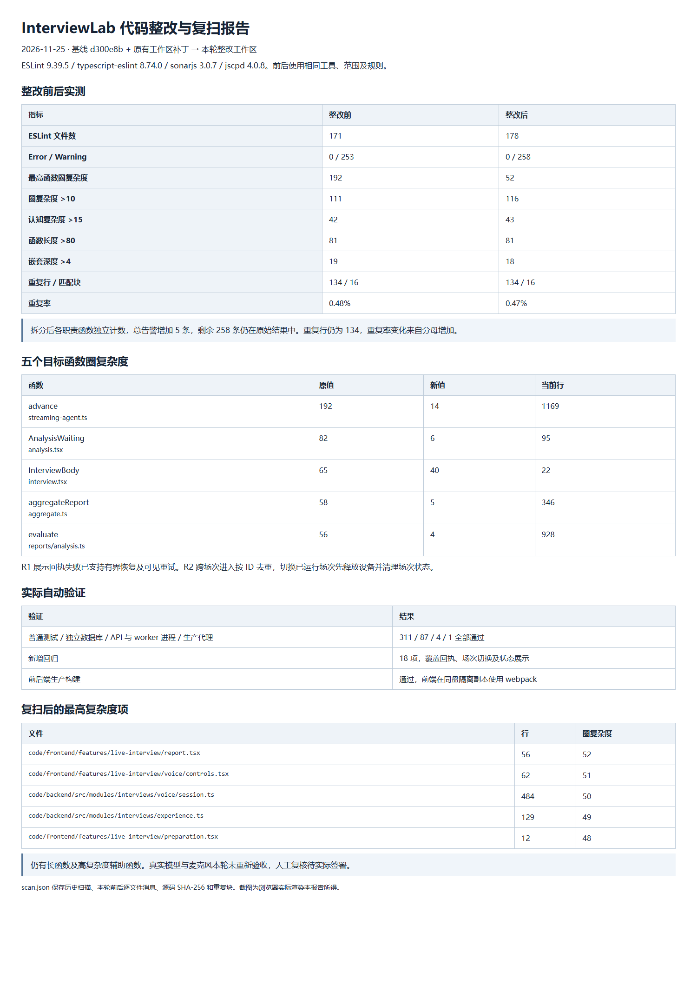

# InterviewLab 代码质量报告

项目为面向高校学生的岗位模拟面试与复盘应用。本报告覆盖 2026-11-15 至 2026-11-25 的课件规范核对、版本同步、文档补齐、扫描、缺陷整改和回归复查。源码整改基线为 `d300e8b` 加本轮开始前已有的工作区改动，整改后版本以附件源码清单和 SHA-256 标识。

教师第 171、172 页将代码质量工作规定为下列四项任务。质量报告按其任务顺序组织，评审表另按教师《Code Review 模板》逐项填写；所参考的 Code Quality Skill 的 S0–S6 对应记录见附录 A。[课程任务 171](https://bettermorn.github.io/IntelligentSWEPractice/courseware/171) · [课程任务 172](https://bettermorn.github.io/IntelligentSWEPractice/courseware/172) · [教师质量检查方法](https://github.com/bettermorn/ACMWDevHubPPT/blob/master/Methodology/CodeQualitySkill.md) · [代码评审记录](code_review.md)

## 1. 为项目配置至少一个静态分析工具（SonarQube/ESLint/Pylint 任选）

本轮选择 ESLint，并配合 TypeScript、sonarjs 和 jscpd。规则及原始结果随报告保存。扫描在临时工具目录及隔离源码副本执行，常规 CI 尚未调用这份扫描配置。

| 工具 | 固定版本 | 实际检查内容 |
| --- | --- | --- |
| ESLint | 9.39.5 | 不可达代码、恒定条件、重复分支、循环方向、类型比较；函数圈复杂度、函数长度和嵌套 |
| typescript-eslint | 8.74.0 | TypeScript / TSX 解析及未使用变量 |
| eslint-plugin-sonarjs | 3.0.7 | 认知复杂度和相同表达式 |
| jscpd | 4.0.8 | mild 模式下，至少 6 行且至少 50 token 的重复片段 |
| TypeScript | 工作区 5.9.3；隔离解析依赖 6.0.3 | 工作区配置用于类型检查，隔离依赖用于解析源码 |
| 项目自带检查 | `npm run check` | 模块依赖边界、类型、岗位内容、普通测试和文档链接 |

ESLint 检查 `code/**/*.ts` 和 `code/**/*.tsx`，排除 `.d.ts`。jscpd 另包含 `.js`，排除声明、`dist` 和 `.next`，最大文件 5 MB、最大行数 100000，覆盖当前最长文件。整改后 ESLint 检查 178 个文件，重复检测共 179 个源码文件。jscpd 的 213 个 format source 项包含 TSX 中同文件的不同语言片段。

本轮固定筛查阈值为圈复杂度 >10、认知复杂度 >15、函数有效行数 >80、嵌套深度 >4。有效行数排除空行和注释。整改前后沿用同一配置。教师参考 Skill 的严格阈值还包含函数 40 行、嵌套 3 层、参数个数等项目，这些严格项仍需进一步统计和复核。

| 扫描范围 | 版本标识与来源 |
| --- | --- |
| 早期已提交基线 | `d300e8b`，原始扫描位于 JSON 的 `scans.current` |
| 整改前工作区 | `d300e8b` 加已有配置页、默认值及岗位客户端三份源文件改动，位于 `remediation.before` |
| 整改后工作区 | 在相同基线上修改六份既有源文件、增加七份职责明确的源文件，位于 `remediation.after` |
| 历史职责拆分对照 | `9546bf5 → 93d05fc`，位于 `scans.before`、`scans.after` |

整改前后均包含原有的三份源文件改动，前后比较的起点一致。附件同时保留其补丁、各文件清单和 SHA-256，支持核查实际输入。

- [固定 ESLint 配置](quality/2026-11-25/eslint.config.mjs)
- [整改前原有工作区补丁](quality/2026-11-25/baseline-workspace.patch)
- [完整扫描与验证数据](quality/2026-11-25/scan.json)
- [浏览器扫描报告](quality/2026-11-25/scan-report.html)
- [实际报告截图](quality/2026-11-25/scan-report.png)

## 2. 运行扫描，记录当前 Bug 数、Code Smell 数、圈复杂度、重复率

2026-11-25 首次扫描已提交基线得到 Error 0、Warning 253、最高函数圈复杂度 192、重复率 0.48%。整改前工作区复扫仍为这些数值，重复检测行分母随已有源文件改动发生变化。下表记录真正用于本轮前后对比的整改前工作区数据。

| 指标 | 整改前实测 | 口径 |
| --- | ---: | --- |
| Bug 类规则 Error | 0 | 仅表示本配置的错误级规则未命中 |
| Code Smell 类 Warning | 253 | 规则命中次数之和，同一函数可以命中多项 |
| 圈复杂度 >10 | 111 | ESLint 函数圈复杂度告警 |
| 认知复杂度 >15 | 42 | sonarjs 的独立度量 |
| 函数有效行数 >80 | 81 | 长函数告警 |
| 嵌套深度 >4 | 19 | 深层嵌套告警 |
| 最高函数圈复杂度 | 192 | 动态出题 `advance` |
| 重复匹配块 | 16 | 需要结合语义判断的候选重复片段 |
| 重复行 / 行统计分母 | 134 / 27827 | 工具的格式化语言片段行统计 |
| 重复率 | 0.48% | 保留工具输出的两位小数 |

辅助代码评审进一步确认了展示回执失败恢复和跨场次进入隔离两类流程缺陷。HTTP 成功 DTO 的运行时校验被列为合同边界关注项，处理结论见下一节。扫描和人工发现分别按其来源记录。

### 扫描报告截图

下图来自浏览器实际渲染附件报告的页面，展示整改前后数据和 Top 5 函数变化。截图数据可以与 `scan.json` 的 `remediation.before`、`remediation.after` 和 `functionComparisons` 逐项核对。



## 3. 选出 Top 5 最严重问题，逐一重构（先补测试，再重构）

本轮先运行已有动态出题、报告和评分专项回归，随后围绕高复杂度入口整理职责，并在整改期间新增 18 项回归。新增用例未保留源码修改前的失败运行记录，因此“先补测试、再重构”的严格顺序证据仍不完整。已有回归的前后结果、最终新增用例和源码前后扫描均已记录。

### Top 5 高复杂度入口整改

以下五项按整改前圈复杂度排序。业务规则、模型输出约束和评分版本保持原调用路径可追踪，具体变更文件见附录 B。

| 编号 | 原文件与函数 | 圈复杂度前 → 后 | 职责调整及复核结果 |
| --- | --- | ---: | --- |
| Q1 | `code/backend/src/modules/interviews/streaming-agent.ts`，`advance` | 192 → 14 | 拆分目标规划、schema、提示输入、预览校验、记忆、问题与检索结果构造。入口处理编排及错误，规划/schema 辅助函数仍有告警 |
| Q2 | `code/frontend/features/live-interview/analysis.tsx`，`AnalysisWaiting` | 82 → 6 | 提取 `analysis-state.ts` 计算真实进度与文案；恢复操作、部分结果导航分为小组件。相关函数最高 9，本范围扫描零告警 |
| Q3 | `code/frontend/features/live-interview/interview.tsx`，`InterviewBody` | 65 → 40 | 提取展示回执、页面展示模型、进度和生成通知，修复回执失败恢复。认知复杂度告警消除，圈复杂度与长函数告警仍在 |
| Q4 | `code/backend/src/modules/reports/aggregate.ts`，`aggregateReport` | 58 → 5 | 分离证据汇总、历史分数、BARS 和当前逐题评分；新增辅助函数最高 10 |
| Q5 | `code/backend/src/modules/reports/analysis.ts`，`evaluate` | 56 → 4 | 分离证据准备、输出 schema、模型输入与结果解码，发布前仍执行证据校验；新增辅助函数最高 10 |

进入流程另将媒体准备及释放集中到 `use-prepared-devices.ts`，Provider 有效行数从 307 降至 284，仍有长函数告警。提示文本经过额外 AST 对照，报告模块九段长提示及指令与原版本一致，动态出题的已有文字和系统模板也逐项核对。

### 流程缺陷整改

| 编号 | 原问题与风险 | 处理结果 | 对应回归 |
| --- | --- | --- | --- |
| R1 | 展示回执发送前即标记已确认，失败后空 catch，页面无法再尝试确认实际展示时间 | 请求成功或权威状态确认后才记为完成；最多自动重试一次。相同输入复用幂等键，版本变化使用新键；持续失败显示手动重试入口，换题及取消后停止后续尝试 | 五项用例，覆盖丢响应、同版本重试、版本变化、持续失败和取消/暂停/换题 |
| R2 | 在途进入操作跨场次共享 Promise，运行中场次的设备与文字降级状态也可能被下一场复用 | 同场次共享在途工作，切换场次先失效旧代、释放媒体、清除绑定及草稿、重置降级状态，再准备新场次。独立记录已进入场次，覆盖旧工作已完成的切换 | 四项用例，覆盖同场共享、跨场切换、旧失败不清新任务、运行后切换先释放设备 |
| R3 | HTTP 成功 DTO 的校验责任描述不清 | 明确统一客户端负责传输、超时及错误，成功 DTO 合同由服务端 Zod 响应模式与接口约束控制，保留现有泛型类型检查。完整前端运行时 DTO 校验尚未增加 | 普通 HTTP 测试与生产代理回归通过，后续按接口版本风险复核 |

### 新增回归清单

| 文件 | 新增用例数 | 覆盖行为 |
| --- | ---: | --- |
| `tests/unit/presentation-request.test.ts` | 5 | 回执丢失恢复、有界重试、幂等键、取消及题目变更 |
| `tests/unit/entry-request.test.ts` | 4 | 同场去重、不同场次取消旧工作、旧任务隔离、已运行场次切换 |
| `tests/unit/analysis-state.test.ts` | 3 | 部分失败仍继续、历史与空回答、读失败时优先重连 |
| `tests/unit/interview-notices.test.ts` | 3 | 补充作答、生成失败恢复和已有结果提示 |
| `tests/unit/interview-presentation.test.ts` | 3 | 展示模型、历史记录及计时和问题呈现 |
| 合计 | 18 | 最终均纳入普通测试 |

## 4. 重新扫描，对比重构前后指标变化，形成质量报告

### 同口径复扫结果

| 指标 | 整改前工作区 | 整改后工作区 | 变化解释 |
| --- | ---: | ---: | --- |
| ESLint 文件数 | 171 | 178 | 新增七份源文件 |
| Bug 类规则 Error | 0 | 0 | 业务时序缺陷通过专项用例验证 |
| Code Smell 类 Warning | 253 | 258 | 规则命中次数净增五条，拆出的函数也分别计数 |
| 圈复杂度 >10 | 111 | 116 | 包含仍超过阈值的规划/schema 等辅助函数 |
| 认知复杂度 >15 | 42 | 43 | 继续按 sonarjs 口径计数 |
| 函数有效行数 >80 | 81 | 81 | 长函数仍需继续整理 |
| 嵌套深度 >4 | 19 | 18 | 同一规则复扫 |
| 最高函数圈复杂度 | 192 | 52 | 当前最高为 `report.tsx` 的 `ReportBody` |
| 重复匹配块 | 16 | 16 | 候选重复片段仍需按语义逐条复核 |
| 重复行 | 134 | 134 | 重复行数保持相同 |
| jscpd 行统计分母 | 27827 | 28404 | 源码与嵌入语言片段的行统计增长 |
| 重复率 | 0.48% | 0.47% | 比例变化来自分母增长 |

五个原高复杂度入口的职责已整理，最高单函数复杂度下降。告警总数仍为 258，Q1 部分辅助函数、Q3 页面及 Provider 仍有告警。当前最高五处为 `ReportBody` 52、`VoiceControls` 51、语音会话回调 50、`experiencePolicy` 49、`PreparationScreen` 48，后续依据业务风险继续处理。

### 实际回归与构建结果

| 检查 | 整改后的实际结果 |
| --- | --- |
| `npm run check` | 普通测试 311/311 通过，无跳过；依赖边界、类型、内容与文档检查通过 |
| 动态出题专项 | 修改前后 87/87 通过 |
| 报告及评分专项 | 修改前后 78/78 通过 |
| 独立 PostgreSQL / pgvector 数据库回归 | 87/87 通过，无跳过 |
| API / worker 编译产物进程回归 | 4/4 通过 |
| 生产 Next.js 代理回归 | 1/1 通过，覆盖 Cookie、Origin、错误、查询参数与流 |
| 后端构建 | `npm run build:backend` 通过 |
| 前端生产构建 | 同盘隔离副本执行 `next build --webpack` 通过，类型检查与静态页面生成通过 |
| 文档检查与模板整理后复核 | 59 份 Markdown、504 个本地链接均通过 |
| 真实模型、麦克风和人工同伴签署 | 本轮尚未重新验收，继续按[评测](../algorithm/evaluation.md)和评审表记录 |

数据库验证使用本轮新建的独立 `interviewlab_test_quality_*` 数据库。前端构建与代理验证在同盘临时副本执行。首次跨盘副本遇到 Windows 路径解析失败，调整到同盘副本后复验通过。

### 持续跟踪项

- 258 条静态告警和 134 行候选重复片段继续保留，后续修改应复扫并说明实际变化。
- 历史行覆盖采样为 71.65%，未包含独立数据库回归。合并数据库回归后的核心逻辑覆盖率仍待统计。
- 完整循环依赖、全量死代码、高危依赖及密钥专项扫描尚未完成。现有边界检查和本轮代码阅读提供局部证据。
- 真实模型效果、麦克风与供应商端到端体验、人工评审签署按实际结果补充。
- 本报告静态配置尚未接入日常 CI，后续接入需保留相同规则与前后基线。
- 临时测试产物的自动清理曾被自动审批拒绝，返回 `blocked by policy`，对应产物保留。

## 附录 A. 全过程与 S0–S6 对应记录

### 规范化工作的阶段记录

| 阶段与时间 | 实际完成的工作 | 输出与证据 |
| --- | --- | --- |
| 课件对照与范围确定，2026-11-15 至 16 日 | 通读《SWIEP软件工程》297 页课件，对照现有需求、架构、管理、测试和运行资料。以现有项目和已确认规范为准，已有实践复用证据，确认差距后补齐 | 首次审查发现时长、评分及验收说明漂移，质量扫描和评审证据待补 |
| 首次工程核查，2026-11-15 至 16 日 | 普通测试 286/286、前后端构建通过；历史行覆盖采样 71.65%。当时 Docker 未运行，独立数据库/进程/代理未在本地重跑 | 初始文档检查 55 份 Markdown、444 个本地链接；已有 CI 流程及实际成功记录经核对 |
| 远端核对及同步，2026-11-16 | 只读查询确认 `codex/all-role-agent` 仍为 `bb545a3`，远端 `main` 为 `f10d7e1`，多一个合并提交但文件相同。随后执行 fetch、确认可快进并 merge --ff-only，保留两份管理文档原有改动 | 本地更新到 `f10d7e1`，工作区管理计划内容保留 |
| 规格与证据补齐，2026-11-16 | 修正时长、题量、硬上限、类型、评分兼容、模型验收入口、个人 Compose 及迁移影响；整理十项需求与测试映射，新增课程所需文档入口 | 十五个文件进入 `ce88b1c`，文档检查 59 份、476 个本地链接通过 |
| 管理计划及提交交付，2026-11-16 | 复核原有 11 月 12 日沟通与风险修订，按实际内容纳入独立提交 `44dce33`；规范资料另提交 `ce88b1c`，随后推送当前分支 | [管理计划提交](https://github.com/hcxlwxlwj/InterviewLab/commit/44dce33) · [规格及证据提交](https://github.com/hcxlwxlwj/InterviewLab/commit/ce88b1c) |
| 合并状态观察，2026-11-25 | 当前 HEAD 已为 PR #52 合并提交 `d300e8b`。记录该状态，规范化工作中的提交、推送记录沿用上述证据 | `f10d7e1` 与 `d300e8b` 的 `code` 源码树相同；PR 合并由既有 Git 历史证明 |
| 教师模板落实及首次扫描，2026-11-25 | 读取教师任务、质量方法和评审模板，固定工具与规则，扫描三份历史快照，填写逐项评审。首次工作区普通测试 293/293，四份核心源码的直接验证 13/13 | 已提交基线扫描 Warning 253，发现 R1、R2 和 R3–R5 关注项，生成 JSON、HTML、截图 |
| 源码整改与复验，2026-11-25 | 处理五个复杂入口、展示回执及跨场次隔离，补十八项回归，执行普通、数据库、进程、代理和构建验证并复扫 | 六份既有源码及七份新增源码，最终 311/87/4/1 测试结果；指标和处理记录见正文 |

此前查询过 PR #49、#50、#51 的正式 review，2026-11-16 查询时三项为空；当前人工评审状态没有据此推定。已有 CI 的实际运行记录保留供复核。[历史 CI](https://github.com/hcxlwxlwj/InterviewLab/actions/runs/42815967950)

### S0–S6 实施映射

| 方法步骤 | 本项目对应实践 | 当前证据及限制 |
| --- | --- | --- |
| S0 评审准备 | 读取课件和模板，确定当前规格、Git 基线、原有工作区改动与具体文件范围 | 源码版本、已有改动补丁、完整变更清单均有记录 |
| S1 编码前约束 | 核对工作区 AGENTS、架构与接口要求，复用现有 API、任务、取消和评分合同 | 保留历史读取、同源认证、幂等和发布前校验；现有规格修订可追踪 |
| S2 编码中规则 | 围绕具体职责提取共享逻辑，限制修改到确认的问题及其调用和回归 | 六份既有源码、七份职责文件，未关闭扫描规则 |
| S3 坏味道自检 | 静态扫描与代码阅读结合，确认流程缺陷并给出 Top 5 | R1/R2 已整改，R3 合同边界记录，复杂度残留继续跟踪 |
| S4 自动检查 | 类型、边界、内容、普通测试、独立数据库、进程、代理及前后端构建 | 311/311、87/87、4/4、1/1 及构建通过，实际范围列于正文 |
| S5 填写评审模板 | 按教师 0–6 章逐项填写结果、说明、行号及处理状态 | 辅助评审有证据，人工复核人与签署待实际记录 |
| S6 修复并回归 | 对确认缺陷和高复杂度职责做调整，以相同规则复扫和回归 | 原最高复杂度 192 降至 52；告警 253 增至 258，新增测试的先红后绿记录缺失 |

## 附录 B. 全部变更文件清单

### 2026-11-16 的管理与规范资料

| 提交 | 文件 | 实际调整 |
| --- | --- | --- |
| `44dce33` | `docs/mgmt/communication_mgmt_plan.md` | 纳入已存在的 11 月 12 日修订，明确沟通内容、频率、方式、产出及责任角色 |
| `44dce33` | `docs/mgmt/risk_mgmt_plan.md` | 纳入已存在的 11 月 12 日修订，补风险分级、触发信号、跟踪频率和 API 额度预案 |
| `ce88b1c` | `docs/requirements/problem_definition.md` | 同步实际面试配置、范围和账号说明 |
| `ce88b1c` | `docs/requirements/functional_spec.md` | 同步时长、题量、硬上限、类型与评分版本 |
| `ce88b1c` | `docs/requirements/nonfunctional_spec.md` | 同步当前默认行为及资源、时间约束 |
| `ce88b1c` | `docs/requirements/user_stories.md` | 更新可执行场景，标明偏好复用的实现差距 |
| `ce88b1c` | `docs/algorithm/knowledge_and_agent.md` | 区分当前六维、HR、重练和历史评分 |
| `ce88b1c` | `docs/algorithm/evaluation.md` | 修正验收入口与当前脚本说明，保留历史模型结果及不足 |
| `ce88b1c` | `docs/software/data_and_interfaces.md` | 同步新建配置、预算与评分合同边界 |
| `ce88b1c` | `docs/software/development.md` | 澄清完整启动方式、个人入口及迁移影响 |
| `ce88b1c` | `docs/software/personal-materials-implementation.md` | 标记实际读取的简历、风格及尚未接入的偏好 |
| `ce88b1c` | `docs/software/README.md` | 增加质量、评审、部署文档导航 |
| `ce88b1c` | `docs/software/code_quality.md` | 建立质量基线，本轮按教师任务补充扫描和整改全过程 |
| `ce88b1c` | `docs/software/code_review.md` | 建立评审证据，本轮按教师模板填写并复核整改 |
| `ce88b1c` | `docs/software/deployment.md` | 汇总启动、迁移、备份恢复和回退检查项及实际状态 |
| `ce88b1c` | `tests/README.md` | 整理十项核心用例及需求、源码映射 |
| `ce88b1c` | `tests/interviewlab_demo_user_test.md` | 建立交叉试用任务及待执行记录 |

### 2026-11-25 的源码整改

| 类别 | 文件 | 实际调整 |
| --- | --- | --- |
| 修改既有源码 | `code/backend/src/modules/interviews/streaming-agent.ts` | 拆分出题目标、输入、输出及流式校验职责 |
| 修改既有源码 | `code/backend/src/modules/reports/aggregate.ts` | 拆分各版本证据与评分汇总 |
| 修改既有源码 | `code/backend/src/modules/reports/analysis.ts` | 拆分评价证据、schema、输入及结果解码 |
| 修改既有源码 | `code/frontend/features/live-interview/analysis.tsx` | 分离进度展示与恢复动作 |
| 修改既有源码 | `code/frontend/features/live-interview/interview.tsx` | 接入可恢复展示回执并拆分展示和通知 |
| 修改既有源码 | `code/frontend/features/live-interview/flow-provider.tsx` | 接入场次隔离及集中设备生命周期 |
| 新增源码 | `code/frontend/features/live-interview/analysis-state.ts` | 计算报告真实阶段、进度及文案 |
| 新增源码 | `code/frontend/features/live-interview/entry-request.ts` | 同场去重、跨场取消和已运行场次隔离 |
| 新增源码 | `code/frontend/features/live-interview/interview-notices.tsx` | 进度、续答及生成恢复提示 |
| 新增源码 | `code/frontend/features/live-interview/interview-presentation.ts` | 问题展示、计时和工作区数据投影 |
| 新增源码 | `code/frontend/features/live-interview/presentation-request.ts` | 展示回执确认、有界重试及幂等恢复 |
| 新增源码 | `code/frontend/features/live-interview/use-prepared-devices.ts` | 媒体准备、缓存与迟到授权释放 |
| 新增源码 | `code/frontend/features/live-interview/use-question-presentation.ts` | 题目展示确认、失败提示和手动重试 |

五份新增测试和十八项用例见第 3 节。报告附件共五项，分别为本轮已有改动补丁、ESLint 配置、扫描 JSON、可视 HTML 和 PNG 截图，均在第 1 节提供链接。

本轮开始前已有九项文件改动保持原来源，覆盖 `setup-state.ts`、`setup.tsx`、`lib/api/interviews.ts`、前端 `package.json`、根 `package-lock.json`、`architecture.md`、`repository_structure.md`、`interview-setup.test.ts` 和 `interview-jobs-client.test.ts`。这些改动属于工作区基线，测试和扫描的包含范围已说明。

## 附录 C. 历史对照与复现

`9546bf5 → 93d05fc` 为既有历史职责拆分及同期功能调整。其 `InterviewBody` 圈复杂度曾由 83 降为 65，认知复杂度由 56 降为 45；整体 Warning 206 增至 250，重复率 0.69% 变为 0.48%。该记录用于理解代码演进，保留原始版本及指标。[历史修改](https://github.com/hcxlwxlwj/InterviewLab/commit/93d05fc)

复现时，在独立临时目录安装固定工具并复制本报告规则。整改前由 `git archive d300e8b code` 导出源码后应用附件工作区补丁得到。整改后使用当前 Git 已跟踪及未忽略源码，保存文件清单与 SHA-256 后扫描。工具目录 `$scanRoot` 和源码副本目录由执行者显式选定。

```powershell
npm install --prefix $scanRoot --no-audit --no-fund --save-exact eslint@9.39.5 typescript-eslint@8.74.0 eslint-plugin-sonarjs@3.0.7 jscpd@4.0.8 typescript@6.0.3
# 从仓库复制 docs/software/quality/2026-11-25/eslint.config.mjs 到工具目录。
# 在相应源码副本目录执行以下命令。
node "$scanRoot/node_modules/eslint/bin/eslint.js" --config "$scanRoot/eslint.config.mjs" --format json --output-file "$scanRoot/eslint-result.json" --no-warn-ignored 'code/**/*.ts' 'code/**/*.tsx'
node "$scanRoot/node_modules/jscpd/bin/jscpd" code --pattern '**/*.{ts,tsx,js}' --format typescript,tsx,javascript --max-lines 100000 --max-size 5mb --min-lines 6 --min-tokens 50 --reporters json --output "$scanRoot/duplication" --ignore '**/*.d.ts,**/dist/**,**/.next/**'
```
## 附录 D. 本轮归档

按用户要求，本轮 13 份整改源码、5 份新增测试、两份完整报告与 5 份扫描附件同批提交，提交号以 Git 历史为准。报告中的测试与复扫仍对应其明示的工作区输入基线。
