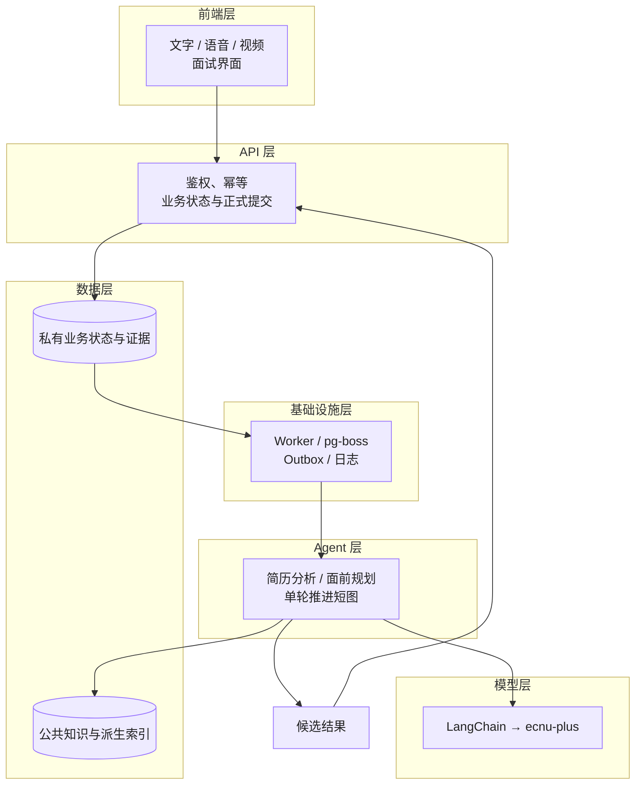
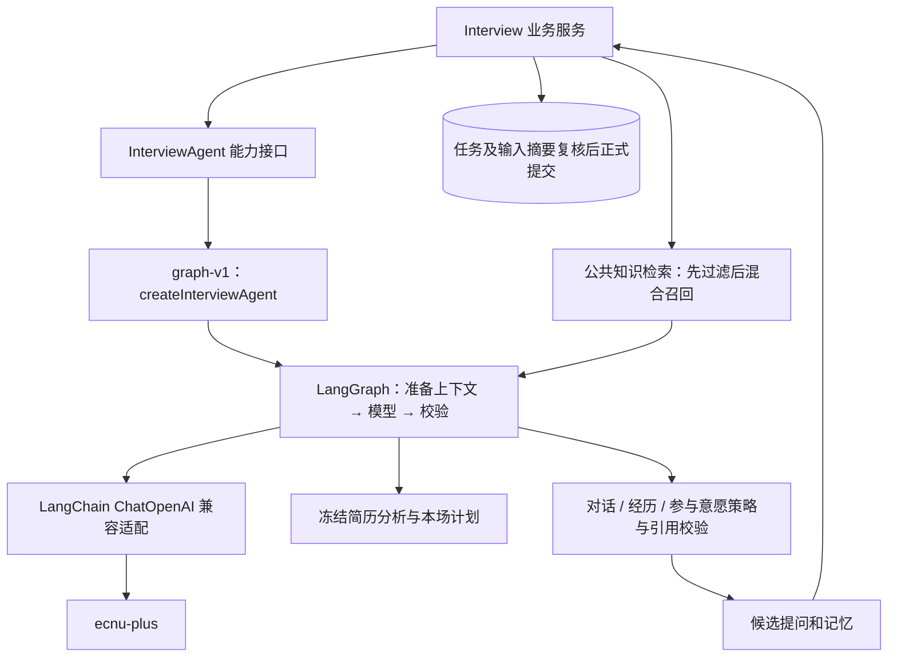
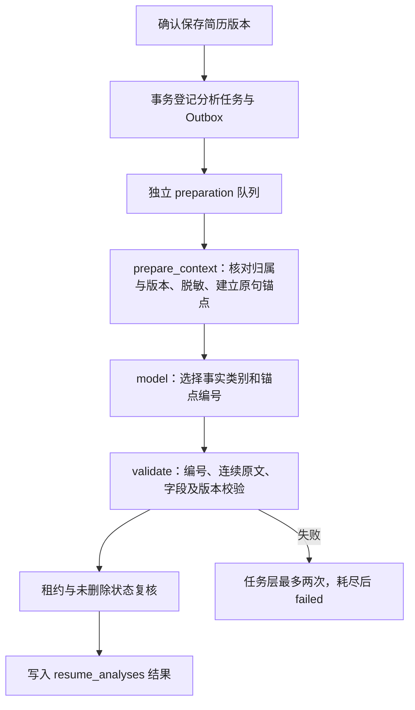
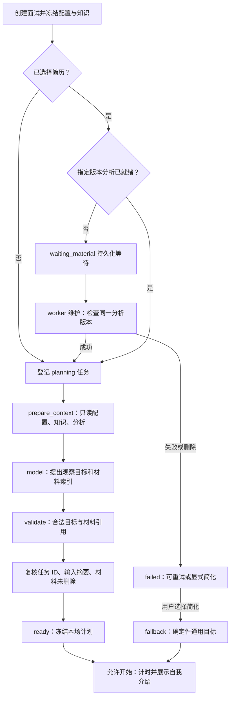
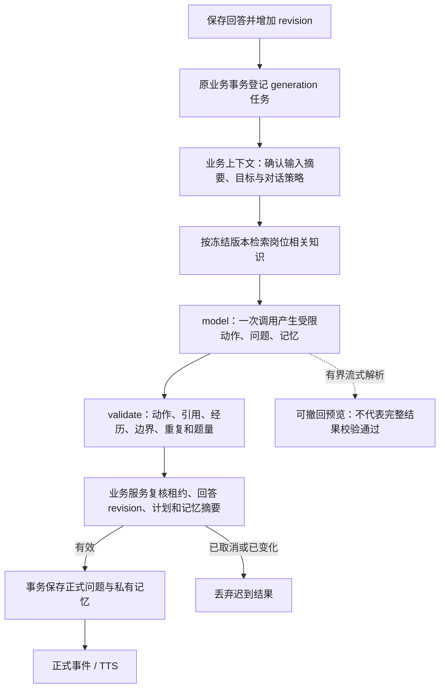
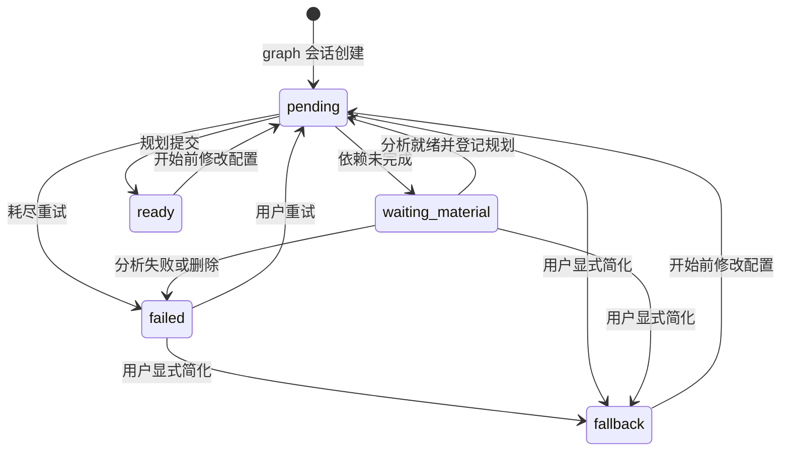
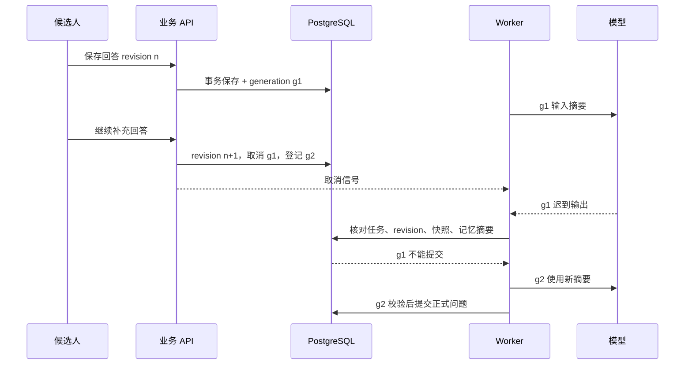
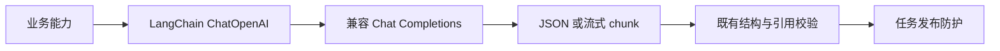
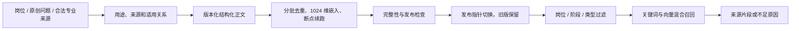

# 面试智能体架构设计

## 2026-11-06 面试前后过渡

配置提交后进入全屏准备，设备采集、简历分析和规划完成后自动开始，不再重复点击开始或开启语音。准备与房间共享当前用户的临时媒体会话；授权失败可重试或改用文字。开始请求在结果不明时复用幂等键，并通过读取服务器状态恢复；刷新不会重新开始已启动的面试，暂停记录不自动恢复。

结束后统一进入全屏分析页，等待逐题、总结及建议全部就绪，再进入报告；生成失败和网络问题留在过渡页处理。建议可通过 `scope:"advice"` 独立重试，不重算成功评分与总结。进度跟随真实阶段，视觉动效不延迟开始或伪造完成。前端计时与语音连接均遵守本场动态截止时间，兼容二十和三十分钟场次。

## 2026-11-06 对话策略更新

新建面试保留专业、业务、HR、综合四类，项目深挖并入专业和业务面；历史项目深挖记录与重练保留读取。准备计划附带 `interview-policy-v2`：按岗位、招聘阶段、类型及10/20/30分钟预算选择主题，不预生成固定题序。专业/业务/综合面整场覆盖六维；HR优先求职动机、到岗与实际安排、薪资期望，有时间再展开协作反思，不考技术实现。

单轮仍只有一次模型调用，输入增加最近三轮原始问答和剩余时间，输出增加中性承接及枚举决策原因。讲清、明确不会/未参与、拒绝、重复回答或进入收尾窗口时停止追问；标准与友好风格最多一次，深入追问最多两次，按10/20/30分钟分别设置6/10/14道主问题上限，目标时间后最多保留2分钟完成当前回答。语音/视频继续共用同一推进链，不改变媒体机制。

HR未考察的维度从评分数组省略，图表不绘制；专业、业务、综合面必须规划六维覆盖，逐题得分以实际问答为依据，整场按固定六维汇总。整场分析完成后固定展示六维，未体现维度计0分并计入总分；不把系统分析失败当作0分。评分、历史与归一化规则见[报告模块](../../code/backend/src/modules/reports/README.md)。`tests/support/interview-policy-live.ts` 仅发送合成材料，检查四类真实模型对话，不写数据库或发布知识索引；自动合同通过不等同于完整语义或设备验收。

## 0. 文档信息

| 项目 | 内容 |
| --- | --- |
| 项目 / 版本 | InterviewLab 面试 Agent / v1.0，2026-11-05 |
| 适用实现 | 唯一运行时 `graph-v1`，文字、语音、视频共用 |
| 组织依据 | [老师的 Web 智能体架构模板](https://github.com/bettermorn/AIAgent/blob/main/docs/architecture.md) |
| 状态 | 当前架构及工程自查；效果和真实媒体尚未完整验收 |

本文沿用原 Agent 接入文档入口，按老师模板补齐分层、状态、接口和自查，不新增重复文件。[系统架构](architecture.md)维护全系统总览；本文维护智能体架构；[动态面试](interview-agent-v3.md)维护流式协议与策略；表结构和完整接口以[数据与接口](data_and_interfaces.md)为准。旧日期试跑记录保留在附录。

## 1. 项目概述

### 1.1 背景与目标

面试需要适配岗位、实际回答和候选人经历，不能机械遍历题库，也不能让模型自行假设经历或修改业务状态。当前采用程序约束下的单 Agent：模型理解内容、提出有限行动，程序提供知识、验证依据并决定是否发布。目标是让问题能够解释“为什么现在问、观察什么、依据在哪里”，让失败与恢复有明确规则。

### 1.2 核心功能清单

| 能力 | 当前实现 |
| --- | --- |
| 全岗位知识 | 1000 岗位、8000 原创问题的统一结构化来源及派生检索记录 |
| 简历分析 | 确认版本中的事实与待澄清点，绑定字段及连续原文 |
| 面前规划 | 生成观察目标，不预排未来固定题单 |
| 动态推进 | 承接已保存回答，提出下一问、澄清或结束建议，更新受限记忆 |
| 三模式共用 | 文字直接保存；语音、视频经 ASR 后进入相同服务 |
| 面后分析 | 共用模型传输，按当前报告模块的评分与证据规则执行 |

### 1.3 范围边界（做什么 / 不做什么）

业务服务唯一控制身份、计时、题量、终态和正式提交。Agent 编排不另定账号、媒体或评分规则；当前评分以报告模块为准，视频仅本机预览。没有多 Agent 自治协作、任意工具执行或 LangGraph checkpoint 存储。旧 Agent 已清退，旧记录可读；停用运行时的会话不能静默切为新运行时继续生成，需要新建面试。

### 1.4 关键质量属性（非功能需求）

| 属性 | 约束 / 验收口径 |
| --- | --- |
| 可追溯 | 材料版本、字段、原文；回答 turn/revision；专业依据与知识版本 |
| 一致性 | 续答、取消、删除或配置变化后，旧结果不得提交 |
| 可恢复 | 以数据库任务和状态恢复，不依赖页面或图内存 |
| 时延与费用 | 正常单轮一次模型调用，SDK 不自动重试，任务最多两次尝试 |
| 隐私 | 用户隔离、过滤无关联系方式、简历不进公共知识库、普通日志不记正文 |
| 效果 | 严重虚构为零、人工审查至少 90% 问题合适、P95 恶化超过 20% 须定位复测；均为待验收门槛 |

## 2. 开发与运行环境

### 2.1 程序设计语言及版本

TypeScript 5.9.3、Node.js 24、npm 11。共享 DTO 与纯领域规则位于 `code/core_engine`，保持无框架依赖。

### 2.2 开发工具（IDE 与辅助工具）

Git/GitHub、npm workspaces、tsx、tsup；Python 3 检查文档，Mermaid 保存图示。编辑器不限。

### 2.3 系统运行环境

前端、API、worker 分进程，Docker 提供 PostgreSQL；外部模型不要求本机 GPU。媒体需要浏览器权限、安全上下文及 Web Audio/WebSocket。数据库测试只写明确指定的 `interviewlab_test*` 库。

### 2.4 使用平台与外部服务

ChatECNU `ecnu-plus` 使用兼容 Chat Completions 的接口；ASR/TTS 沿用现有适配器，嵌入保留既有模型及 1024 维空间。媒体边界见[实时语音与视频](voice-interview.md)。

### 2.5 依赖清单与版本锁定

| 依赖 | 当前版本 / 用途 |
| --- | --- |
| `@langchain/core` | 1.3.4，模型消息与公共抽象 |
| `@langchain/openai` | 1.8.0，兼容协议集成 |
| `@langchain/langgraph` | 1.6.1，三类短工作流 |
| pg-boss / Drizzle | 12.38.0 / 0.45.4，任务及事务 |
| Zod | 以 lockfile 为准，输出与边界校验 |

框架在后端 package.json 精确锁定，解析以根 lockfile 为准。升级需回归供应商结构化输出、流式结束原因和取消。

### 2.6 配置与密钥管理

沿用根目录 npm 工作区及受邀账号认证。先按[后端说明](../../code/backend/README.md)配置 PostgreSQL、`AUTH_ENABLED`、`BETTER_AUTH_SECRET` 和可信来源，执行 `npm run db:migrate`；随后分别运行 `npm run dev:api`、`npm run dev:worker`、`npm run dev`。

服务端配置示例见根 `.env.example`：

```dotenv
LLM_BASE_URL=https://chat.ecnu.edu.cn/open/api/v1
LLM_MODEL=ecnu-plus
LLM_API_KEY=
LLM_OUTPUT_MODE=json_object
LLM_TIMEOUT_MS=25000
```

地址与模型名默认采用 [ChatECNU 官方配置](https://developer.ecnu.edu.cn/vitepress/llm/index.html)。密钥仅填本机 `.env` 或服务端环境，不使用 `NEXT_PUBLIC_`。配置修改后重启 API 和 worker。兼容协议使用 `/chat/completions`，默认 JSON 对象和服务端 Zod 校验；严格 JSON Schema 只在供应商支持时显式开启。LangChain SDK maxRetries=0，不进行隐藏重试，每任务最多两次模型调用，第二次附带修复提醒。

打开 `/login` 登录，然后进入 `/interview/setup`。创建配置不计时，准备时冻结运行时、材料与知识，点击开始才计时。真实面试与报告使用 `/interview/{id}`、`/reports/{id}`，历史入口为 `/me/interviews`。旧演示地址和合成 API 已删除；真实错误不会回退假数据。

## 3. 总体架构

### 3.1 分层架构图



### 3.2 分层职责总览

| 层 | 输入 → 输出 | 边界 |
| --- | --- | --- |
| 前端 | 用户输入和服务状态 → 命令及界面 | 不持有密钥、框架对象 |
| API | 身份、版本、命令 → 持久操作 | 不在写入事务内等待模型 |
| Agent | 冻结快照、回答、上下文 → 候选计划或问题 | 无正式提交或改分权限 |
| 模型 | 受限消息 → JSON/流式内容与用量 | 外部输出均不可信 |
| 数据 | 归属及版本 → 状态、证据、适用知识 | 公共知识与私有材料隔离 |
| 基础设施 | 持久任务 → 执行、取消、重试及恢复 | 模型成功不等于提交成功 |

### 3.3 核心请求时序

保存、任务登记、模型执行和提交见 6.3 的续答时序图。回答与 Outbox 同事务，模型在事务外执行；只有业务事务成功后才能发布正式问题并启动 TTS。

### 3.4 架构决策记录（ADR）

| 决策 | 选择及理由 | 代价 / 替代方案 |
| --- | --- | --- |
| 模型集成 | LangChain 统一兼容协议、流式、取消及用量 | 需依赖适配；直接 fetch 更轻但自行维护协议 |
| 图编排 | LangGraph 显式表达上下文、模型与校验 | 当前是线性短图，普通函数也能实现，不夸大自治能力 |
| 状态归属 | 业务服务及数据库维持唯一权威 | 失败重跑短图；长任务再评估 checkpoint 及一致性 |
| 决策权限 | 单 Agent 提建议，程序控制检索与发布 | 自治程度有限，权限和版本边界可验证 |
| 三模式 | 共用保存后的文本证据 | 不分析声音情绪或视频画面 |

选型比较见[技术调研](../algorithm/research.md)。

## 4. 前端层（Presentation Layer）

### 4.1 主要职责

展示准备、保存、生成和失败，提供重试/简化入口。准备期间不计时、不自动开启媒体，沿用原组件布局。

### 4.2 技术选型

沿用 Next.js / React，版本见[系统架构](architecture.md)。前端仅依赖 DTO 和客户端，不导入框架。

### 4.3 页面与组件结构

`/interview/setup` 配置准备，`/interview/{id}` 面试，`/reports/{id}` 报告，`/me/interviews` 历史；材料页面确认简历版本。

### 4.4 与后端交互方式

HTTP 保留 Cookie、Origin、幂等键及版本；SSE 展示进度，语音保留 WebSocket。刷新、断线和模式切换读取同一面试，不重建或重置时间。

### 4.5 智能体特有的 UI 设计要点

ASR partial 只作字幕，保存回答才进入 Agent。TTS 只朗读正式问题，不朗读预览或计划。视频仅本机预览。麦克风权限通过不代表设备选对，排查见[语音设计](voice-interview.md)，不增加复杂框架 UI。

## 5. API 层（Interface Layer）

### 5.1 主要职责

检查归属、版本、状态及准备依赖，登记后台任务并暴露进度，不公开私有计划或提示。

### 5.2 技术选型

沿用 Fastify、Zod、共享 DTO 与 OpenAPI。API/worker 通过业务能力接口协作，不暴露框架对象。

### 5.3 接口清单

| 接口（`/api/v1` 前缀） | 职责 |
| --- | --- |
| `POST /materials/{id}/analysis` | 指定版本补分析或重试 |
| `POST /interviews` | 冻结初始配置并登记准备依赖 |
| `POST /interviews/{id}/prepare` | 准备、重试或显式简化 |
| `POST /interviews/{id}/start` | 准备门禁通过后计时和呈现开场 |
| 回答、生成重试、状态控制 | 保存证据、取消旧代、推进或终止 |
| 报告与比较 | 查询及重试面后分析 |

完整合同见[数据与接口](data_and_interfaces.md)，没有开放通用 `/agent` 工具执行接口。

### 5.4 数据模型（Schema）

材料 DTO 增加可选分析状态，面试 DTO 增加独立 preparation，历史缺字段可读。模型结果经结构、索引/原文及业务规则检查；内部快照不直接返回前端。

### 5.5 错误码规范

沿用统一错误结构：`invalid_state` 状态不符，`unsupported_input` 输入/停用运行时不支持，`task_cancelled` 取消，`invalid_model_output` 校验失败，`capability_unavailable` 未配置。供应商原始错误脱敏，不返回密钥或提示正文。

## 6. Agent 层（Orchestration Layer）

### 6.1 主要职责

目标是在给定岗位、类型、时长和候选人材料边界内，承接实际回答，逐步观察职责、行动、选择和验证依据。问题质量以现场相关性、事实引用、重复率和可用性验收。框架接入不是效果验收结论。

| 能力 | 输入 | 输出 | 不允许的动作 |
| --- | --- | --- | --- |
| 简历分析 | 用户确认的指定材料版本、去联系方式字段 | 可定位事实、待澄清点 | 补写经历、跨用户复用、写入公共知识库 |
| 面前规划 | 配置、冻结知识、可选分析 | 有限观察目标、关注点、材料依据、限制 | 固定未来题单、计时或改变评分 |
| 单轮推进 | 当前问题、已保存回答 revision、私有记忆、规划、检索 | ask / clarify / finish 建议、受限记忆更新 | 任意工具调用、越权检索、直接正式提交 |
| 报告与比较 | 当前报告模块的证据与规则 | 当前报告与比较结构 | 将简历事实替代回答证据、由面试 Agent 改写评分规则 |

### 6.2 Agent 类型与编排模式

当前是受业务约束的单 Agent，包含简历、规划、推进三类短工作流，不是多 Agent 自治协作或循环 ReAct 代理。`checkedGraph` 节点为 `prepare_context → model → validate`，状态为 `input/context/raw/result`；`recursionLimit=8` 是执行保护，不代表八轮模型调用。

检索、条件策略和多项校验位于业务模块及流式推进器，不全是 LangGraph 条件边。下图表示逻辑协作，不表示框架直接控制所有动作。



主要文件：`agent.ts` 构建唯一图运行时，`model-analysis.ts` 提供共用分析及比较；`graph.ts` 构建三节点图并记录节点耗时；`workflow-models.ts` 实现简历与准备模型；`streaming-agent.ts` 复用现有有界流式提问与记忆校验；`model.ts` 统一 LangChain 模型传输。代码位于 `code/backend/src/modules/interviews/`。

#### 状态与记忆

- 感知：只读取用户所属面试、确认材料、已保存回合及已冻结公共知识。ASR partial 不进入模型。
- 记忆：保留目标覆盖、当前经历、回答证据、话题拒绝和参与状态，按原私有状态持久化。材料事实使用 `material_id/version/field/quote`；回答证据使用 turn/revision/quote，互不转换。
- 规划：本场计划冻结；职责修正、拒绝话题或实际回答影响目标覆盖和后续观察选择，每轮仍受题量、时长、重复与经历边界校验。
- 行动：生成下一问、澄清或建议结束；业务服务拥有接受、拒绝、取消和封存权。

正常单轮只有一次模型调用；一次无效输出导致本次任务失败，由任务层最多执行两次。SDK 自动重试关闭。检索和校验是程序能力，没有开放自治浏览器或无限工具循环。

#### 框架分工与持久化

LangChain 负责兼容模型协议、结构化 JSON、流式 chunk、AbortSignal、超时和用量；LangGraph 负责三个显式、可取消、有校验节点的工作流。没有把框架对象返回前端。使用已锁定的 `@langchain/core 1.3.4`、`@langchain/openai 1.8.0`、`@langchain/langgraph 1.6.1`，升级需要回归兼容模型。

LangGraph 不另建业务持久化层。业务表保存准备状态、冻结快照及记忆；tasks/outbox/pg-boss 保存重试、租约和恢复。任务失效重跑整条短图，不能将内存节点完成视作正式业务提交。


### 6.3 处理流程（Pipeline / 状态图）

#### 简历分析工作流



结果键包含用户、材料 ID/版本、输入摘要、分析版本和模型。新版材料不覆盖旧版分析。删除取消任务并清理派生分析；分析完成后的迟到提交仍须核对删除状态。具体算法见[简历分析](../algorithm/knowledge_and_agent.md)。

#### 面前规划工作流



准备不生成固定题单，不占用面试时间。没有简历可直接规划。固定题重练保留原问题，不重新规划替换它。配置在开始前修改时取消旧任务、清空快照并重新准备；开始后快照固定。

#### 单轮推进工作流



本图展开端到端业务流程：知识检索由业务服务在调用推进图前执行；图的 prepare_context 核对上下文是否齐备，不能将图示所有步骤当作独立 LangGraph 节点。流式预览沿用有界解析，不是正式问题。模型 finish 建议不能绕过业务时长和题量规则；检索不足时可问岗位相关经历或分析方法，保留不足原因，不伪造来源。

#### 准备状态独立于主状态

LangGraph 不替代业务状态机。面试主状态 `draft / ready / in_progress / paused / ending / completed / failed` 由业务服务与数据库维护；preparation 管准备依赖，generation_status 管问题生成。图只维护本次节点状态，没有 checkpointer；恢复时由持久任务重跑短图。



只有主状态为 ready 且准备为 ready/fallback 时才能开始。旧会话没有 preparation 字段，沿用旧开始条件。`generation_status` 继续只描述问题生成状态。刷新从数据库恢复，不靠页面局部状态猜测。

#### 续答与发布防护



准备、问题生成和 TTS 分别取消。暂停、结束、删除及离页继续使用现有媒体释放逻辑；播放回执只接受当前 `speech_id`，详见[语音设计](voice-interview.md)。


- 面前规划、推进/澄清、逐题评估及比较共用 LangChain 模型传输；简历、准备、单轮由 LangGraph 短图组织。模型只建议动作；服务负责状态、身份、版本、预算、保存和任务发布。
- 常规面试开始时由程序呈现统一的自我介绍开场，返回 200；不预生成后续问题。收到回答后才调用模型，按面试类型侧重和当场陈述决定继续深挖或转换方向。单题重练直接回到原题。
- 当前单轮使用必要的当前回答、自我介绍线索、带证据私有记忆和少量适用检索片段，避免完整历史反复重传；回合保留稳定 ID/revision。换话题可以承接早期线索，当前话题追问仍须引用相应回答。报告按题处理。
- 新问题携带 `stage` 和中性的 `acknowledgement`，前端以连续对话、承接语和底部输入框展示，取消主界面的题号。未达到三份有效回答、题量上限或目标时间前，模型不可主动结束；用户仍可随时明确结束。
- 规划和追问必须引用冻结来源；追问引用当前回答；报告的优势和缺口均需逐字证据。结构、来源、revision、原文和重复题干由程序检查；事实新增、语义重复、专业正确性和答案泄露仍需人工评测，不能声称 schema 校验解决了这些问题。
- `InterviewKnowledgeProvider.read(configuration)` 返回 `content_version/questions/sources/missing_reason`。注入点为 `createInterviewRuntime` 的 `knowledge`。本地实现只读取已发布、岗位与阶段适用的基础题；开始时冻结实际正文，后续替换 provider 无需改编排器。
- 空知识不阻断通用流程；不能编造专业来源和结论。无简历时项目事实标记为用户当场陈述，不能当成核实后的履历。
- 模型使用准备快照记录的模型名；新面试提示和标准分别为 `interview-graph-v1`、`evidence-uncalibrated-v1`。历史 v1 问题缺少对话字段时仍可读取，历史报告不自动重算。密钥和提供商原始异常不进入日志，运行日志只含任务类别、模型、版本、耗时、用量和错误码。

### 6.4 模块划分

代码在 `code/backend/src/modules/`：组合根 `interview-runtime.ts`；唯一入口 `interviews/agent.ts`；图 `graph.ts`；简历/规划 `workflow-models.ts`；流式/记忆 `streaming-agent.ts`；模型传输 `model.ts`；报告/比较 `model-analysis.ts`；生命周期与提交由 `service.ts` 及任务模块负责。材料和知识分别归属 `resumes/`、`knowledge/`。

### 6.5 工具（Tools）定义【可选】

当前没有向模型注册可任意调用的 LangChain tools。下表为程序固定调用的能力，不能描述成模型自主选择工具。

| 能力 | 输入 → 输出 | 权限边界 |
| --- | --- | --- |
| 知识检索 | 岗位、阶段、类型、版本 → 片段/不足原因 | 先过滤发布及适用范围 |
| 分析读取 | 用户、选定版本、分析键 → 私有事实 | 归属和版本核对 |
| 记忆更新 | 回答证据和有限动作 → 私有状态候选 | 原文、索引、状态与上限检查 |
| 结果发布 | 候选结果、任务条件 → 正式回合 | 仅业务事务执行，模型无写库权 |

### 6.6 记忆与上下文管理

冻结计划、简历分析、当前回答及少量证据记忆避免全历史重复传输。开始后本场计划固定，适应体现在目标覆盖、经历/话题状态和下一步观察选择；不把记忆变化写成重建整份计划。材料陈述不等于外部核实事实，不能直接增加评分。

### 6.7 提示词工程（Prompt Engineering）

提示/schema 在服务端代码维护，关联 `resume-evidence-v2`、`interview-preparation-v1` 及面试快照版本。系统规则限制经历、引用、单问和中性承接；材料作为不可信数据输入。失败由任务层有限修复。尚无独立提示平台或完成的全岗位注入基准，不将提示约束当完整安全保证。

### 6.8 安全护栏（Guardrails）

输入检查身份、归属、版本和长度；输出检查结构、索引、原文、revision 和问题规则；提交复核租约、取消、删除、generation 与摘要。语义重复、隐性虚构、专业正确性和答案暗示仍需人工审查。简化/降级须用户明确选择，不用演示数据冒充模型。

## 7. 模型层（Model Layer）

### 7.1 主要职责

统一模型协议、消息、结构化结果、流式响应、取消、超时及用量，不决定身份或业务终态。

### 7.2 模型选型

沿用 `ecnu-plus` 与兼容 Chat Completions 协议，不假定供应商支持全部 OpenAI 特有能力，嵌入空间不变。

### 7.3 模型访问封装

当前数据与外部接口以[数据与接口](data_and_interfaces.md)为准；本节只说明 Agent 的模型和发布边界。


框架比较见[调研](../algorithm/research.md)，下表维护实际模型适配合同。

`model.ts` 用 LangChain ChatOpenAI 接入现有 `LLM_BASE_URL` 的 Chat Completions 兼容协议，保持 `ecnu-plus` 默认模型，不使用 Responses API。单轮、简历分析、准备、报告和比较统一走此传输边界。旧记录可读，不再执行旧 Agent。报告使用独立分析提示，不混入出题指令；schema、证据及评分以当前[报告模块](../../code/backend/src/modules/reports/README.md)为准。

| 项目 | 实现约束 |
| --- | --- |
| 输出 | 支持 json_object / json_schema，Zod 校验结构；finish_reason 必须 stop；截断不能当完整成功 |
| 流式 | LangChain chunk 转为已有 SSE 解析合同，保留结束原因及用量；正文上限 65536 字符 |
| 取消与超时 | AbortSignal 贯穿图、模型与流；LLM_TIMEOUT_MS；错误统一脱敏 |
| 重试 | ChatOpenAI maxRetries=0；任务 max_attempts=2，避免嵌套重试扩大费用 |
| 冻结 | 会话快照冻结模型；分析键包含模型；重启或修改默认配置不改变既有准备输入 |
| 用量与日志 | 只记录任务/节点、耗时、用量、错误码和必要标识，不记录简历或模型全文 |



单轮不增加第二次模型规划调用，准备在独立队列预先完成。模型提出动作，业务规则决定能否提交。服务不可用时返回明确错误与重试入口；不得以演示回答冒充真实模型。


### 7.4 成本与性能估算

固定开场不调用模型，简历按版本复用，准备队列默认并发一，失败重试计费。尚无可靠单场价格或 P95；应分别统计准备、保存、首内容、正式提交、TTS 首音频及打断停止耗时。六维汇总已有独立提示与紧凑输出修复，真实模型稳定性仍待复验，不能断言先前所有超时根因已解决；本次不改默认 25000ms 超时。

## 8. 数据层（Data Layer）

### 8.1 主要职责

保存材料、分析、冻结快照、回答、计划、记忆与发布条件；权威字段及物理 ER 见[数据与接口](data_and_interfaces.md)。

### 8.2 数据存储选型

业务 PostgreSQL 提供权限与事务，pg-boss 管任务；公共知识库维护正文及 pgvector 派生索引，不另维护重复正文。没有另建 Redis 对话记忆或图 checkpoint 库。

### 8.3 知识库构建流程（RAG）



岗位要求、专业知识、问题方法、评价参考属于同一服务的不同用途，约束暴露场景；共通知识关联复用。1000 岗位有映射不代表专业覆盖充分，真实全量向量正式发布与九类质量对照未完成。算法及覆盖见[知识与 Agent](../algorithm/knowledge_and_agent.md)。

### 8.4 数据模型 / 表结构

材料与版本使用 `resume_materials / resume_material_versions`，派生分析使用 `resume_analyses`；准备及冻结计划依附面试记录。Agent 数据采用追加迁移；当前工作区另有主线报告重置及准备数据补齐迁移，影响见[合并记录](../retrospection/2026-11-05-runtime-cleanup.md)。本次不执行迁移。以下说明提交一致性，字段以数据文档为准。

迁移 `0002_futuristic_genesis.sql` 新增六张模块表：面试、问题/回答、动作事件、报告、逐题评估、比较。问题独立存在，跳过与未提交不伪造有效回答。真实 DTO 位于 `core_engine/src/live-interview.ts`，旧演示 Session/DataClient 已清退。

HTTP 合同在第 5 节与数据接口文档维护，不在数据层重复接口表。幂等响应只存最小结果引用，重放仍检查资源可用性；删除后不能重建或读回原文。

回答、面试版本和下一题 outbox 同事务保存。模型在事务外执行，发布前校验 generation、输入摘要、状态和预算。模块先锁业务来源，再锁任务，避免暂停/删除与任务提交形成相反锁顺序。执行器每 500ms 检查取消，业务发布仍保留最终检查，不假定外部服务一定遵守取消。

追加迁移 `0011_voice_publication_activity.sql` 保存语音会话的短期发布租约，仅阻止下一题在新增语音尚未确认时抢先发布，不改变面试版本、模型输入或公开 DTO。VAD和临时转写均不取消模型；最终补充确认后，在同一业务事务中保存回答修订、取消旧生成并安排新生成，不产生已取消却尚无新任务的空档。识别撤回、最终识别超时或断线时释放租约，旧任务仍可继续；未确认草稿保留供用户核对。普通静默默认1.8秒，未说完的连接句至少等待4.5秒。结束面试可直接取消正在生成的下一题，零回答不启动分析任务，前端直接展示结束记录。迁移及并发回归仅在独立测试和预览数据库执行，不改写开发库中的已有面试。

worker 注册规划、推进、逐题评估和比较处理器，面试推进、报告分析、面前准备使用独立队列及并发预算；每秒维护到期面试、最终任务失败和报告汇总。目标10/20/30分钟收尾，本场截止时间包含暂停和断线；worker 中断时，恢复后补处理错过的期限。任务终态失败不回滚回答；有界重试用尽后允许显式重试或降级流程题。

报告只在封存后对用户提供，但每次稳定回答提交后，后台分析与下一题生成并行。分析结果按问答版本累计，结束复用成功结果；整场总结和建议只等待剩余有效分析，并行生成。两类 Agent 不直接交流，面试 Agent 不依赖评分继续提问。逐题按实际内容评分，非HR整场固定六维，未体现维度计0分并计算总分；HR及单题重练按实际维度展示。生成中、失败或零有效回答不得伪造评分。评分、引用与紧凑输出合同唯一维护在[报告模块](../../code/backend/src/modules/reports/README.md)，不由面试 Agent 另定规则。

### 8.5 数据安全与隐私

材料按用户及版本读取，联系方式过滤后进入分析，但必要经历文本仍可能含个人信息，不能称完全匿名化。简历不进入公共知识库。

删除立即撤销读取并清理本场问题、回答、事件、报告、比较和关联任务。独立重练回答保留，来源关系解除。当前项目没有实现备份系统或备份清理，不能把在线删除宣称为备份立即抹除。

## 9. 基础设施层（Infrastructure Layer）

### 9.1 主要职责

提供 API/worker 分离、Outbox、租约、取消、重试和维护任务。图成功只产生候选结果，业务提交后才发布。

### 9.2 部署架构

沿用前端、API、worker 和业务/知识数据库单元，准备与实时推进分队列。这里描述本地实现，不代表已生产部署或完成容量压测。

### 9.3 配置管理

启动、端口、知识发布和恢复命令集中在[运行指南](development.md)。旧链路已删，回退需恢复匹配数据库及知识版本的已验证提交，没有可直接启用的旧 Agent 开关。

### 9.4 日志、监控与可观测性

记录必要任务标识、工作流/节点、模型版本、耗时、用量与脱敏错误码，不记录简历、对话、提示及供应商异常全文。已有节点日志和健康检查，尚无完整持续时延看板或质量漂移告警。

### 9.5 CI/CD 与代码规范

边界、类型、内容、单元/集成、文档和构建检查分层执行，数据库、进程及代理测试独立运行。本次仅改文档，不重启、推送或部署。

## 10. 测试方案

### 10.1 当前证据与待验收项

| 验证层次 | 代码证据及范围 |
| --- | --- |
| 确定性与模型合同 | `tests/unit/agent-workflow.test.ts`：1000/8000 映射、非前端三模式推进、原文/索引、脱敏、取消、完成原因及无 SDK 重试 |
| 数据库与接口 | `tests/integration/database/agent-workflow.test.ts`：开始门禁、不计时、版本复用、配置变化、失败简化、删除竞态、鉴权及九类岗位类型创建 |
| 业务回归 | `tests/integration/` 中保存、续答、暂停、报告、重练、重启、语音及代理合同 |
| 真实模型 | `tests/support/agent-workflow-live.ts` 与[评测](../algorithm/evaluation.md)：供应商实际执行与人工质量审查 |
| 真实媒体 | [语音设计](voice-interview.md)：实际设备、采集、识别、播放与打断，不用替身替代 |

2026-11-05 清理阶段记录：164 项普通测试、70 项专用数据库测试、4 项进程和 1 项代理测试通过，类型、内容及前后端构建通过。本次文档更新不声称重跑。这些工程回归不代表真实模型、全岗位专业质量或硬件验收。

### 10.2 按老师模板自查

| 检查项 | 结论 | 依据 / 缺口 |
| --- | --- | --- |
| 目标、范围、分层 | 已说明 | 本文 1—5；业务、Agent、模型、媒体及数据职责分开 |
| 框架参与执行 | 已实现，范围有限 | `agent.ts / graph.ts / workflow-models.ts / model.ts`；短线性图，不是自治工具循环或生命周期图 |
| 状态与恢复 | 既定边界已实现 | 数据库任务与 Outbox，无 checkpoint，恢复重跑短图 |
| 规划与动态行动 | 已实现，效果待评 | 观察目标、当前回答和记忆；专业深度、重复与引导性须人工评测 |
| 证据与隐私 | 关键校验已实现 | 原文锚点、revision、归属和脱敏；不保证发现全部语义虚构或个人信息 |
| 工具权限 | 已明确 | 程序控制检索和发布，模型无任意工具与写库权 |
| 全岗位知识 | 映射接入，覆盖待补 | 真实全量向量正式发布及细分专业覆盖未验收 |
| 三模式一致性 | 自动合同回归已有 | 真实设备和端到端媒体稳定性待验收 |
| 报告可靠性 | 修复后待真实复验 | 已有独立提示及紧凑输出修复；不代表所有超时根因已确认，未靠延长超时处理 |
| 效果、性能与监控 | 部分完成 | 九类同输入人工对照、P95 及持续监控未完成 |

当前具备可解释、可追溯且受业务约束的 Agent 工程结构，可以从代码核对框架用途；尚不能宣称全部岗位效果达标或生产可靠性已验收。线性图本身不是缺陷，有长任务、动态分支或人工介入需求时再评估扩展。

## 11. 风险与应对

| 风险 | 当前措施 | 下一步验收 |
| --- | --- | --- |
| 材料误读或虚构 | 原句锚点、受限索引、材料/回答证据分离 | 九类简历对照，含职责修正、无项目和拒绝话题 |
| 专业不足或跨岗误召回 | 适用过滤、用途、来源和不足原因 | 全量发布检查并补覆盖清单 |
| 模型与报告失败 | 有限重试，保留成功分析与回答 | 沿供应商输出及校验链定位，记录失败与 P95，不先改时间 |
| 取消/删除后迟到 | 取消信号及最终事务复核 | 延迟、续答、删除与 worker 重启回归 |
| 麦克风及媒体故障 | 默认设备与底层采集错误处理 | 逐段实测采集、传输、识别和播放 |
| 为框架过度设计 | 单 Agent、短图、唯一业务状态权威 | 以实际分支与恢复需求决定扩展 |

## 12. 项目结构与开发计划

### 12.1 目录结构

```text
code/backend/src/modules/
├── interview-runtime.ts    # 组合根
├── interviews/            # Agent、图、模型、业务与推进
├── resumes/               # 私有材料和版本分析
└── knowledge/             # 全岗位公共知识
code/core_engine/          # 无框架依赖的共享合同与规则
tests/unit/agent-workflow.test.ts
tests/integration/database/agent-workflow.test.ts
```

### 12.2 迭代计划

先完成报告失败定位及真实媒体验证，再执行真实全量知识构建发布、九类同输入质量/时延对照；不达门槛保留未验收状态。阶段安排和回退统一维护在[项目管理](../mgmt/project_management.md)，不编造负责人和期限。

## 附录

### A. 设计依据

[老师模板](https://github.com/bettermorn/AIAgent/blob/main/docs/architecture.md)提供章节组织依据；[LangGraph Graph API](https://docs.langchain.com/oss/javascript/langgraph/graph-api)与[Persistence](https://docs.langchain.com/oss/javascript/langgraph/persistence)说明图状态及 checkpoint 能力，后者当前未接入。

### B. 原接入阶段的验证记录（历史）

以下旧日期、旧运行时和样本仅用于追溯，不是当前验收。出现的演示控制器、旧启动命令和开发身份组合均已清退，不应用于启动当前项目。当前状态以正文、运行指南和评测文档为准。

本节后续带 v2/旧日期的记录仅用于追溯，不能作为当前执行链。当前旧 Agent 和旧启动器已经清退；运行、质量缺口和验证记录分别见[运行指南](development.md)、[评测](../algorithm/evaluation.md)。


自动验证包括模型协议/取消/超时、题量与原文引用、真实 PostgreSQL、幂等及删除、模型迟到、硬时限、报告重试、固定题重练、比较和 worker 重启。普通检查与数据库/进程/代理测试分开；测试库必须命名为 `interviewlab_test*`。

本轮通过：`npm run check`（57 项普通测试）、`test:db`（28 项真实 PostgreSQL 测试）、`test:process`（4 项）、`test:web`（1 项），以及前后端构建、OpenAPI 导出和 `git diff --check`。数据库采用独立临时 PostgreSQL 16.14，测试使用专用库，未迁移或清空开发数据库。代理测试使用临时构建目标 33701，结束后已重新构建恢复项目默认代理配置。

浏览器使用独立测试库、受邀测试账号和本机受控兼容模型服务，验证登录、配置、首题/追问、刷新恢复草稿、暂停恢复、报告、重练、比较及历史读取。桌面报告与手机配置页已截图，手机页面实测无横向溢出。截图均是合成数据，不能解释为真实 ecnu-plus 效果：

- [桌面报告](prototype/screenshots/live-report-desktop.png)
- [手机配置](prototype/screenshots/live-setup-mobile.png)

`tests/fixtures/interview-cases.ts` 提供前端、后端、算法各 10 组原创合成回答/重练对及人工审查目标，覆盖职责归因、缺少指标、未上线、未知概念、提示注入和材料限制。它们是待评审案例，不是已获得质量指标的评测结果。

配置真实密钥和独立 `TEST_DATABASE_URL` 后运行 `npm run test:llm`。该命令仅发送合成案例，执行规划、面试推进、报告、固定题重练和比较，结束后清理自建数据；缺少密钥直接失败，不跳过或用替身代替。

2026-10-25 已使用本机私有配置完成 `ecnu-plus` 真实模型闭环：合成案例 `interview-1`，成功运行 5 次实际调用，覆盖规划、面试推进、原报告、单题重练报告和比较；断言及自建数据清理通过。真实试跑发现无专业观察点时模型可能选择专业维度，已将输出 schema 与可用观察点绑定，并补充回归测试。修复后 54 项常规检查、后端构建及 14 项面试相关数据库回归通过；真实验收使用独立库，不能与会清空数据的数据库回归共用运行中的库。

**单案例真实闭环已通过；30 组人工质量评审仍未完成。** 该结果验证接口与流程，不代表全部岗位的专业判断、事实边界或教学效果已通过。人工校准的专业数值评分仍未开放；新提供的 experimental AI 参考分不代表通过该质量验收。

### 浏览器真实模型补充检查

通过本机独立测试账号，使用真实 ecnu-plus 检查了后端岗位项目深挖：登录、配置、首题、文字作答、动态追问、重复/澄清、草稿刷新恢复、暂停/恢复、目标时间收尾、报告、单题重练、比较及历史回看。服务重启后原记录仍可读取；本轮未执行永久删除的浏览器操作，删除由独立数据库测试覆盖。

实测也发现了不稳定路径：追问引用较早回答而被校验拒绝，澄清给出接近答案的字段示例，部分报告/比较首次生成失败。已将追问的动作、当前回合 ID/revision 和评估/比较引用版本收紧到输出 schema；澄清只允许简短重述，评估不得把未问到的扩展事项列为缺陷。报告重试期间不再同时展示最终失败提示。新增三项回归测试，修复后 57 项普通测试、14 项面试相关数据库测试及前后端构建通过；真实定向复测返回的追问引用当前回答，澄清未给字段示例。

报告与比较经独立重试已生成，原回答无需重答，历史及原/重练版本保持可追溯。此检查证明文字流程可以完成和恢复，但仍观察到模型输出需要手动重试，不能据此宣称模型质量或长期稳定性已验收。历史报告不会因提示修改而静默重算。实际模型截图见[真实重练比较](prototype/screenshots/live-ecnu-plus-comparison.png)，其中材料均为合成项目经历。

当前浏览器脚本 `tests/support/agent-preview.ts` 只使用正式 Agent 和本机 `.env` 配置的真实模型，不再注入固定追问、固定评分或跳过报告任务。它创建独立合成账号与材料，要求独立 `TEST_DATABASE_URL`；测试端口为 33600/33601，不能与清空测试库的回归命令共用运行中的数据库。旧受控截图仅证明当时的界面，不代表模型表现。

### 对话式面试 v2

2026-10-26 将常规开场统一为自我介绍，配置默认综合面试。题库作为可选岗位背景，不预生成或按题库顺序推进。面试官读取完整自我介绍、最近三轮及更早摘录，从实际陈述中选择后续线索；没有项目时接受经历边界。前端改为连续对话、候选人消息、承接语和底部输入框，显示预计交流时间；服务端仍保留硬时限与题量上限。

新增阶段、承接语字段保存在现有 question JSON 中，不需要修改已应用迁移。重练保留原题和阶段，去掉原场对话承接语。模型不可在仅一两份有效回答后主动结束；自我介绍报告只允许观察逻辑表达，不要求展开技术细节。

实测曾发现模型在承接语中评价技术方案，并使用二选一或多个问句。已强化中性承接和单问句约束，服务端拒绝常见评价措辞及多个问号。这些检查只能覆盖明确形式，无法取代对语义重复、事实新增、暗示答案的人工评审。

本轮 `npm run check` 的 60 项常规测试、16 项面试相关 PostgreSQL 测试及前后端构建通过。`npm run test:llm` 用真实 ecnu-plus 完成面试推进、报告、单题重练报告及比较，4 次实际调用通过；统一开场不调用模型。浏览器另完成自我介绍、基于回答提问、连续回答、原子提交最终草稿及三题复盘。

`npm run test:llm` 的真实模型定向检查：相同后端岗位下，预约项目介绍引出并发冲突处理问题；仅 React 经历引出接口对接困难；给出数据库约束和 409 处理流程后，模型继续询问本机如何验证并发效果。三个场景引用校验通过，人工检查本次输出符合上述线索。该检查使用合成输入，不代表 30 组专业质量评审已经完成。

重启后浏览器另用“只有 React 搜索页经历、没有后端项目”的介绍复测，模型继续询问搜索页在接口失败时如何展示，没有假设候选人实现过后端接口。实际界面见[对话式面试截图](prototype/screenshots/live-conversation-v2.png)，内容为合成案例。

### 沿用原前端界面

后续按项目界面约束移除另做的聊天布局及专用样式，将原配置页框架/选项控件和原左右面试布局提取为共用组件。真实 HTTP 与显式演示控制器共用 `interview-setup.tsx`、`interview-workspace.tsx`；真实流程保留登录、草稿隔离、幂等重试、版本冲突刷新和生成轮询。报告业务未扩展。

60 项常规检查与前端生产构建通过。浏览器以合成材料验证真实自我介绍、动态提问、生成期间禁用输入、暂停/刷新/恢复草稿，以及原子提交最终草稿后封存；同时确认演示和真实模式都使用 `.session-grid` 原布局，不再渲染 `.live-conversation`。验收中超过硬时限的草稿保留为可复制文本，不伪造提交成功。当前界面见[原配置布局](prototype/screenshots/live-original-setup.png)、[原面试布局接入 AI](prototype/screenshots/live-original-interview.png)；前面的聊天截图属于历史实现。

### 历史面试模块独立联调（已停用）

下述开发组合是历史验收记录，当前已清退，不能作为启动命令。当前统一使用真实登录、正式 Agent 与完整报告；浏览器验收使用上文的 `tests/support/agent-preview.ts`。

面试负责人只交付配置、自我介绍、Agent 动态推进、回答保存、暂停/恢复与结束封存。账号认证由共享 `IdentityProvider/RequestIdentity` 和前端会话上下文提供；知识与报告分别通过内容接口、封存接口对接。

`npm run dev:interview` 启动本机专用组合：原前端、真实 API、worker、ecnu-plus 与固定开发身份，不创建账号或使用密码。配置使用本机 `.env` 的 `INTERVIEW_DEV_DATABASE_URL`，仅允许独立 `interviewlab_dev*` 数据库，与 `TEST_DATABASE_URL` 隔离；退出后保留联调记录。该组合关闭账号服务，并通过 `onFinalize` 接收封存，不自动调用报告评估。生产环境拒绝启动开发组合，生产前端不注入开发身份，正式组合保留原认证和报告接入。

62 项常规测试、17 项面试相关数据库测试及前后端构建通过。真实 ecnu-plus 联调已验证无需登录的开始、暂停/恢复、原文保存、动态追问与结束；最新验证的账号创建数、报告数和报告任务数均为 0。该验证使用合成经历，不代表全部岗位质量评审已完成。

### 2026-11-06：回答资格、六维覆盖与证据评分

新计划使用 `interview-policy-v3`。同次推进调用先判断回答是否回应当前问题、证据是否足够、候选人是否明确到达当前话题边界，再选择重请、澄清、追问或转场。纯问候不完成介绍，也不写入能力观察；所有面试类型均先温和邀请介绍。正确的事实短答不强求未问到的原理，明确不会或已尽可能回答时转场，不无限追问。状态和引用均绑定回答的 turn/revision，严格区分介绍完成、沟通可观察性与目标覆盖。

准备计划冻结公共岗位职责、要求及来源，HR不接技术题问法，业务面围绕实际岗位任务。简历只可为当前已匹配的项目提供背景，不能把不同项目的用途与职责拼接，也不能覆盖候选人的否定或修正。非HR按剩余题数优先补齐六维考察机会；表达贯穿实际作答，不因问候自动视为覆盖。维度要求不增加时长和题量上限。

新报告为 `question-evidence-v3`、分析提示 `text-review-v14`。每题先界定实际问题范围，再以本题组回答原文判断可评分维度；题目、简历、岗位要求与专业参考均不是候选人证据。服务端验证资格、允许维度、原文及revision；无证据不补分，零分也须对应实际作答或明确不会。正常非HR整场六维齐备后才给综合分；提前结束或只说问候可以完成分析，但不产生虚假总分。HR与单题重练按实际维度计分，图表省略无分维度。历史报告保持原记录，不静默重算。

浏览器验收曾使用固定追问和固定78分的受控替身，它只能验证界面流转，不能证明Agent质量；当前预览已改为正式Agent与真实模型，合成的仅是账号及材料。`tests/support/response-evidence-live.ts` 定向验证问候、事实短答和明确不会，输出仅含合成案例。浏览器连接不可用且Edge操作被自动审批拒绝时，不将SSR/CSS测试视作真实设备或动画帧验收。

本次检查：247项常规测试、76项数据库回归、4项进程测试、1项生产代理测试、前后端构建及OpenAPI导出通过。并行检查曾触发本机内存不足，改为串行并以2个静态页面worker构建，失败的目录导入用例独立复跑通过；未改动项目构建配置。真实 `json_object` 闭环完成准备、自动开始接口、问候后重请介绍、提前结束和报告就绪，`text-review-v14` 对问候不生成能力分；正确事实短答与明确不会的定向评分也通过。六次真实对话推进完成，随后批量评分仍出现供应商超时，不能宣称完整批量评分稳定性或人工质量校准已经通过。旧向量发布版本的业务适用绑定未自动重建；新增公共岗位上下文立即生效。
