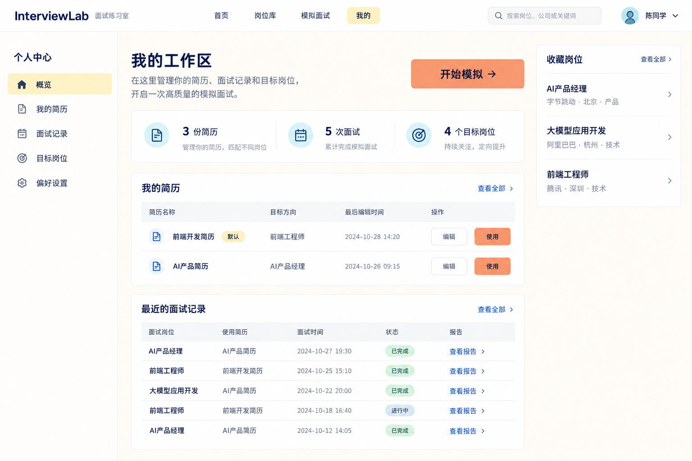
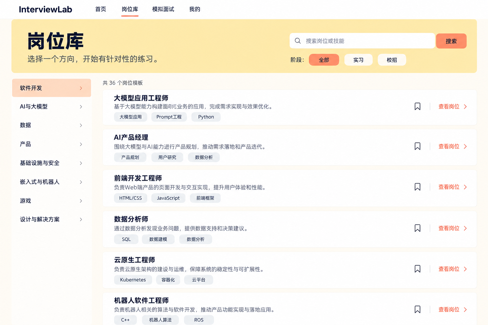
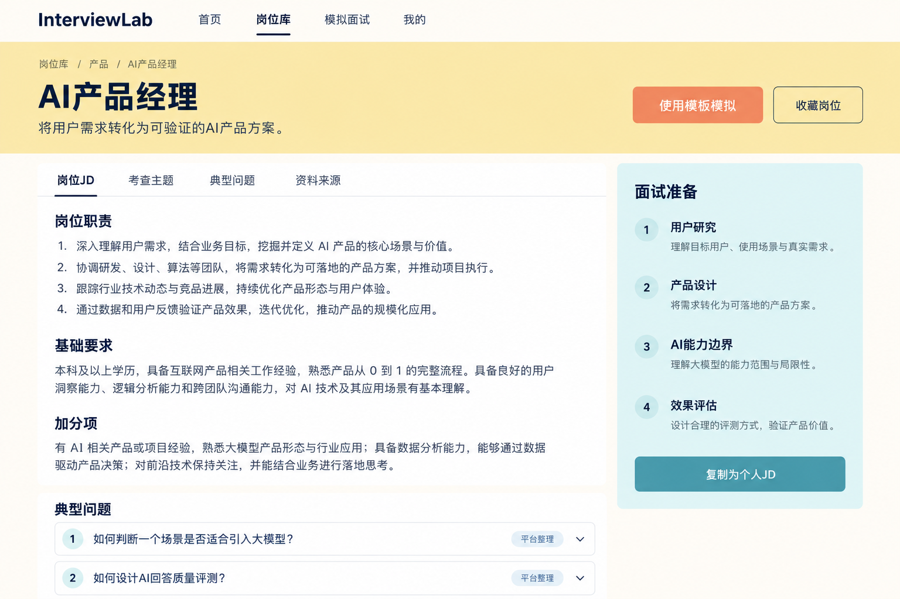

# 个人中心与岗位库参考稿

2026-10-19，使用内置 imagegen，三张图仅作布局参考，页面由真实组件实现。

## personal-workspace-v3

Use case: ui-mockup. Create a high fidelity desktop web UI screenshot for InterviewLab 面试练习室, Chinese university interview practice platform, personal center overview. 1440px wide natural production website. White top navigation brand InterviewLab, 首页 岗位库 模拟面试, 我的. Ivory #FFFCF5 background, pale butter #FBE8A6 selected areas, peach #F4976C action buttons with dark text, pale teal #B4DFE5 accents, navy #303C6C text only. Large readable Chinese sans text, normal 16px body. Left 210px vertical navigation 个人中心, 概览, 我的简历, 面试记录, 目标岗位, 偏好设置. Main heading 我的工作区, peach 开始模拟 button. Modest plain inline counts 3份简历 5次面试 4个目标岗位. Main section 我的简历 two clean document rows 前端开发简历 and AI产品简历 with default badge, target direction, edited date, 编辑 and 使用. Recent interviews simple real table rows with role, resume, time, status, report link. Right narrow column 收藏岗位 simple list AI产品经理, 大模型应用开发, 前端工程师. Professional student friendly mature editorial spacing, restrained borders, no dark sidebar, no tiny microcopy, no gradients, no floating bubbles, no dashboard charts, no gamification, no illustrations.

## jobs-catalog-v3

Use case: ui-mockup. High fidelity screenshot of Chinese InterviewLab 岗位库 page, wide desktop professional recruitment reference library website. White navigation InterviewLab 首页 岗位库 模拟面试 我的. Ivory #FFFCF5 body, warm butter #FBE8A6 header band, peach #F4976C main buttons with dark navy text. Clean Chinese sans 16px body, 36px title 岗位库 with one line subtitle 选择一个方向，开始有针对性的练习. Wide search field 搜索岗位或技能, stage filter 全部 实习 校招. Left column 方向分类 simple navigation 软件开发 AI与大模型 数据 产品 基础设施与安全 嵌入式与机器人 游戏 设计与解决方案. Main two column list of restrained white horizontal role blocks with titles 大模型应用工程师, AI产品经理, 前端开发工程师, 数据分析师, 云原生工程师, 机器人软件工程师. Each has concise one-line responsibilities, 3 skill tags, bookmark outline and 查看岗位 link. Visible results count 36个岗位模板. Shallow 8px rounded borders, spacious typographic hierarchy. No salaries, no company logos, no fake active job vacancies, no purple blue primary, no excessive pill tags or tiny explanatory text, no charts or illustrations.

## job-detail-v3

Use case: ui-mockup. High fidelity desktop Chinese website UI for InterviewLab job template detail AI产品经理. White top navigation InterviewLab 首页 岗位库 模拟面试 我的. Warm pale yellow banner with breadcrumb 岗位库 / 产品 / AI产品经理, 38px navy title AI产品经理, subtitle 将用户需求转化为可验证的AI产品方案. Peach action 使用模板模拟 and outline 收藏岗位. Main white readable article left 2/3: tabs 岗位JD 考查主题 典型问题 资料来源, heading 岗位职责 with 4 clear numbered lines, 基础要求 with normal text, 加分项. Right sidebar pale teal background 面试准备, list 用户研究 产品设计 AI能力边界 效果评估, button 复制为个人JD. Below article visible typical questions grouped as numbered accordion rows 如何判断一个场景是否适合引入大模型？ 如何设计AI回答质量评测？ with small 平台整理 badge. Dark navy is text only, ivory #FFFCF5 page, #FBE8A6 header, #F4976C action, #B4DFE5 supporting. Chinese sans 16px body. Mature normal site with very restrained borders, ample reading space, no decorative illustrations, no overdone cards, no small fonts, no fictitious score or salary.
