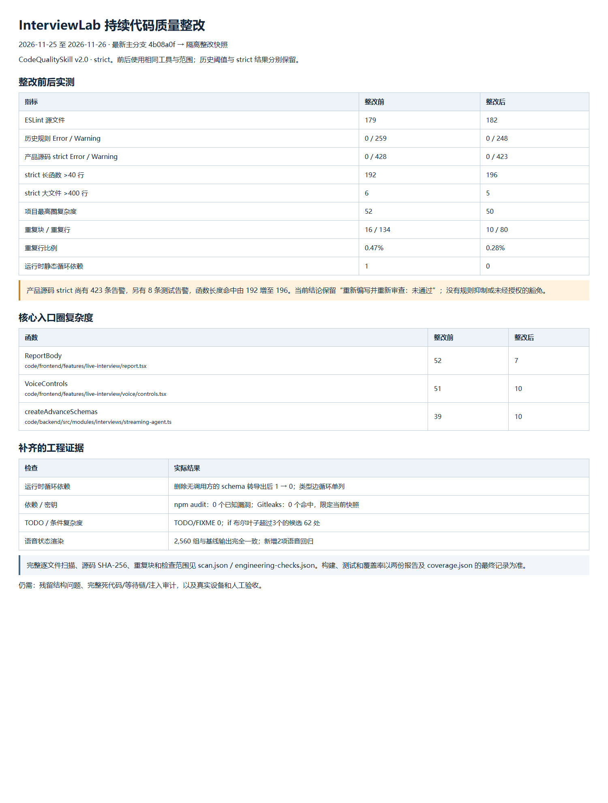
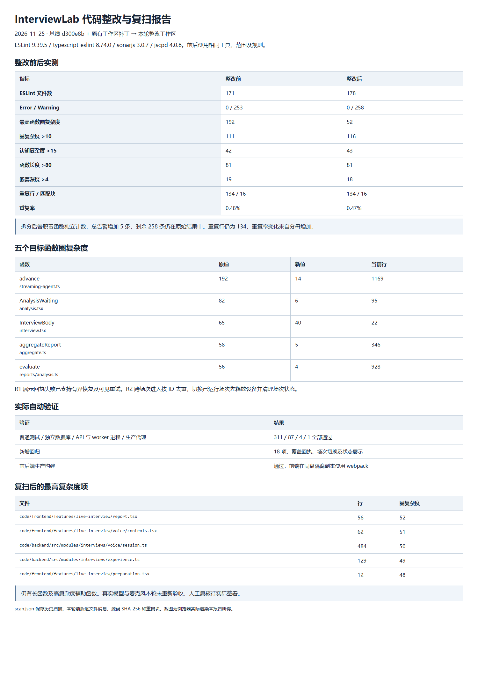

# InterviewLab 代码质量报告

本版 v1.8 最新远端同步与复核见附录 J；v1.7 按用户要求重启本地后端，并使用教师 CodeQualitySkill 复核双入口新增代码，详见附录 I；v1.6 的入口与文案整改保留在附录 H。第 1–4 节及附录 F 的“本轮”专指 v1.5 结构整改快照。**v1.5 全量 423+8 条、v1.6 较大局部范围 25 条和 v1.7 本次局部 11 条对应不同采样范围，不能直接连成下降趋势或冒充最新全项目告警数。**

v1.5 按教师 [CodeQualitySkill v2.0](https://github.com/bettermorn/ACMWDevHubPPT/blob/master/Methodology/CodeQualitySkill.md) 的 strict 模式继续整改，并保留本对话全部前期过程。该轮开始：2026-11-25，完成复验：2026-11-26；基线：最新主分支 `4b08a0f`，含已合并的 PR #54 和随后其他作者的目录/API/检索修复。结构整改结论仍为：**自动回归通过；严格结构复审未通过**，仍有未关闭 Major，没有团队豁免记录。

本轮修改 8 份产品源码、2 份测试和 7 份当前文档入口。检查在隔离工作树执行，排除本轮开始前原有 9 项工作区输入；来源和同步过程见附录 F。旧 253→258 告警及旧测试结果继续保留为历史记录，不作为本轮当前指标。

## 1. 为项目配置至少一个静态分析工具（SonarQube/ESLint/Pylint 任选）

| 工具 | 固定版本 | 本轮实际用途 |
| --- | --- | --- |
| ESLint / typescript-eslint / sonarjs | 9.39.5 / 8.74.0 / 3.0.7 | 错误、未使用变量、圈复杂度、认知复杂度；保留历史规则，另执行 strict 规则 |
| jscpd | 4.0.8 | 同口径重复检测；6 行、50 token、mild 模式；补充低 token 探测并保留局限 |
| 项目 TypeScript | 5.9.3 | 仓库 strict 类型与边界检查；扫描解析器隔离依赖为 6.0.3 |
| c8 / Istanbul | 12.0.0 | 普通及数据库测试合并采样，`--all` 将未加载源码纳入零覆盖；计算本轮插入行覆盖率 |
| Gitleaks | 8.30.1 | 默认规则扫描 469 份当前跟踪/新文件，启用完全脱敏并忽略内联放行标记 |
| npm audit / TypeScript AST | npm 实际审计 / TS 5.9.3 | 依赖漏洞、运行时模块环、TODO/FIXME 和 if 布尔叶子筛查 |

strict 采用函数 ≤40 有效行、CC≤10、认知复杂度≤15、嵌套≤3、参数≤4、单文件≤400 行。ESLint 覆盖 `code/**/*.ts,tsx` 并排除声明文件；jscpd 另含 JS，排除生成目录。前后固定相同工具、范围和规则，附源码 SHA-256。旧规则的函数 80 行、嵌套 4 层只用于历史对照，没有将其冒充 strict。

- [历史同口径配置](../../2026-11-25/followup/eslint.config.mjs)、[strict 配置](../../2026-11-25/followup/followup-strict.config.mjs)
- [前后逐文件结果、源码摘要和问题索引](../../2026-11-25/followup/scan.json)
- [依赖、密钥、模块和 TODO 检查原始证据](../../2026-11-25/followup/engineering-checks.json)
- [覆盖率及本轮插入行明细](../../2026-11-25/followup/coverage.json)
- [可视报告](../../2026-11-25/followup/scan-report.html)、[真实渲染截图](../../2026-11-25/followup/scan-report.png)
- [模块审计复现脚本](../../2026-11-25/followup/audit-modules.cjs)、[条件筛查复现脚本](../../2026-11-25/followup/audit-boolean-conditions.cjs)

## 2. 运行扫描，记录当前 Bug 数、Code Smell 数、圈复杂度、重复率

| 指标 | 本轮整改前 `4b08a0f` | 本轮整改后 |
| --- | ---: | ---: |
| ESLint 文件数 | 179 | 182 |
| Lint Error | 0 | 0 |
| 历史规则 Warning | 259 | 248 |
| 产品源码 strict Warning | 428 | 423 |
| 本轮两份测试 strict Warning（另列） | 未作同口径比较 | 8 |
| strict 长函数 >40 行 | 192 | 196 |
| CC>10 / 认知复杂度>15 | 116 / 44 | 111 / 41 |
| strict 嵌套>3 / 参数>4 | 38 / 32 | 38 / 32 |
| strict 文件>400 行 | 6 | 5 |
| 项目最高圈复杂度 | 52 | 50 |
| 重复块 / 重复行 | 16 / 134 | 10 / 80 |
| 重复行比例 | 0.47% | 0.28% |
| 运行时模块循环 | 1 | 0 |

产品源码当前423条，另对两份新改测试检出8条strict布局/复杂度告警，合计431条，测试项列为T001–T008；两套范围分别披露。Warning 是规则命中数，不是同等数量的功能故障。strict 长函数命中增加 4 条，当前 423 条结构告警仍逐项列入 [代码评审表](code_review.md) 第 5 章 F001–F423；62 条长条件候选列为 B001–B062。本轮未发现新的 Lint Error，未对语义 Bug 总数作穷尽统计。

jscpd 的主对照保留 50 token 过滤，以保证与前期可比；另以 1 token / 6 行运行[原始探测](../../2026-11-25/followup/strict-duplication-probe.json)，算法输出 1363→1396 个重叠候选块。该低 token 结果包含大量短标记/布局匹配，尚未逐块完成业务语义判定，不能将其当作已确认缺陷数。strict 的“零重复”仍未通过，没有靠提高阈值或放行规则将其写成通过。

## 3. 选出 Top 5 最严重问题，逐一重构（先补测试，再重构）

| 本轮优先项 | 实际整改 | 验证与当前状态 |
| --- | --- | --- |
| K1 schema 运行时环，SM-K02 | 删除 `interviews/schemas.ts` 原 141 行无调用方的报告 schema 转导出；既有调用方直接引用报告模块 | 运行时静态及含字面量动态边均 1→0；48 项既有专项通过；类型边循环单列 |
| Q6 报告页职责，SM-B01/SM-C01 | 拆分报告读取/命令、完整报告/打印、逐题复盘与重练；复用建议展示 | `ReportBody` CC 52→7，相关函数最高 10；7 项新视图回归通过；7 条 strict 长函数仍保留 |
| Q7 语音控制，SM-B01/SM-B06 | 分离状态优先级、文案、连接/操作/转写与补充恢复；保留权限及错误提示 | `VoiceControls` CC 51→10；两份源码 strict 0 告警；9 项语音界面测试通过，含 2 项新增；2560 组渲染与基线一致 |
| Q8 出题 schema，SM-B01/SM-C01 | 分离行动、预算、目标、契约和引用构造，保留默认值及字段省略条件 | `createAdvanceSchemas` CC 39→10，新策略函数≤9；320 个字符串/模板片段 AST 内容一致；schema 长函数及历史大文件仍未关闭 |
| Q9 报告事务流程重复，SM-D01 | 复用已有评价上下文、建议/总结登记和源删除锁检查；保留键、摘要、版本和取消边界 | 91 项评分/Agent/响应专项及独立 43 项报告数据库专项通过；全项目同口径重复行 134→80 |

先运行既有 55 项前端及 91 项后端相关回归，再作职责拆分；语音新增用例在拆分前后均通过。报告页新增回归在实现过程中补充，随后根据真实覆盖率补齐完整报告/逐题页面边界，没有将全过程描述为新增用例先红的 TDD。初始语音测试夹具缺少布尔默认值导致断言失败，修正夹具后再验证；不是应用缺陷修复记录。

## 4. 重新扫描，对比重构前后指标变化，形成质量报告

| 验证 | 本轮最终结果 | 范围 |
| --- | --- | --- |
| 普通 / 独立数据库 | 321 / 87，全部通过，0 跳过 | 独立树最新主分支及本轮源码，排除原工作区改动 |
| 合回原工作区后的整体检查 | npm run check 通过，普通 328/328、0 跳过；文档59份/527本地链接 | 包含原有输入，和隔离树321项分别记录，不相加 |
| API/worker 进程 / 生产代理 | 4 / 1，全部通过 | 专用测试库，代理使用隔离构建与独立本机端口 |
| 边界、类型、内容、前后端生产构建 | 通过 | 前端在同盘隔离副本执行 `next build --webpack` |
| 本轮新增/修改行覆盖 | **86.07%（921/1070）** | 对 `4b08a0f` 插入的 TS/TSX/JS 行，与 Istanbul 行覆盖逐行映射，达到 TH-09 的 80% |
| 全源码 / core_engine 行覆盖 | 70.91% / 75.14% | `--all` 采样；与历史 71.65% 的日期、工具和范围不同，不能直接比较 |
| 依赖 / 当前快照密钥 | 已知漏洞 0 / Gitleaks 命中 0 | 不包含私有忽略文件、Git 全历史或完整注入审计 |
| 模块图 / TODO/FIXME | 运行时环 0 / 标记 0 | 静态模块及字面量动态导入；对象循环、内存和数据库等待链不在该工具范围 |

首次 Node 原生合并采样在测试断言全通过后，因 `Cannot read properties of undefined (reading 'line')` 生成覆盖率失败；改用临时 c8 后完成采样。第一次生产代理验证的默认 3001 端口被既有服务占用，改用独立端口重建后 1/1 通过，没有停止正在运行的服务。构建、回归、采样和修正过程分别记录，没有把采样失败写成应用通过。



按 strict 仍有 423 条结构告警及未完成的人工判断，源代码改动合计 1919 行，超过 TH-11 建议的 400 行小批门槛；未授权豁免，也尚未分批提交。当前“代码质量较好：否；重新编写并重新审查：未通过”。自动回归通过与严格结构/人工验收分别记录，已验证功能不因报告状态被写成不可用。

## 附录 A. 全过程与 S0–S6 对应记录

### 规范化工作的阶段记录

| 阶段与时间 | 实际完成的工作 | 输出与证据 |
| --- | --- | --- |
| 课件对照与范围确定，2026-11-15 至 16 日 | 通读《SWIEP软件工程》297 页课件，对照现有需求、架构、管理、测试和运行资料。以现有项目和已确认规范为准，已有实践复用证据，确认差距后补齐 | 首次审查发现时长、评分及验收说明漂移，质量扫描和评审证据待补 |
| 首次工程核查，2026-11-15 至 16 日 | 普通测试 286/286、前后端构建通过；历史行覆盖采样 71.65%。当时 Docker 未运行，独立数据库/进程/代理未在本地重跑 | 初始文档检查 55 份 Markdown、444 个本地链接；已有 CI 流程及实际成功记录经核对 |
| 远端核对及同步，2026-11-16 | 只读查询确认 `codex/all-role-agent` 仍为 `bb545a3`，远端 `main` 为 `f10d7e1`，多一个合并提交但文件相同。随后执行 fetch、确认可快进并 merge --ff-only，保留两份管理文档原有改动 | 本地更新到 `f10d7e1`，工作区管理计划内容保留 |
| 规格与证据补齐，2026-11-16 | 修正时长、题量、硬上限、类型、评分兼容、模型验收入口、个人 Compose 及迁移影响；整理十项需求与测试映射，新增课程所需文档入口 | 十五个文件进入 `ce88b1c`，文档检查 59 份、476 个本地链接通过 |
| 管理计划及提交交付，2026-11-16 | 复核原有 11 月 12 日沟通与风险修订，按实际内容纳入独立提交 `44dce33`；规范资料另提交 `ce88b1c`，随后推送当前分支 | [管理计划提交](https://github.com/hcxlwxlwj/InterviewLab/commit/44dce33) · [规格及证据提交](https://github.com/hcxlwxlwj/InterviewLab/commit/ce88b1c) |
| 合并状态观察，2026-11-25 | 当前 HEAD 已为 PR #52 合并提交 `d300e8b`。记录该状态，规范化工作中的提交、推送记录沿用上述证据 | `f10d7e1` 与 `d300e8b` 的 `code` 源码树相同；PR 合并由既有 Git 历史证明 |
| 教师模板落实及首次扫描，2026-11-25 | 读取教师任务、质量方法和评审模板，固定工具与规则，扫描三份历史快照，填写逐项评审。首次工作区普通测试 293/293，四份核心源码的直接验证 13/13 | 已提交基线扫描 Warning 253，发现 R1、R2 和 R3–R5 关注项，生成 JSON、HTML、截图 |
| 源码整改与复验，2026-11-25 | 处理五个复杂入口、展示回执及跨场次隔离，补十八项回归，执行普通、数据库、进程、代理和构建验证并复扫 | 六份既有源码及七份新增源码，最终 311/87/4/1 测试结果；指标和处理记录见正文 |

此前查询过 PR #49、#50、#51 的正式 review，2026-11-16 查询时三项为空；当前人工评审状态没有据此推定。已有 CI 的实际运行记录保留供复核。[历史 CI](https://github.com/hcxlwxlwj/InterviewLab/actions/runs/42815967950)

### S0–S6 实施映射

| 方法步骤 | 本项目对应实践 | 当前证据及限制 |
| --- | --- | --- |
| S0 评审准备 | 读取课件和模板，确定当前规格、Git 基线、原有工作区改动与具体文件范围 | 源码版本、已有改动补丁、完整变更清单均有记录 |
| S1 编码前约束 | 核对工作区 AGENTS、架构与接口要求，复用现有 API、任务、取消和评分合同 | 保留历史读取、同源认证、幂等和发布前校验；现有规格修订可追踪 |
| S2 编码中规则 | 围绕具体职责提取共享逻辑，限制修改到确认的问题及其调用和回归 | 六份既有源码、七份职责文件，未关闭扫描规则 |
| S3 坏味道自检 | 静态扫描与代码阅读结合，确认流程缺陷并给出 Top 5 | R1/R2 已整改，R3 合同边界记录，复杂度残留继续跟踪 |
| S4 自动检查 | 类型、边界、内容、普通测试、独立数据库、进程、代理及前后端构建 | 311/311、87/87、4/4、1/1 及构建通过，实际范围列于正文 |
| S5 填写评审模板 | 按教师 0–6 章逐项填写结果、说明、行号及处理状态 | 辅助评审有证据，人工复核人与签署待实际记录 |
| S6 修复并回归 | 对确认缺陷和高复杂度职责做调整，以相同规则复扫和回归 | 原最高复杂度 192 降至 52；告警 253 增至 258，新增测试的先红后绿记录缺失 |

## 附录 B. 全部变更文件清单

### 2026-11-16 的管理与规范资料

| 提交 | 文件 | 实际调整 |
| --- | --- | --- |
| `44dce33` | `docs/mgmt/communication_mgmt_plan.md` | 纳入已存在的 11 月 12 日修订，明确沟通内容、频率、方式、产出及责任角色 |
| `44dce33` | `docs/mgmt/risk_mgmt_plan.md` | 纳入已存在的 11 月 12 日修订，补风险分级、触发信号、跟踪频率和 API 额度预案 |
| `ce88b1c` | `docs/requirements/problem_definition.md` | 同步实际面试配置、范围和账号说明 |
| `ce88b1c` | `docs/requirements/functional_spec.md` | 同步时长、题量、硬上限、类型与评分版本 |
| `ce88b1c` | `docs/requirements/nonfunctional_spec.md` | 同步当前默认行为及资源、时间约束 |
| `ce88b1c` | `docs/requirements/user_stories.md` | 更新可执行场景，标明偏好复用的实现差距 |
| `ce88b1c` | `docs/algorithm/knowledge_and_agent.md` | 区分当前六维、HR、重练和历史评分 |
| `ce88b1c` | `docs/algorithm/evaluation.md` | 修正验收入口与当前脚本说明，保留历史模型结果及不足 |
| `ce88b1c` | `docs/software/data_and_interfaces.md` | 同步新建配置、预算与评分合同边界 |
| `ce88b1c` | `docs/software/development.md` | 澄清完整启动方式、个人入口及迁移影响 |
| `ce88b1c` | `docs/software/personal-materials-implementation.md` | 标记实际读取的简历、风格及尚未接入的偏好 |
| `ce88b1c` | `docs/software/README.md` | 增加质量、评审、部署文档导航 |
| `ce88b1c` | `docs/software/code_quality.md` | 建立质量基线，本轮按教师任务补充扫描和整改全过程 |
| `ce88b1c` | `docs/software/code_review.md` | 建立评审证据，本轮按教师模板填写并复核整改 |
| `ce88b1c` | `docs/software/deployment.md` | 汇总启动、迁移、备份恢复和回退检查项及实际状态 |
| `ce88b1c` | `tests/README.md` | 整理十项核心用例及需求、源码映射 |
| `ce88b1c` | `tests/interviewlab_demo_user_test.md` | 建立交叉试用任务及待执行记录 |

### 2026-11-25 的源码整改

| 类别 | 文件 | 实际调整 |
| --- | --- | --- |
| 修改既有源码 | `code/backend/src/modules/interviews/streaming-agent.ts` | 拆分出题目标、输入、输出及流式校验职责 |
| 修改既有源码 | `code/backend/src/modules/reports/aggregate.ts` | 拆分各版本证据与评分汇总 |
| 修改既有源码 | `code/backend/src/modules/reports/analysis.ts` | 拆分评价证据、schema、输入及结果解码 |
| 修改既有源码 | `code/frontend/features/live-interview/analysis.tsx` | 分离进度展示与恢复动作 |
| 修改既有源码 | `code/frontend/features/live-interview/interview.tsx` | 接入可恢复展示回执并拆分展示和通知 |
| 修改既有源码 | `code/frontend/features/live-interview/flow-provider.tsx` | 接入场次隔离及集中设备生命周期 |
| 新增源码 | `code/frontend/features/live-interview/analysis-state.ts` | 计算报告真实阶段、进度及文案 |
| 新增源码 | `code/frontend/features/live-interview/entry-request.ts` | 同场去重、跨场取消和已运行场次隔离 |
| 新增源码 | `code/frontend/features/live-interview/interview-notices.tsx` | 进度、续答及生成恢复提示 |
| 新增源码 | `code/frontend/features/live-interview/interview-presentation.ts` | 问题展示、计时和工作区数据投影 |
| 新增源码 | `code/frontend/features/live-interview/presentation-request.ts` | 展示回执确认、有界重试及幂等恢复 |
| 新增源码 | `code/frontend/features/live-interview/use-prepared-devices.ts` | 媒体准备、缓存与迟到授权释放 |
| 新增源码 | `code/frontend/features/live-interview/use-question-presentation.ts` | 题目展示确认、失败提示和手动重试 |

五份新增测试和十八项用例见第 3 节。报告附件共五项，分别为本轮已有改动补丁、ESLint 配置、扫描 JSON、可视 HTML 和 PNG 截图，均在第 1 节提供链接。

本轮开始前已有九项文件改动保持原来源，覆盖 `setup-state.ts`、`setup.tsx`、`lib/api/interviews.ts`、前端 `package.json`、根 `package-lock.json`、`architecture.md`、`repository_structure.md`、`interview-setup.test.ts` 和 `interview-jobs-client.test.ts`。这些改动属于工作区基线，测试和扫描的包含范围已说明。

## 附录 C. 历史对照与复现

`9546bf5 → 93d05fc` 为既有历史职责拆分及同期功能调整。其 `InterviewBody` 圈复杂度曾由 83 降为 65，认知复杂度由 56 降为 45；整体 Warning 206 增至 250，重复率 0.69% 变为 0.48%。该记录用于理解代码演进，保留原始版本及指标。[历史修改](https://github.com/hcxlwxlwj/InterviewLab/commit/93d05fc)

复现时，在独立临时目录安装固定工具并复制本报告规则。整改前由 `git archive d300e8b code` 导出源码后应用附件工作区补丁得到。整改后使用当前 Git 已跟踪及未忽略源码，保存文件清单与 SHA-256 后扫描。工具目录 `$scanRoot` 和源码副本目录由执行者显式选定。

```powershell
npm install --prefix $scanRoot --no-audit --no-fund --save-exact eslint@9.39.5 typescript-eslint@8.74.0 eslint-plugin-sonarjs@3.0.7 jscpd@4.0.8 typescript@6.0.3
# 从仓库复制 docs/software/quality/2026-11-25/eslint.config.mjs 到工具目录。
# 在相应源码副本目录执行以下命令。
node "$scanRoot/node_modules/eslint/bin/eslint.js" --config "$scanRoot/eslint.config.mjs" --format json --output-file "$scanRoot/eslint-result.json" --no-warn-ignored 'code/**/*.ts' 'code/**/*.tsx'
node "$scanRoot/node_modules/jscpd/bin/jscpd" code --pattern '**/*.{ts,tsx,js}' --format typescript,tsx,javascript --max-lines 100000 --max-size 5mb --min-lines 6 --min-tokens 50 --reporters json --output "$scanRoot/duplication" --ignore '**/*.d.ts,**/dist/**,**/.next/**'
```
## 附录 D. 本轮归档

按用户要求，本轮 13 份整改源码、5 份新增测试、两份完整报告与 5 份扫描附件同批提交，提交号以 Git 历史为准。报告中的测试与复扫仍对应其明示的工作区输入基线。

## 附录 E. PR #54 的提交复验与集成检查

2026-11-25，本轮整改及报告以 `5bfb56d` 提交，推送至 `codex/all-role-agent` 并创建 [PR #54](https://github.com/hcxlwxlwj/InterviewLab/pull/54)。独立检出该提交，复用本地依赖且不包含原工作区 9 项未提交改动，`npm run check` 通过：普通测试 304/304、0 跳过，文档 59 份、508 个本地链接。这与此前包含既有改动的工作区 311 项测试属于不同输入。

随后 PR 的 `application (pull_request)` 失败，而同一分支的 `application (push)` 已通过。[失败日志](https://github.com/hcxlwxlwj/InterviewLab/actions/runs/45633138412/job/139271399599)显示，GitHub 验证的是 `5bfb56d` 与最新主分支 `2205b2e` 的合并结果 `55620a2`。新增岗位目录检查中，`publishedJobs` 是 `JobTemplate[]`，返回统计却使用了 `publishedJobs.size`，触发 TS2339。

在隔离工作树合入 `origin/main` 后，先运行 `npm run typecheck` 复现同一错误，再修正 `.github/scripts/check-content.ts:376`：

```diff
-    templates: publishedJobs.size,
+    templates: publishedJobs.length,
```

修复后重新运行 `npm run check`，边界、类型、内容检查和普通测试 311/311 全部通过，0 失败、0 跳过；文档 59 份、508 个本地链接通过。此处 311 项由独立提交的 304 项加主分支新增加的 7 项组成，不包含原工作区 9 项改动。内容检查实际统计为 1269 个已发布岗位、10148 道活跃主问题和 1962 个来源。

首轮集成修复仅更正统计字段，未更改岗位内容及校验断言。此前 ESLint/重复检测结果仍对应附件中的原采样快照；本次未重新计算全项目质量指标或覆盖率。云端检查的最终结果以 PR 中对应提交的 Actions 记录为准。

上述修复推送后，`03a41dd` 的 push 和 pull_request 应用检查均通过，包含生产构建；文档检查也通过。随后[数据库检查日志](https://github.com/hcxlwxlwj/InterviewLab/actions/runs/45633817945/job/139273804101)暴露第二项集成差距：87 项中 86 项通过，全岗位知识检索测试仍断言 HR 结果只能是 `job_profile` 或 `interview_method`。新目录已有明确适用于 HR 的问题，例如 `public-interview-fe-c003` 的类型为 `hr/mixed`，HR 检索返回 `question` 符合当前合同。

在新建专用 `interviewlab_test_pr54_*` 数据库中先复现旧断言失败，再更新 `tests/integration/database/all-role-knowledge.test.ts`：HR 可返回问题，但每条结果的数据库 binding 必须同时匹配发布版本、片段、岗位、招聘阶段和面试类型；返回 DTO 的 `types` 也必须包含当前类型，并显式禁止 `evaluation_reference`。该调整加强适用边界，不改生产检索逻辑。修复后全量数据库测试 87/87、进程测试 4/4 通过，0 失败、0 跳过，后端生产构建通过。


## 附录 F. v1.5 持续整改与 Skill 执行台账

| 阶段 | 本轮输入、动作与产出 |
| --- | --- |
| S0 | 明确评审对象为最新 `4b08a0f` 后的 8 份源码、2 份测试；加载教师原模板，保留原检查项；strict 为默认值 |
| S1 | 阅读架构、接口、相邻实现和 Next 本地文档，搜索复用能力；先跑相关已有测试并对最新纯主分支留扫描基线 |
| S2 | 按 K1、Q6–Q9 小问题拆分职责，不新增业务依赖，不改变公开 API、评分、提示文本或事务边界 |
| S3 | 按 Blocker/Critical/结构顺序复核；确认并消除运行时环；严格指标与原有规则分别扫描，逐条保留未关闭项 |
| S4 | 边界/类型/内容、构建、321 普通/87 数据库/4 进程/1 代理、c8、依赖和密钥检查；未执行检查明确标为未知 |
| S5 | 更新本报告四项任务及评审原表；附 strict 全量索引、输入摘要、截图与检查范围；不代替人工签署 |
| S6 | 第 1 轮职责拆分；第 2 轮按 strict 修正局部结构并补实测覆盖；第 3 轮独立复核和总验。残留 Major 按 Skill 最多 3 轮保留未通过，未作未经授权的豁免 |

新增源码为 `report-overview.tsx`、`report-practice.tsx`、`voice/call-presentation.ts`；既有源码为 `report.tsx`、`voice/controls.tsx`、`interviews/schemas.ts`、`interviews/streaming-agent.ts`、`reports/service.ts`。测试为新增 `report-pages.test.ts` 7 项、更新 `voice-interface.test.ts` 新增 2 项。完整前序源码、文档和提交清单见附录 A–E 及评审附录 A。

当前入口文档同步到 1269 岗位、10148 道活跃主问题、独立 48 道补充题、98 道课程题、1962 个来源；原始 8000 条主问题记录及历史验收数字保留其含义。修正 `README.md`、后端 README、测试 README、功能需求、问题定义、Agent 方法及架构两处当前数量；补清真实 HTTP、浏览器打印 PDF、文字 PDF/TXT 提取与 OCR/源文件存储边界。

`94e556f` 为已存在的 PR #54 合并，`49fc03d` 为随后其他作者的目录/API/检索修复，均不计作本轮原创整改。同步时两份依赖文件与原有改动重叠，先备份并暂存到可恢复 stash，再快进并恢复原文件；原 9 份文件内容在同步后逐字节核对一致。前端版本已被远端吸收，其他既有输入继续保留。架构仅在原有效修改基础上合入上述两处数量修正，不整份覆盖。

覆盖率采用同一产品源码快照的 c8 数据库/普通联合采样，再追加 3 项真实视图测试后复用数据库样本并重跑全部 321 项普通测试；生产源码 SHA-256 保持一致。覆盖率工具与扫描器仅在临时目录安装，未写入业务依赖。本轮尚未提交或推送，也未创建新的 PR；新增源码及附件的版本归档状态在评审表如实保留。

剩余事项：strict 长函数/复杂度/重复等结构问题；完整未使用导出/死代码、注入、等待链、日志与长时资源审计；真实模型和设备、交叉用户试用、专业评分校准、发布恢复及人工评审；团队 develop/main 流程与人员确认。工具“未发现”只在已记录的范围内成立。

## 附录 G. 首轮四项质量任务完整记录（历史归档）

以下保留 v1.4 之前的原始任务正文，版本、工作区输入与数字均属于当时阶段；本轮当前值以前四节及附录 F 为准。

### InterviewLab 代码质量报告

项目为面向高校学生的岗位模拟面试与复盘应用。本报告覆盖 2026-11-15 至 2026-11-25 的课件规范核对、版本同步、文档补齐、扫描、缺陷整改和回归复查。源码整改基线为 `d300e8b` 加本轮开始前已有的工作区改动，整改后版本以附件源码清单和 SHA-256 标识。提交后的独立复验及 PR 合并检查修复另记于附录 E，原扫描数据保留其采样版本。

教师第 171、172 页将代码质量工作规定为下列四项任务。质量报告按其任务顺序组织，评审表另按教师《Code Review 模板》逐项填写；所参考的 Code Quality Skill 的 S0–S6 对应记录见附录 A。[课程任务 171](https://bettermorn.github.io/IntelligentSWEPractice/courseware/171) · [课程任务 172](https://bettermorn.github.io/IntelligentSWEPractice/courseware/172) · [教师质量检查方法](https://github.com/bettermorn/ACMWDevHubPPT/blob/master/Methodology/CodeQualitySkill.md) · [代码评审记录](code_review.md)

#### 1. 为项目配置至少一个静态分析工具（SonarQube/ESLint/Pylint 任选）

本轮选择 ESLint，并配合 TypeScript、sonarjs 和 jscpd。规则及原始结果随报告保存。扫描在临时工具目录及隔离源码副本执行，常规 CI 尚未调用这份扫描配置。

| 工具 | 固定版本 | 实际检查内容 |
| --- | --- | --- |
| ESLint | 9.39.5 | 不可达代码、恒定条件、重复分支、循环方向、类型比较；函数圈复杂度、函数长度和嵌套 |
| typescript-eslint | 8.74.0 | TypeScript / TSX 解析及未使用变量 |
| eslint-plugin-sonarjs | 3.0.7 | 认知复杂度和相同表达式 |
| jscpd | 4.0.8 | mild 模式下，至少 6 行且至少 50 token 的重复片段 |
| TypeScript | 工作区 5.9.3；隔离解析依赖 6.0.3 | 工作区配置用于类型检查，隔离依赖用于解析源码 |
| 项目自带检查 | `npm run check` | 模块依赖边界、类型、岗位内容、普通测试和文档链接 |

ESLint 检查 `code/**/*.ts` 和 `code/**/*.tsx`，排除 `.d.ts`。jscpd 另包含 `.js`，排除声明、`dist` 和 `.next`，最大文件 5 MB、最大行数 100000，覆盖当前最长文件。整改后 ESLint 检查 178 个文件，重复检测共 179 个源码文件。jscpd 的 213 个 format source 项包含 TSX 中同文件的不同语言片段。

本轮固定筛查阈值为圈复杂度 >10、认知复杂度 >15、函数有效行数 >80、嵌套深度 >4。有效行数排除空行和注释。整改前后沿用同一配置。教师参考 Skill 的严格阈值还包含函数 40 行、嵌套 3 层、参数个数等项目，这些严格项仍需进一步统计和复核。

| 扫描范围 | 版本标识与来源 |
| --- | --- |
| 早期已提交基线 | `d300e8b`，原始扫描位于 JSON 的 `scans.current` |
| 整改前工作区 | `d300e8b` 加已有配置页、默认值及岗位客户端三份源文件改动，位于 `remediation.before` |
| 整改后工作区 | 在相同基线上修改六份既有源文件、增加七份职责明确的源文件，位于 `remediation.after` |
| 历史职责拆分对照 | `9546bf5 → 93d05fc`，位于 `scans.before`、`scans.after` |

整改前后均包含原有的三份源文件改动，前后比较的起点一致。附件同时保留其补丁、各文件清单和 SHA-256，支持核查实际输入。

- [固定 ESLint 配置](../../2026-11-25/eslint.config.mjs)
- [整改前原有工作区补丁](../../2026-11-25/baseline-workspace.patch)
- [完整扫描与验证数据](../../2026-11-25/scan.json)
- [浏览器扫描报告](../../2026-11-25/scan-report.html)
- [实际报告截图](../../2026-11-25/scan-report.png)

#### 2. 运行扫描，记录当前 Bug 数、Code Smell 数、圈复杂度、重复率

2026-11-25 首次扫描已提交基线得到 Error 0、Warning 253、最高函数圈复杂度 192、重复率 0.48%。整改前工作区复扫仍为这些数值，重复检测行分母随已有源文件改动发生变化。下表记录真正用于本轮前后对比的整改前工作区数据。

| 指标 | 整改前实测 | 口径 |
| --- | ---: | --- |
| Bug 类规则 Error | 0 | 仅表示本配置的错误级规则未命中 |
| Code Smell 类 Warning | 253 | 规则命中次数之和，同一函数可以命中多项 |
| 圈复杂度 >10 | 111 | ESLint 函数圈复杂度告警 |
| 认知复杂度 >15 | 42 | sonarjs 的独立度量 |
| 函数有效行数 >80 | 81 | 长函数告警 |
| 嵌套深度 >4 | 19 | 深层嵌套告警 |
| 最高函数圈复杂度 | 192 | 动态出题 `advance` |
| 重复匹配块 | 16 | 需要结合语义判断的候选重复片段 |
| 重复行 / 行统计分母 | 134 / 27827 | 工具的格式化语言片段行统计 |
| 重复率 | 0.48% | 保留工具输出的两位小数 |

辅助代码评审进一步确认了展示回执失败恢复和跨场次进入隔离两类流程缺陷。HTTP 成功 DTO 的运行时校验被列为合同边界关注项，处理结论见下一节。扫描和人工发现分别按其来源记录。

##### 扫描报告截图

下图来自浏览器实际渲染附件报告的页面，展示整改前后数据和 Top 5 函数变化。截图数据可以与 `scan.json` 的 `remediation.before`、`remediation.after` 和 `functionComparisons` 逐项核对。



#### 3. 选出 Top 5 最严重问题，逐一重构（先补测试，再重构）

本轮先运行已有动态出题、报告和评分专项回归，随后围绕高复杂度入口整理职责，并在整改期间新增 18 项回归。新增用例未保留源码修改前的失败运行记录，因此“先补测试、再重构”的严格顺序证据仍不完整。已有回归的前后结果、最终新增用例和源码前后扫描均已记录。

##### Top 5 高复杂度入口整改

以下五项按整改前圈复杂度排序。业务规则、模型输出约束和评分版本保持原调用路径可追踪，具体变更文件见附录 B。

| 编号 | 原文件与函数 | 圈复杂度前 → 后 | 职责调整及复核结果 |
| --- | --- | ---: | --- |
| Q1 | `code/backend/src/modules/interviews/streaming-agent.ts`，`advance` | 192 → 14 | 拆分目标规划、schema、提示输入、预览校验、记忆、问题与检索结果构造。入口处理编排及错误，规划/schema 辅助函数仍有告警 |
| Q2 | `code/frontend/features/live-interview/analysis.tsx`，`AnalysisWaiting` | 82 → 6 | 提取 `analysis-state.ts` 计算真实进度与文案；恢复操作、部分结果导航分为小组件。相关函数最高 9，本范围扫描零告警 |
| Q3 | `code/frontend/features/live-interview/interview.tsx`，`InterviewBody` | 65 → 40 | 提取展示回执、页面展示模型、进度和生成通知，修复回执失败恢复。认知复杂度告警消除，圈复杂度与长函数告警仍在 |
| Q4 | `code/backend/src/modules/reports/aggregate.ts`，`aggregateReport` | 58 → 5 | 分离证据汇总、历史分数、BARS 和当前逐题评分；新增辅助函数最高 10 |
| Q5 | `code/backend/src/modules/reports/analysis.ts`，`evaluate` | 56 → 4 | 分离证据准备、输出 schema、模型输入与结果解码，发布前仍执行证据校验；新增辅助函数最高 10 |

进入流程另将媒体准备及释放集中到 `use-prepared-devices.ts`，Provider 有效行数从 307 降至 284，仍有长函数告警。提示文本经过额外 AST 对照，报告模块九段长提示及指令与原版本一致，动态出题的已有文字和系统模板也逐项核对。

##### 流程缺陷整改

| 编号 | 原问题与风险 | 处理结果 | 对应回归 |
| --- | --- | --- | --- |
| R1 | 展示回执发送前即标记已确认，失败后空 catch，页面无法再尝试确认实际展示时间 | 请求成功或权威状态确认后才记为完成；最多自动重试一次。相同输入复用幂等键，版本变化使用新键；持续失败显示手动重试入口，换题及取消后停止后续尝试 | 五项用例，覆盖丢响应、同版本重试、版本变化、持续失败和取消/暂停/换题 |
| R2 | 在途进入操作跨场次共享 Promise，运行中场次的设备与文字降级状态也可能被下一场复用 | 同场次共享在途工作，切换场次先失效旧代、释放媒体、清除绑定及草稿、重置降级状态，再准备新场次。独立记录已进入场次，覆盖旧工作已完成的切换 | 四项用例，覆盖同场共享、跨场切换、旧失败不清新任务、运行后切换先释放设备 |
| R3 | HTTP 成功 DTO 的校验责任描述不清 | 明确统一客户端负责传输、超时及错误，成功 DTO 合同由服务端 Zod 响应模式与接口约束控制，保留现有泛型类型检查。完整前端运行时 DTO 校验尚未增加 | 普通 HTTP 测试与生产代理回归通过，后续按接口版本风险复核 |

##### 新增回归清单

| 文件 | 新增用例数 | 覆盖行为 |
| --- | ---: | --- |
| `tests/unit/presentation-request.test.ts` | 5 | 回执丢失恢复、有界重试、幂等键、取消及题目变更 |
| `tests/unit/entry-request.test.ts` | 4 | 同场去重、不同场次取消旧工作、旧任务隔离、已运行场次切换 |
| `tests/unit/analysis-state.test.ts` | 3 | 部分失败仍继续、历史与空回答、读失败时优先重连 |
| `tests/unit/interview-notices.test.ts` | 3 | 补充作答、生成失败恢复和已有结果提示 |
| `tests/unit/interview-presentation.test.ts` | 3 | 展示模型、历史记录及计时和问题呈现 |
| 合计 | 18 | 最终均纳入普通测试 |

#### 4. 重新扫描，对比重构前后指标变化，形成质量报告

##### 同口径复扫结果

| 指标 | 整改前工作区 | 整改后工作区 | 变化解释 |
| --- | ---: | ---: | --- |
| ESLint 文件数 | 171 | 178 | 新增七份源文件 |
| Bug 类规则 Error | 0 | 0 | 业务时序缺陷通过专项用例验证 |
| Code Smell 类 Warning | 253 | 258 | 规则命中次数净增五条，拆出的函数也分别计数 |
| 圈复杂度 >10 | 111 | 116 | 包含仍超过阈值的规划/schema 等辅助函数 |
| 认知复杂度 >15 | 42 | 43 | 继续按 sonarjs 口径计数 |
| 函数有效行数 >80 | 81 | 81 | 长函数仍需继续整理 |
| 嵌套深度 >4 | 19 | 18 | 同一规则复扫 |
| 最高函数圈复杂度 | 192 | 52 | 当前最高为 `report.tsx` 的 `ReportBody` |
| 重复匹配块 | 16 | 16 | 候选重复片段仍需按语义逐条复核 |
| 重复行 | 134 | 134 | 重复行数保持相同 |
| jscpd 行统计分母 | 27827 | 28404 | 源码与嵌入语言片段的行统计增长 |
| 重复率 | 0.48% | 0.47% | 比例变化来自分母增长 |

五个原高复杂度入口的职责已整理，最高单函数复杂度下降。告警总数仍为 258，Q1 部分辅助函数、Q3 页面及 Provider 仍有告警。当前最高五处为 `ReportBody` 52、`VoiceControls` 51、语音会话回调 50、`experiencePolicy` 49、`PreparationScreen` 48，后续依据业务风险继续处理。

##### 实际回归与构建结果

| 检查 | 整改后的实际结果 |
| --- | --- |
| `npm run check` | 普通测试 311/311 通过，无跳过；依赖边界、类型、内容与文档检查通过 |
| 动态出题专项 | 修改前后 87/87 通过 |
| 报告及评分专项 | 修改前后 78/78 通过 |
| 独立 PostgreSQL / pgvector 数据库回归 | 87/87 通过，无跳过 |
| API / worker 编译产物进程回归 | 4/4 通过 |
| 生产 Next.js 代理回归 | 1/1 通过，覆盖 Cookie、Origin、错误、查询参数与流 |
| 后端构建 | `npm run build:backend` 通过 |
| 前端生产构建 | 同盘隔离副本执行 `next build --webpack` 通过，类型检查与静态页面生成通过 |
| 文档检查与模板整理后复核 | 59 份 Markdown、504 个本地链接均通过 |
| 真实模型、麦克风和人工同伴签署 | 本轮尚未重新验收，继续按[评测](../../../../algorithm/evaluation.md)和评审表记录 |

数据库验证使用本轮新建的独立 `interviewlab_test_quality_*` 数据库。前端构建与代理验证在同盘临时副本执行。首次跨盘副本遇到 Windows 路径解析失败，调整到同盘副本后复验通过。

##### 持续跟踪项

- 258 条静态告警和 134 行候选重复片段继续保留，后续修改应复扫并说明实际变化。
- 历史行覆盖采样为 71.65%，未包含独立数据库回归。合并数据库回归后的核心逻辑覆盖率仍待统计。
- 完整循环依赖、全量死代码、高危依赖及密钥专项扫描尚未完成。现有边界检查和本轮代码阅读提供局部证据。
- 真实模型效果、麦克风与供应商端到端体验、人工评审签署按实际结果补充。
- 本报告静态配置尚未接入日常 CI，后续接入需保留相同规则与前后基线。
- 临时测试产物的自动清理曾被自动审批拒绝，返回 `blocked by policy`，对应产物保留。

## 附录 H. v1.6 岗位入口与提示文案整改（2026-11-26）

本次按用户截图确认两项体验问题，仅修改对应入口、配置和文案，并补充回归。初稿曾将所有入口统一到岗位库并完成 334 项普通测试；用户随后明确保留导航入口的岗位下拉，最终采用下述双入口方案。简历区精简继续保留。沿用教师四项任务顺序记录，v1.5 原扫描配置、数据、截图和未关闭项保持原采样范围。

### 1. 工具与检查范围

复用仓库 `npm run check` 的边界、类型、内容、普通测试和文档检查，并在同盘隔离副本执行前端生产构建。沿用 v1.5 固定工具与 strict 阈值，扫描范围包含本次涉及的 15 份产品 TS/TSX 和 2 份测试，其中 6 份导航文件已恢复原通用入口，CSS 不纳入 ESLint；最终净修改为 9 份产品 TS/TSX、1 份 CSS 及 2 份测试。双入口方案的测试、构建及[范围扫描](../../2026-11-26/interview-setup/scan.json)已完成，逐文件结果、行号与源码SHA-256已归档。本次未重新执行全量 strict 扫描、重复率或覆盖率采样，因此不填写新的全项目指标。

### 2. 确认的问题与整改前后对比

| 编号 | 整改前 | 整改后与证据 |
| --- | --- | --- |
| UI-01 面试入口 | 配置页不区分入口，已在岗位库明确选择岗位后仍出现全量下拉；旧配置可能覆盖本次明确选择的岗位 | 通用“模拟面试/开始面试”进入 `/interview/setup`，保留岗位下拉，优先恢复原岗位，否则选可用默认岗位。岗位详情、已保存岗位及已知岗位的重新面试入口携带 `?job={id}`，只读取并固定展示所选岗位，不提供下拉修改；“更换岗位”返回岗位库重新选择。缺少或空白 `job` 使用通用配置，重复参数返回岗位库，明确的无效岗位报错，不自动替换。明确所选岗位覆盖其他岗位旧配置，同岗位保留原设置；沿用提交前所选ID与目录的一致性校验。见 `app/interview/setup/page.tsx`、`setup.tsx`、`setup-state.ts`、`setup-fields.tsx` |
| UI-02 多余提示 | 简历区同时显示多份简历说明、选中摘要、版本及冻结解释；部分相邻页面保留重复说明或已过时的未接入提示 | 简历区保留“选择简历（可选）”、简历标题、“不使用简历”和“管理简历”；移除重复摘要、版本和冻结解释，精简权限说明；保留错误、空态和媒体隐私提示。个人简历页及岗位详情删除相邻重复/失实说明。简历版本校验与历史快照规则保持现有实现 |

### 3. 实际修改与回归范围

| 文件组 | 实际调整 |
| --- | --- |
| `code/frontend/app/interview/setup/page.tsx`；`features/live-interview/setup.tsx`、`setup-state.ts`、`setup-fields.tsx` | 区分通用和明确岗位入口；通用配置读取可选岗位并提供下拉，明确岗位只读取对应模板并固定展示；处理旧配置、支持阶段与本次目标岗位的关系 |
| `code/frontend/components/interview-setup.tsx`；`app/live-interview.css` | 删除标题下的重复介绍，调整固定岗位与简历链接布局 |
| `code/frontend/components/shared.tsx`；`app/page.tsx`；`features/live-interview/common.tsx`、`history.tsx`；`features/personal-center/live-workspace.tsx`、`profile-overview.tsx` | 已撤回初稿中跳转岗位库的改动，恢复原通用配置入口；这 6 份文件无本次最终净差异，仍纳入入口复核与范围扫描 |
| `code/frontend/features/live-interview/preparation.tsx`、`analysis.tsx` | 返回配置和重新开始时保留已知岗位；无岗位信息时进入可选岗位的通用配置 |
| `code/frontend/features/personal-center/materials-workspace.tsx`；`components/job-library.tsx` | 精简简历维护与岗位详情的重复、过时提示；简历页开始入口先选岗位 |
| [interview-entry.test.ts](../../../../../tests/unit/interview-entry.test.ts)；[interview-setup.test.ts](../../../../../tests/unit/interview-setup.test.ts) | 新增 8 项用例，覆盖通用/明确/重复参数入口、岗位下拉与固定展示、简历精简呈现、旧配置与所选岗位、恢复链接及新建默认值 |
| [功能需求](../../../../requirements/functional_spec.md)；[原型入口说明](../../../prototype/README.md)；本报告与[评审表](code_review.md) | 同步最终双入口和界面行为，保留长期目标及历史扫描证据 |

表中 `app/`、`components/`、`features/` 的未展开路径均相对于 `code/frontend/`。已有未提交修改保留，本次尚未提交或推送。

### 4. 本次验证与限制

| 检查 | 实际结果与边界 |
| --- | --- |
| 本次范围 strict 扫描 | 最终双入口源码：Error 0、Warning 25；产品25、测试0，细分为长函数17、圈复杂度6、认知复杂度2。配置状态辅助、服务端配置页、新展示组件及两份测试均无告警；既有ConfigurationForm仍285有效行/CC31。未作本次修改前同口径扫描，不将25条称为新增缺陷，也不据此替换v1.5全量423+8 |
| 定向回归 | 双入口的配置、入口、分析状态与过渡页面共23/23通过，无跳过；随后保留提交一致性校验的最终源码已纳入完整336项检查 |
| 完整工作区检查 | 最终源码npm run check通过：336/336普通测试，无失败或跳过；182份TS/TSX边界、类型与内容检查通过。报告更新后最终文档复验通过：59份Markdown、539个本地链接；git diff --check无错误 |
| Edge 实页验证 | 导航“模拟面试”进入通用配置，原生岗位下拉从前端切到广告SRE后阶段自动切为校招，开始按钮可用；从该岗位详情携带job进入配置时显示固定岗位标题、岗位下拉数量为0。简历精简保留，未启动真实面试或申请媒体权限；截图接口超时，未生成本次页面截图 |
| 前端生产构建 | 最终源码在同盘隔离副本执行next build --webpack通过，编译、类型检查及12个静态页面生成通过；配置路由为动态页面，不占用正在运行的开发服务 |
| 未重新执行 | 全量 strict/重复率/覆盖率、真实模型与设备采集、数据库/进程/生产代理专项；沿用证据必须注明 v1.5 范围，不认定为本次新增验证 |

UI-01/UI-02 已按用户最终确认完成实现和已列验证。当前范围仍有25条结构告警；v1.5的其他strict项、人工评审及前序未关闭项不因本次UI验证通过而自动关闭。


## 附录 I. v1.7 后端重启与新增代码质量复核（2026-11-26）

用户要求关闭现有后端并重新启动供本人测试，同时按教师 [CodeQualitySkill v2.0](https://github.com/bettermorn/ACMWDevHubPPT/blob/master/Methodology/CodeQualitySkill.md) 检查新增代码、更新报告。沿用最终双入口要求，不调整岗位目录或制造不可用岗位。本轮起点为开始复核时的不可变工作区副本，而非 Git HEAD；原有用户输入、v1.5 和 v1.6 的改动及证据保留。

### 1. 工具、范围与运行基线

继续采用已固定的 ESLint 9.39.5、typescript-eslint 8.74.0、sonarjs 3.0.7、jscpd 4.0.8、TypeScript 5.9.3、c8 12.0.0、Gitleaks 8.30.1 和 npm audit。正式 strict 阈值仍为函数40有效行、CC10、认知复杂度15、嵌套3、参数4、文件400行；另用独立采数运行取得函数长度与复杂度，没有放宽正式规则。

| 范围 | 本轮实际输入 |
| --- | --- |
| 修改的产品源码 | `setup.tsx`；新增 `setup-controller.ts`、`setup-panels.tsx`、`setup-summary.tsx`，均在 `code/frontend/features/live-interview/`。共4份，不含本轮无净修改的其他旧文件 |
| 修改的测试 | `tests/unit/interview-setup.test.ts` 追加2项；新增 `tests/unit/setup-presentation.test.ts` 7项，共9项新增用例 |
| 静态复核范围 | 起点9份UI产品源码；结束12份产品源码与3份测试（原入口/配置测试及新展示测试）。CSS不在本轮新增或ESLint范围，6份已还原导航文件不纳入本次扫描 |
| 启动状态 | 已关闭旧API/worker并按原本地配置重启：API端口3003、前端端口3000；直接后端及前端代理健康请求均200，ready结果数据库/worker均为true。未改运行配置、未启动真实面试或调用模型/媒体 |

证据：[前后扫描、源码摘要与函数测量](../../2026-11-26/setup-review/scan.json)、[工程检查及运行状态](../../2026-11-26/setup-review/engineering-checks.json)、[覆盖率与插入行映射](../../2026-11-26/setup-review/coverage.json)、[低token重复探测](../../2026-11-26/setup-review/duplication-probe.json)、[可视扫描报告](../../2026-11-26/setup-review/scan-report.html)。前序配置及截图只证明原采样范围，本轮未声称生成新截图或完成新的浏览器交互验收。

### 2. 扫描结果与确认的问题

| 指标 | 本轮起点 | 本轮结束 | 解释 |
| --- | ---: | ---: | --- |
| 产品源码数 | 9 | 12 | 拆分新增3个职责文件；同一UI功能范围 |
| Lint Error | 0 | 0 | 正式strict规则 |
| 产品源码 strict Warning | 13 | 11 | 关闭配置大函数的2条命中；其余旧11条保留 |
| 测试 strict Warning | 未作起点对比 | 0 | 结束3份测试独立扫描 |
| `ConfigurationForm` 有效行/CC | 285 / 31 | 11 / 3 | 分离配置状态、面板与摘要；5个setup相关模块所有函数最高CC6，正式strict均0告警 |
| 固定主规则重复块 | 0 | 0 | 6行/50token/mild；不能据此覆盖低token候选 |
| 6行/1token原始重复候选 | 126 | 127 | 包含重叠及布局/短标记匹配，仍需逐块人工语义核查，不称为127个已确认功能缺陷 |

当前11条结构告警来自 `job-library.tsx` 3条、`analysis.tsx` 1条、`preparation.tsx` 4条、`materials-workspace.tsx` 3条；逐项当前路径和行号见评审表 UIW01–UIW11 与本轮scan.json，均未关闭或豁免。新增配置职责文件以及配置服务端入口、状态辅助、原展示字段文件均无strict告警。v1.6扫描包含15份产品文件及2份测试，其25条为历史较大范围快照，不能写成25→11的同口径改善。

### 3. 按实际风险整改并回归

| 编号 | 原问题 | 实际修正及验证 |
| --- | --- | --- |
| UIQ01，SM-B01/SM-C01 | `ConfigurationForm` 同时负责目录选择、默认设置、简历、流程及四块界面和摘要，285有效行、CC31 | `setup.tsx`保留读取和流程分发；`setup-controller.ts`负责真实配置/简历/流程状态；`setup-panels.tsx`负责四组字段；`setup-summary.tsx`负责摘要。复用原字段组件与统一API，删除从未调用run的恒空command状态，使用真实flow.busy。入口降至11行/CC3，相关5模块最高CC6且strict0告警 |
| UI03，异常安全/SM-V15 | 焦点刷新目录发生临时错误时，原Form因`jobs.error`卸载配置组件，重试后未提交的岗位/时长/简历等选择丢失 | 有已读取目录时保留同key配置实例，错误可见并提供重试；目录错误期间禁用开始，submit同样检查canStart；没有目录时才显示整体加载/错误页。独立源码复核确认同key实例保持；SSR用例仅验证目录错误下真实hook仍初始化已知岗位且blocked，未执行前后两次更新。已编辑值跨刷新保持由同key源码复核，挂载后网络/事件交互仍未实测 |

先保留并运行既有回归，再拆职责及追加9项测试；未保留新增用例先红记录，不声明严格TDD顺序。展示测试按输入呈现真实面板/摘要；另以真实Next/Session/InterviewFlow Provider执行配置hook的SSR初始化，没有Mock被测hook或被测组件。保留原迟到默认值保护、简历版本、可选材料、AbortController清理、双入口选择和返回路径。

### 4. 复验、工程检查与结论

| 检查 | 本次实际结果及边界 |
| --- | --- |
| 定向回归 | 3份入口/配置/展示测试24/24通过；本轮新增9项，配置补默认缺失/经历不能替代简历、同岗位不支持阶段规范化两项，展示和真实hookSSR共7项 |
| 完整检查 | 最终源码npm run check通过，345/345、0失败、0跳过；185份TS边界、类型、内容检查通过。报告更新后docs:check通过：59份Markdown、550个本地链接；git diff --check无错误 |
| c8采样 | 同345项测试通过；本轮相对task-start插入行覆盖85.01%（380/447），达到TH-09的80%；对HEAD累计UI插入行86.50%（538/622）另列，包含此前用户默认设置补丁，不能算本轮独立贡献 |
| 局部整体覆盖 | 本次12份产品源码44.46%（763/1716），不是全项目覆盖率；SSR不执行挂载effects或浏览器事件，不能据新增行达标声明完整客户端时序已验收 |
| 前端生产构建 | 同E盘隔离副本显式运行npm run build --workspace @interviewlab/web -- --webpack通过；编译、类型及页面生成成功，未停止前端或写原工作区.next |
| 构建过程记录 | 初次从仓库根透传--webpack未生效，实际触发Turbopack后遇隔离依赖junction错误；改为显式workspace webpack命令后通过。属于验证方式修正，不列为产品功能缺陷 |
| 依赖与密钥 | npm audit覆盖412个依赖，已知漏洞0；Gitleaks默认规则、完全脱敏扫描本次15份源码/测试，命中0。不代表Git全历史或私有忽略文件审计 |
| 模块与标记 | 当前完整源码图运行时环0、含类型边2组；脚本raw将2个Next生成的类型导入标为source-outside-inventory，实际文件存在，不当作产品缺失模块。已跟踪源码TODO/FIXME为0，本次12份产品范围也为0；TH-07仅原有preparation.tsx:185四叶条件（HEAD原184行同值），新增配置模块无命中，见工程附件 |
| 变更规模与归档 | 对task-start与最终不可变副本执行git diff --no-index numstat，本次4份源码447插入/313删除，共760行，超过TH-11建议400行；不含测试/报告，不能以v1.5的1919行代替。本次未分批提交，新文件尚未归档 |

本轮UIQ01和UI03已修复，新增代码自动回归、构建及插入行覆盖达标；审查范围仍有11条旧Major、低token重复候选待人工核查，760行超过建议批量且未完成版本归档。**代码质量较好：否；重新编写并验证：未完成；重新编写并重新审查：未通过。** 不能将局部结果替代最新全项目strict结论。用户可在已重启环境自行测试；本轮没有代做真实模型、媒体或团队人工验收，也未提交/推送。


## 附录 J. v1.8 远端同步与新增代码复核（2026-11-26）

### 1. 工具与同步范围

按用户要求执行fetch，当前分支由4b08a0f快进至origin/main的be648d9；新增8c9d137、cbb2c0a、be648d9三提交，远端共36文件、428插入/187删除。同步前将全部已跟踪及未跟踪改动保存到具名stash并另存补丁；apply产生setup、语音controls及voice-interface测试三处冲突，逐项合回后解除冲突并取消暂存。备份stash继续保留，未提交或推送。

沿用教师CodeQualitySkill v2.0 strict及原ESLint9.39.5/typescript-eslint8.74.0/sonarjs3.0.7，函数40/CC10/认知15/嵌套3/参数4/文件400。复核远端涉及16份TS/TSX产品文件，以及本地拆分后承接远端配置改动的panels、summary，共18份。起点是同步前不可变工作区副本，包含此前本地整改，不能当成纯远端提交前的干净源码。

### 2. 扫描与确认的问题

| 指标 | 同步前同范围 | 合回后 | 证据边界 |
| --- | ---: | ---: | --- |
| Lint Error / strict Warning | 0 / 109 | 0 / 109 | 18份产品文件，非全项目计数；具体函数值和位置见附件 |
| 固定6行/50token重复 | 本轮未测起点 | 1块/14行 | 当前范围0.23%；不能声称strict零重复 |
| 密钥扫描 | 不作起点对比 | 0命中 | Gitleaks8.30.1对18份产品快照脱敏扫描，非.env/Git历史审计 |
| 新增/修改行覆盖 | 起点未测 | 90.36%（178/197） | 同步前工作区→最终工作区18文件；c8普通与面试数据库采样合并，重复运行不计为新用例 |

远端新增续时、10/14/18主问题预算、面试官身份边界、语音回显隔离和界面精简。合并保留本地双入口、简历精简、配置状态保护及报告/语音职责拆分；将远端视频设备状态及样式同步到拆出的配置组件。发现续时提示仍显示原始时长，修正为实际累计时长；将超过40行的进度提示拆出时间决策组件，避免新增长函数。109条规则命中包含既有长函数、大文件、复杂度和参数等，逐条列入评审表RS001–RS109，未豁免，不把命中数当作同等数量功能故障。

### 3. 修正与有效测试

- RS-UI：续时后提示时长与硬截止一致；已有20+5分钟用例新增“已到25分钟”断言。
- RS-MERGE：远端移除挂断/重听等冗余操作，与本地拆分后的VoiceControls逐项合回；保留静音、思考、文字切换、补充恢复及当前题澄清/跳过。新增真实SSR回归验证澄清/跳过仍可见。
- RS-DB：追加3项数据库用例，验证未到时间拒绝且不改变版本、续时5分钟同时移动两个计算截止且幂等重放只生效一次、已保存回答后续时重新排队且不改回答及版本。

首次数据库尝试使用非pgvector实例，并在新夹具误把计算字段target_at当列；修正为更新started_at和使用独立pgvector测试库后全量89/89通过，随后新增已作答续时用例，最终面试专项46/46通过。没有将这些验证环境/夹具错误当作产品缺陷，也没有删掉失败断言。

### 4. 复验与交付状态

| 检查 | 实际结果 |
| --- | --- |
| 完整普通检查 | npm run check：351/351通过、0跳过；类型、185文件边界、内容及文档检查通过 |
| 独立数据库 | 全量89/89后，再运行含新增已作答场景的面试专项46/46；两者重叠，不相加 |
| 前后端构建 | 后端tsup通过；前端在同E盘隔离副本webpack构建最终源码通过，不写开发服务.next |
| 迁移 | Docker原未运行；启动已有postgres与knowledge-postgres容器后，0012续时列和0013题量约束迁移应用成功；未重建原数据卷 |
| 覆盖率 | 90.36%（178/197），达到80%；包括导入、类型和排版的插入物理行映射，未映射行按未覆盖处理。浏览器挂载、真实媒体/模型仍待验收 |
| 最终文档/模板 | 保留原0–6章及48项标签，最终docs:check通过59份Markdown、558个本地链接；git diff --check无错误；具体证据链接如下 |

[前后扫描与源码摘要](../../2026-11-26/remote-sync/scan.json)、[覆盖行映射](../../2026-11-26/remote-sync/coverage.json)、[检查结果与限制](../../2026-11-26/remote-sync/checks.json)、[重复原始结果](../../2026-11-26/remote-sync/duplication.json)、[密钥扫描](../../2026-11-26/remote-sync/gitleaks.json)。本轮未重跑全项目Lint/依赖审计、进程/生产代理专项或真实模型媒体效果。当前仍有109条局部结构命中和重复候选、远端整批615增删行超过建议400、工作区未归档，严格总体验收仍未通过；不将v1.5全量423+8、v1.7局部11与本轮109直接比较。
