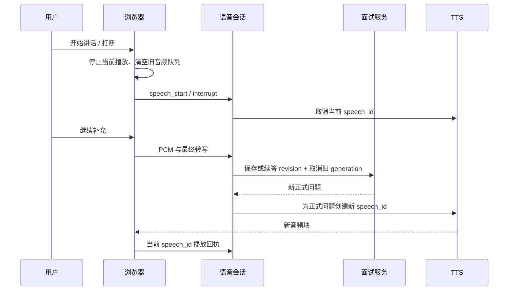
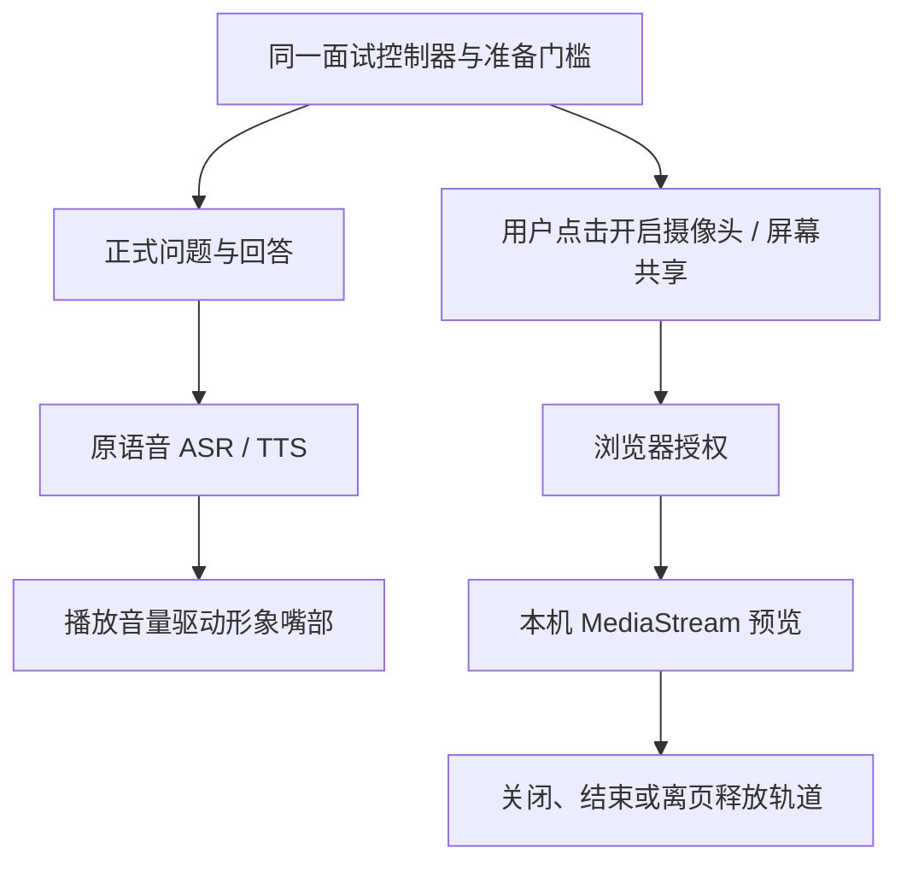

# 实时语音面试接入

更新：2026-11-04。实现路线为流式 ASR → 面试 Agent → 流式 TTS，保留独立文字作答与原报告流程。无需更换现有 LLM；需要单独开通火山引擎语音识别与语音合成。当前代码已包含语音与视频呈现，真实供应商的合成测试句已通过 TTS 与流式 ASR 联通检查；真实浏览器麦克风、多轮交互及端到端延迟仍待验收，不能视为已达到豆包 App 的体验。

## 开通与本机配置

1. 登录[豆包语音控制台](https://console.volcengine.com/speech/)，开通豆包流式语音识别模型 2.0 和豆包语音合成模型 2.0。按控制台当前要求完成账号验证、授权和计费开通；费用、赠送额度和服务可用范围以控制台为准。
2. 在语音服务新版控制台的 API Key 管理中创建可访问对应资源的密钥。这里不是火山方舟文字模型的 Key；现有 `LLM_API_KEY` 保留。如果同一 Key 同时授权了 ASR、TTS，可填入两项，否则分别填写。
3. 只在本机根目录 `.env` 追加以下配置，不要发送到聊天、放入前端变量或提交 Git：

```dotenv
VOICE_ENABLED=true
VOLC_ASR_API_KEY=在本机填写识别服务Key
VOLC_TTS_API_KEY=在本机填写合成服务Key
VOLC_ASR_RESOURCE_ID=volc.seedasr.sauc.duration
VOLC_TTS_RESOURCE_ID=seed-tts-2.0
VOLC_TTS_SPEAKER=zh_female_vv_uranus_bigtts
VOICE_SILENCE_MS=3000
```

示例采用新版 `X-Api-Key` 鉴权。旧版 AppID/Access Token 鉴权未实现，旧账户请按官方控制台说明迁移或另行扩展适配器。资源 ID 和音色必须匹配已开通的产品。

在仓库根目录执行：

```bash
npm ci
npm run db:migrate
npm run dev:api
```

另外两个终端分别运行 `npm run dev:worker`、`npm run dev`。已经运行的后端需要重启，配置不会自动热加载；不要同时启动两份占用同一端口的 API。

配置完成后先运行 `npm run voice:check`，使用固定测试句完成 TTS → ASR 联通检查，并要求发送结束包前已收到流式转写，仅输出成功状态和耗时，不输出密钥、音频或转写。该检查会调用供应商服务，可能计费，不能代替麦克风实测。

在面试配置的“作答方式”中可选择“文字作答”“语音面试”或“视频面试”，选择结果随面试配置保存。选择语音本身不启动采集。进入真实面试、点击开始，待进入进行中状态后点击“开启实时语音”，允许麦克风权限。开启前会说明音频发送至火山引擎识别。本站不保存原始录音；语音服务商的数据处理条款仍由其提供。页面展示实时转写，停顿后自动保存回答并等待 Agent 提问；不需要逐轮点提交。语音模式使用通话界面，转写保留在折叠记录中；切回文字后可编辑未提交草稿。新问题经现有业务校验并提交后才进入 TTS，音频按块播放。

浏览器必须支持 AudioWorklet、Web Audio 和麦克风接口。开发可使用 `http://127.0.0.1:3000`，远程部署必须使用 HTTPS。建议先用新版 Chrome 和耳机验证。页面的“实时语音尚未开启”是能力未配置提示，不会静默调用浏览器语音识别或生成假数据。

## 交互与故障恢复

- 持续监听：AudioWorklet 将设备原始采样率转换为 16 kHz、16-bit、小端、单声道 PCM，每 200ms 发包；请求浏览器回声消除、降噪及自动增益。实际设备效果需实测。
- 输入确认：使用浏览器配置的麦克风，页面不额外提供设备选择或音量诊断。只有服务端就绪且采集到音频帧后才显示连接完成；连续 5 秒无采集帧明确报错并释放资源。静音帧仍属于有效采集，不因思考时安静而断线。音频上下文暂停或处理器错误同样显式报错。若选错输入设备，在系统或浏览器中调整后重新开启语音。
- 自动接话：必须同时满足本地停止讲话、识别分句 final、文本稳定及至少配置时长的停顿。ASR final 不等于整段答完。“因为/然后/比如”等未完成结尾额外等待；这仍是启发式端点判断，不是完善的语义端点模型。
- 思考：点击“让我想想”暂停自动提交，继续采集转写；“恢复自动接话”恢复判断。“我说完了”要求 ASR 刷出最终结果后提交，即使处于思考状态也可主动结束回答。
- 打断播报：检测到持续人声时本地立刻停止所有排队音频，并通知后端取消 TTS；旧 `speech_id` 的音频和取消事件不能影响新播报。
- 打断思考：若上一回答已保存、下一问题仍生成中，则取消对应 generation，将面试置于可补充状态。新转写追加到上一回答并提升 revision，再调用同一 Agent。已被取消的旧任务通过既有 generation 和输入摘要校验无法提交。
- 切回文字/断线：停止麦克风、采集节点与播放资源。已识别的草稿保留在当前标签页；无法保证保留尚未被识别的音频。补充状态下可文字提交，或点击“按已保存的回答继续提问”。重新连接读取服务端权威状态，不重放历史问题；主动重连时仅播报当前待回答题目。
- 暂停、结束、离页和麦克风断开会释放资源。远端状态每 500ms 刷新，连接内每 5 秒重新认证。每位用户每场面试只保留一个语音连接，新连接替换旧连接。
- TTS 失败时题目仍显示，可以继续回答或切回文字；ASR 或连接失败时停止采集并明确报错，不自动重试上传音频。

## 接口与数据

- `GET /api/v1/interviews/:id/voice/capabilities`：仅本人读取，返回是否可用及说明，不返回配置值或密钥。
- `WS /api/v1/interviews/:id/voice`：同源 Cookie 身份和资源归属校验；必须携带与 `PUBLIC_ORIGIN` 相符的 Origin。原 Next.js 外部重写负责开发代理，生产反向代理必须允许 WebSocket Upgrade，不能缓存或缓冲实时帧。
- 上行二进制为 PCM；控制事件有 `speech_start`、`speech_end`、`commit`、`hold`、`interrupt`、`repeat`、`playback` 和 `ping`。下行 JSON 包括转写、面试状态、播报标识、PCM base64 块和经过脱敏的错误；核心 DTO 位于 `code/core_engine/src/voice.ts`。
- `POST /api/v1/interviews/:id/voice/continue`：复用 version、幂等键、身份和同源校验；仅允许补充被打断后尚未生成新问题的最后一条已回答回合，空文本表示按原回答继续生成。
- 新增迁移 `0005_massive_marvex.sql`，历史回合默认 `input_mode=text_fallback`，语音回答记为 `voice`；不修改历史迁移。报告和重练继续使用确认保存的 answer_text/revision。
- 播放结束/打断时记录 `voice_playback` 事件，包含 speech_id、实际播放毫秒数和是否打断。它不代表用户听清或听完全文，也不用于推断情绪、人格或专业能力。
- 供应商密钥只存在于后端配置。协议错误与服务异常不打印原始供应商消息、音频、转写或凭证。连接有音频包大小、传输速率、累计时长和出站积压限制。

## 当前边界与验收

ASR/TTS 流式传输和持续收听已实现；Agent 保留 worker/outbox 的持久化编排。当前出题先完成校验和保存再播报，没有将可撤回的 SSE 预览提前朗读，因此模型生成速度仍决定接话延迟。没有承诺某个端到端延迟数值，也未实现基于大模型的语义端点、通用口语指令路由和录音回放。仅支持句尾“回答结束／我的回答完毕／我说完了”作为主动提交指令，该指令从保存的回答中移除。提问过程中说话默认作为回答，不会自动把“请重复”解释为操作；重复/思考/暂停等有明确按钮。

受控测试覆盖协议解码、不同设备采样率、自动提交、ASR final 不直接结束回答、思考与主动提交、TTS 取消、迟到音频、旧 generation 失效、追加 revision、Cookie/Origin/跨用户隔离及异常消息。数据库验证只使用 `interviewlab_test*` 库。

真实验收还必须完成：

1. 使用实际 ASR/TTS Key，在浏览器完成多轮麦克风对话与报告。
2. 在播报中和 Agent 思考中分别打断，验证旧音频不再播放且补充不丢失。
3. 测试思考长停顿、口头自纠、中文专业词和中英混说，记录误截/误打断。
4. 测试外放回声、耳机、麦克风拒绝/拔出、弱网、断线与重新连接。
5. 分别统计语音结束到保存、Agent 首内容/提交、首音频及打断到静音的 P50/P95，包含失败样本；当前尚无真实测量值。

官方协议依据：[双向流式识别](https://docs.volcengine.com/docs/doubao-voice/bidirectional-streaming-automatic-speech-recognition-websocket?lang=zh)、[流式合成](https://docs.volcengine.com/docs/doubao-voice/websocket-unidirectional-streaming-v3?lang=zh)、[浏览器麦克风权限](https://developer.mozilla.org/en-US/docs/Web/API/MediaDevices/getUserMedia)。

## 语音通话界面

语音模式使用动态球体、通话状态、静音与挂断控制；默认隐藏文字输入框和逐条发送操作。对话仍在后台转写保存，记录可在折叠区域查看。切回文字可编辑尚未提交的草稿。默认停顿约3秒后自动接话，仍需 ASR 最终结果并避开未说完的句尾。静音实际禁用麦克风轨道并停止发送真实音频，挂断释放音频资源但不结束面试。

## Agent 准备与打断兼容

准备在后台独立队列执行，不替代主状态和 generation_status。开始前需 ready/fallback，等待期间不计时、不自动开麦。ASR partial 仅作字幕，保存后的回答才进入同一 Agent；TTS 只朗读已保存正式问题，不朗读预览、内部规划或分析。三模式共享规则见[Agent 工作流](interview-agent-implementation.md)。



问题生成、准备和 TTS 各自取消，旧 speech_id 的迟到块和回执不能操作新播放。视频页和形象素材已拆至[视频面试](voice-interview.md)，不在本文件重复维护。


## 视频房间、设备授权与本机呈现


更新：2026-11-04。本文只维护视频房间、设备授权与本机画面；语音协议见[语音设计](voice-interview.md)，Agent 共用链见[系统架构](architecture.md)。

配置 `realtime_video` 进入 `/interview/:id/video`，继续记录仍回到同一房间。文字/语音页使用 `/interview/:id`。模式切换不创建新面试，不重置时间、目标或冻结快照。



摄像头与屏幕共享默认关闭，必须点击并经浏览器授权。当前画面只作本机预览，没有上传、录像、远程数字人视频服务或视觉分析。拒绝授权可继续文字或语音，不产生视觉分数。共享屏幕再次开启需要重新选择窗口。

形象素材为 `code/frontend/public/avatars/interviewer-reference-sprite.png`，源于此前用户提供参考图制作的两帧开闭口素材。只根据实际播放 PCM 音量混合嘴部区域，排队音频不驱动，静音与打断后闭口。这是基础动画，不是音素级口型或远端真人。

准备状态在视频页共用顶部提示展示；未准备完成不能开始，刷新保持 00:00，不自动开启媒体。暂停、结束、删除及离页保留原有语音关闭与媒体释放行为。本次受控浏览器验证经过视频房间准备、开始、自我介绍和文字兜底续问；真实摄像头、麦克风与供应商体验另行验收，见[评测](../algorithm/evaluation.md)。
